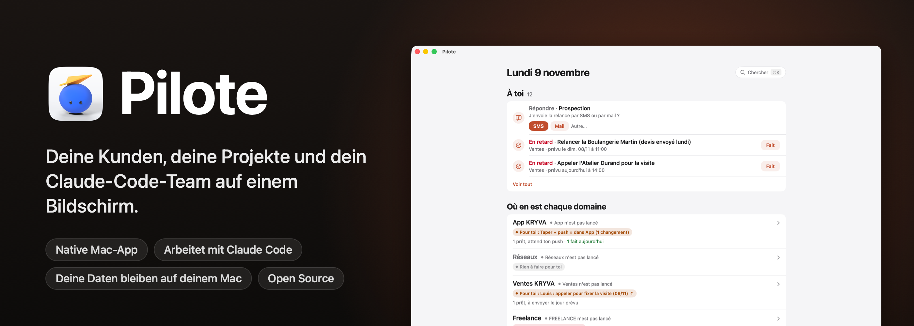

<p align="center">
  
</p>

<p align="center">
  
  
  
  
  
  <a href="../../stargazers"></a>
</p>

<p align="center">
  <a href="README.md">English</a> · <a href="README.fr.md">Français</a> · <a href="README.es.md">Español</a> · <a href="README.pt-BR.md">Português (Brasil)</a> · <b>Deutsch</b> · <a href="README.it.md">Italiano</a> · <a href="README.zh-CN.md">简体中文</a> · <a href="README.ja.md">日本語</a> · <a href="README.ko.md">한국어</a>
</p>

<p align="center">
  Entwickelt von <b>pjk</b> (Sacha Praljak) ·
  <a href="https://sachapraljak.com/?utm_source=github&utm_medium=readme&utm_campaign=pilote">sachapraljak.com</a> ·
  <a href="https://www.instagram.com/sachaprljk/">Instagram</a> ·
  <a href="https://www.tiktok.com/@sachaprljk">TikTok</a>
</p>

<p align="center">
  <b>Wenn dir Pilote hilft, hilft ein ⭐ anderen dabei, es zu finden.</b>
</p>

**Pilote ist das Logbuch eines Freelancers, der mit einem Team aus Claude-Code-Agenten arbeitet.**
Eine native Mac-App für alles, was dich braucht: deine Kunden und jeden Austausch mit ihnen, die nächste Aktion für jeden Einzelnen, deine
Erinnerungen und deinen Kalender und das, was deine Claude-Code-Sitzungen gerade tun. Die Sitzungen lesen und schreiben
Pilote über einen MCP-Server und halten es so auf dem neuesten Stand; du siehst nur, was dich braucht. Alles bleibt auf
deinem Mac: eine lokale SQLite-Datenbank, kein Server, kein Konto.

## Installation mit einem einzigen Prompt

Füge diesen Prompt in Claude Code (oder einen anderen Coding-Agenten) auf deinem Mac ein. Er prüft deinen Rechner, baut und installiert Pilote, stellt dir zu jeder Verbindung nacheinander eine Frage (du kannst alle überspringen), verbindet Pilote mit Claude Code und endet mit einer Übersicht, was angeschlossen ist. Deine Schlüssel laufen nie durch den Chat. Derselbe Text steht in [`docs/INSTALL-PROMPT.md`](docs/INSTALL-PROMPT.md); von Hand geht es mit „Installation“ weiter unten. Der Prompt bleibt auf Englisch.

````text
You are going to install Pilote (a native Mac app + a command-line tool + an MCP server for Claude Code) on this Mac, then
connect it, asking me for what you need. Repository: https://github.com/pjksens/pilote . Work in English unless I write
to you in another language, then answer in mine.

GROUND RULES
- Ask me ONE question at a time and wait for my answer. Every connection is optional: if I say "skip" (or "no", or
  "later"), move on and leave it off.
- Before each connection, say in ONE sentence what it is for. Never turn anything on that I did not say yes to.
- Never ask me to paste an API key, token or password in this chat, never print one, never read a secret file back to me
  (no cat, no echo, no logging). To enter a key: create the file with permissions 600 and an empty placeholder, open it in
  an editor for me (`open -e <file>`), tell me exactly where to paste, wait for "done", then check it is not empty
  WITHOUT displaying it. If I paste a secret in the chat anyway, use it, never repeat it, and tell me once that it is now
  in this conversation's history, so I may want to rotate it later.
- Secrets never go inside the git repository. Never commit, never push, never change the repository.
- If a command fails, show me the last 20 lines of its output, say what you think went wrong, and stop and ask before
  trying something else. Do not invent results: if you did not check it, say you did not.

STEP 1. CHECK THE MACHINE
1. `sw_vers -productVersion` must be 15 or later.
2. `xcodebuild -version` must work (full Xcode, not only the command-line tools). If it does not: tell me to install
   Xcode from the App Store, open it once to accept the license, and stop until I say it is done.
3. `xcodegen --version`. If missing, check `brew --version`: if Homebrew exists, propose `brew install xcodegen` and run
   it only after I say yes. If Homebrew is missing, tell me to install it from https://brew.sh, and stop until I say it
   is done (do not run its install script yourself).
4. `git --version` must work.
Tell me in one line what you found.

STEP 2. GET THE CODE AND BUILD
1. Ask me where to put the code. Default: ~/pilote . Moving that folder later breaks the connection to Claude Code, so
   pick a place that stays. If the folder exists and is not a clone of pjksens/pilote, propose another name.
2. `git clone https://github.com/pjksens/pilote.git <folder>` then `cd <folder>`.
3. Warn me, in one sentence, that the next script quits Pilote if it is running and replaces ~/Applications/Pilote.app
   (it stops if another app named Pilote with a different identifier is there). Then run `./scripts/construire.sh`.
   It takes a few minutes. It installs ~/Applications/Pilote.app and puts the `pilote` tool in <folder>.
4. Check that ~/Applications/Pilote.app and <folder>/pilote exist.

STEP 3. SETTINGS (connections)
Pilote reads ONE file: ~/Library/Application Support/io.github.pjksens.pilote/reglages.json (the template is
docs/reglages.exemple.json). Without it, everything that touches an account or a network is off. Keep my answers in
memory and write the file once at the end of this step: `mkdir -p` its folder, then write it with `chmod 600`. Only
write the keys of the connections I accepted. If the file already exists, read it first and merge, never overwrite my
existing values.

Ask these questions, in this order, one at a time:
a. First name ("prenom"). Used in the app ("Camille: call back..."). Default "Vous". Then, optionally, the display
   names of my workspaces ("espaces": internal keys kryva, freelance, autre).
b. Reminders and Calendar ("rappels_calendrier": true): shows today's appointments and reminders. macOS will ask its
   permission the first time the app opens.
c. Mail.app ("mail": true): lets Pilote read received messages and create drafts. It never sends anything on its own.
d. Incoming messages ("entrants": true): the `pilote entrants` collector reads calls, texts, iMessage, WhatsApp and
   received emails on this Mac to log them in the right contact's thread. macOS may ask for extra permissions.
e. A git repository to follow ("depot_suivi": a path): the app shows its latest commits, read only.
f. Secrets folder ("dossier_secrets"). Only ask it if I accept g or h. Default ~/Secrets . Create it with chmod 700 if
   missing. It must not be inside a git repository or a synced folder (iCloud Drive, Dropbox).
g. Publishing to YouTube, Instagram and TikTok ("publication": true, needs the secrets folder). Each post waits for my
   explicit approval in the app before it goes out. Ask which of the two clients I have:
   - Google/YouTube: I need an OAuth client of type "Desktop app" from the Google Cloud console (YouTube Data API v3
     enabled), downloaded as client_secret_....json into ~/Downloads. When I tell you it is there, move the newest one
     to <dossier_secrets>/pilote-google-oauth.json and chmod 600 it (do not open it).
   - TikTok: I need the app's "Client key" and "Client secret" from the TikTok developer portal. Ask me for the Client
     key in the chat (it is public), and tell me to COPY the Client secret to the clipboard (do not paste it in the
     chat). Then run `./pilote publication client-tiktok --cle <Client key>` from the code folder: it reads the secret
     from the clipboard, stores it in <dossier_secrets>/pilote-tiktok-client.json and clears the clipboard.
   Instagram needs nothing here. The accounts themselves are connected afterwards in the app (Pilote > Publications,
   "Connecter"), tokens go to the macOS keychain. Tell me that last part.
h. Radar ("radar": true, needs the secrets folder): watches public numbers of social accounts through ScrapeCreators,
   a paid service billed per credit, and it never runs without my confirmation. If I have a key: create
   <dossier_secrets>/cle-scrapecreators.env containing the single line `SCRAPECREATORS_API_KEY=` , chmod 600, open it for
   me to paste the key after the "=".
i. Sign-ups of my own product ("comptes"): Pilote reads ONE view of a PostgREST/Supabase database, read only, to show
   who signed up and who pays. Only for people who have a product with accounts. If yes: ask for the project URL and
   the view name (default pilote_comptes), and point me to the "comptes" section of the README for the SQL view. The key
   must be a token that can ONLY read that view, NEVER a Supabase service_role / secret key: say it, and refuse one if I
   offer it. Optional: a Stripe restricted key (rk_..., "Subscriptions: Read" only). These keys ("comptes.cle",
   "comptes.stripe_cle") are read by Pilote inside reglages.json itself: write them as empty strings, then open
   reglages.json for me to paste each key between the quotes (do not retype the quotes), and validate the JSON after.
j. Contact sync with a phone ("synchro"): exchanges one workspace's contacts with two remote tables. Same rule for its
   key ("synchro.cle": a token limited to those two tables, never service_role), same editor procedure. Skip if unsure.
k. Forbidden sender domains ("domaines_interdits": a list): Pilote refuses to send an email from them. Only if I name some.
l. Gmail sending is NOT in this file: it is enabled inside the app by pasting a Gmail app password (kept in the macOS
   keychain). Tell me where to do it in the app and move on. Do not ask for the password.

When the file is written, run `<folder>/pilote reglages` and show me its output: it lists what is on and what is off.
Careful: that command says "actif" as soon as a block exists (for example "comptes" with an empty key), so do not call a
connection working unless its key file or key is really filled in (check the size or the emptiness, never the content).

STEP 4. CONNECT MY AGENT
1. Claude Code. Check `claude --version`. Run `claude mcp list`: if a server named "pilote" is already there, tell me
   what it points to and ask before replacing it. Then run, with the ABSOLUTE path:
   `claude mcp add --scope user pilote -- <folder>/pilote mcp`
   and check `claude mcp list` shows pilote as connected.
2. Optional, ask me first: a journal of what my sessions deliver. It needs a "Stop" hook in ~/.claude/settings.json
   that runs `<folder>/pilote journal-crochet`. If I say yes, show me the exact change, merge it into the existing JSON
   without touching anything else (create the file if missing), and validate the JSON afterwards.
3. Any other agent that supports MCP (Cursor, Codex, Gemini CLI, Windsurf...): Pilote is a plain stdio MCP server. Add a
   server named "pilote" with command `<folder>/pilote` and the single argument `mcp`, using that agent's own way of
   adding MCP servers (usually a JSON file with "mcpServers": {"pilote": {"command": "...", "args": ["mcp"]}}). If you
   are not sure how my agent does it, say so instead of guessing.

STEP 5. CHECK AND OPEN
1. Run `<folder>/pilote jour` and confirm it answers without error (an empty day is normal on a fresh install).
2. Run `open ~/Applications/Pilote.app`. Tell me the app is open and to accept the macOS permission prompts for the
   connections I turned on.

STEP 6. RECAP
Finish with a short table with three groups: CONNECTED (what you checked, and how), NOT CONNECTED (what I skipped, and
the one setting that turns it on later), and TO DO BY HAND (Gmail app password in the app; connecting each social
account in Pilote > Publications; the OAuth/TikTok steps I still owe; macOS permission prompts). Add that sessions opened
BEFORE this install do not see the Pilote tools: I must start a new Claude Code session (or restart my agent) to use
them. For each item, only write what you actually verified.
````

<p align="center">
  
  <br><sub>Demo-Modus (<code>./scripts/demo.sh</code>): erfundene Daten, keine echten Personen.</sub>
</p>

> Die Oberfläche der App und ihre Code-Kommentare sind auf Französisch. Dieses README gibt es in neun Sprachen; die App (noch) nicht.

## Was Pilote kann

- **Ein Bildschirm für den Tag.** Termine (Kalender), heutige und überfällige Erinnerungen (Erinnerungen, du hakst sie
  ab), von Claude vorbereitete Nachrichten, die auf deine Freigabe warten, fällige Nachfassaktionen, erhaltene Antworten.
- **Kunden mit ihrem Kontext.** Ein Adressbuch pro Arbeitsbereich, mit Phase, nächster Aktion und dem vollständigen
  Verlauf jedes Austauschs (E-Mail, SMS, Anruf, Besuch). Vor einem Anruf siehst du alles, was gesagt wurde.
- **Claude Code angebunden.** Ein MCP-Server gibt deinen Claude-Sitzungen Werkzeuge, um Pilote zu lesen und zu
  beschreiben (`jour`, `cherche`, `fiche`, `enregistre_contact`, `ajoute_au_fil`, `marque`, `carte`, `ou_est`, `agents`,
  `journal`, `note_au_journal`, `publications`…). Die Anweisungen des Servers sagen ihnen, dass sie suchen sollen, bevor
  sie etwas anlegen, nichts erfinden und nichts von sich aus senden dürfen.
- **Agenten.** Die auf deinem Mac geöffneten Claude-Code-Sitzungen, ihr Zustand und ihre letzte Aktion sowie ein
  Journal dessen, was sie geliefert haben (gefüllt durch einen `Stop`-Hook von Claude Code).
- **Eine Karte deiner Arbeit.** Jedes Projekt, sein Ordner, seine `ETAT.md` (Statusdatei), seine wichtigen Dokumente;
  durchsuche alles (⌘K) über Projekte, Kontakte, Journal und Dateien (Spotlight).
- **E-Mail unter Kontrolle.** Eine vorbereitete E-Mail geht erst raus, wenn du klickst, von deinem Gmail aus (SMTP,
  App-Passwort im macOS-Schlüsselbund, von Claude nie gelesen). Reiner Text, Antworten bleiben im richtigen Thread.
- **Veröffentlichen.** Plane Videos auf YouTube, Instagram und TikTok, mit einer ausdrücklichen Freigabe vor jeder
  Veröffentlichung (Tokens im Schlüsselbund).
- **Radar.** Beobachte Social-Media-Konten (Aufrufe, Veröffentlichungsrhythmus, Ideen), von Hand eingetragen oder über
  eine kostenpflichtige Quelle, die niemals ohne deine Bestätigung läuft.

## Mit Claude Code

Deine Sitzungen erledigen die Arbeit; in Pilote siehst du sie und antwortest ihnen.

<p align="center">
  
  <br><sub>Was deine Sitzungen gerade tun, und eine Nachricht an eine von ihnen, ohne Pilote zu verlassen.</sub>
</p>

Braucht eine Sitzung eine Entscheidung, erscheint ihre Frage mit den passenden Schaltflächen auf dem Startbildschirm.
Deine Antwort wartet unter **„Vos réponses, prêtes à partir“** (deine Antworten, versandbereit), bis du auf **Envoyer**
(senden) klickst: Nichts erreicht eine Sitzung versehentlich.

<p align="center">
  
  <br><sub>Eine Sitzung fragt, du antwortest mit einem Klick und bestimmst selbst, wann es rausgeht.</sub>
</p>

> **Wie deine Antworten zu den Sitzungen kommen:** [`scripts/facteur.py`](scripts/facteur.py), der „Facteur“ (der Briefträger).
> Der Button **Démarrer le Facteur** auf dem Startbildschirm öffnet eine Claude-Code-Sitzung mit seinen Anweisungen: Sie
> wartet im Hintergrund und stellt jede Antwort innerhalb von Sekunden der richtigen Sitzung zu. Das ist die Sitzung, die
> gefragt hat oder der du geschrieben hast; sonst die in `facteur.sessions` in `reglages.json` genannte; sonst die aus der
> Tabelle in `EQUIPE.md`. Im Code steht keine Sitzungs-ID.

## Ein Warnhinweis

Dies ist **mein persönliches System, so veröffentlicht, wie es ist**, aber konfigurierbar gemacht: Deine Schlüssel,
deine Ordner und dein Vorname stehen in einer einzigen Einstellungsdatei (siehe „Einstellungen“), und alles, was ein
Konto oder einen Online-Dienst berührt, bleibt ausgeschaltet, bis du es einschaltest. Spuren meiner eigenen Nutzung
sind geblieben: meine Arbeitsbereiche (interner Schlüssel `kryva`, Anzeigename konfigurierbar), mein Team aus
Claude-Sitzungen, französische Beschriftungen. Alle echten Daten (Kontakte, Nachrichten, Konten, Zugangsdaten) wurden
entfernt oder durch erfundene Werte ersetzt.

Nicht enthalten: meine eigenen Organisationsskripte (Zustellung von Antworten, Beobachtung, Importe), meine Notizen und
meine Datenbank.

## Ausprobieren, ohne etwas zu verbinden: Demo-Modus

```bash
./scripts/demo.sh             # baut die App (ohne sie zu installieren) und öffnet sie mit erfundenen Daten
./scripts/demo.sh --captures  # erstellt die Screenshots unten neu (docs/captures)
./scripts/demo.sh --gif       # spielt die drei Demos ab und baut die GIFs neu (docs/media, benötigt ffmpeg)
```

Im Demo-Modus (`PILOTE_DEMO=1`) sieht Pilote statt deines Home-Ordners einen fiktiven, der bei jedem Start neu ist:
Datenbank, Claude-Sitzungen, Dateien. Es liest weder Erinnerungen, Kalender, Mail noch Spotlight, und nichts verlässt
den Rechner (E-Mail, Nachricht an eine Sitzung, Benachrichtigung, Beitrag). Screenshots und GIFs nimmt die App selbst
von ihrem eigenen Fenster auf: keine Berechtigung zur Bildschirmaufnahme nötig.

| | |
|---|---|
|  |  |
|  |  |
|  |  |

Alle Daten in den Screenshots sind erfunden (Namen, Firmen, Telefonnummern im französischen Fiktionsbereich
06 39 98 00 0x, Adressen auf `.example`).

## Installation

Du brauchst macOS 15 oder neuer, Xcode und [XcodeGen](https://github.com/yonaskolb/XcodeGen).

```bash
brew install xcodegen
git clone https://github.com/pjksens/pilote.git && cd pilote
./scripts/tester.sh        # Unit-Tests (sie berühren weder die App noch deine Datenbank)
./scripts/construire.sh    # baut die App, installiert sie in ~/Applications und legt das Werkzeug ./pilote an
```

`construire.sh` beendet Pilote, falls es läuft, und ersetzt dann `~/Applications/Pilote.app`. Liegt dort schon eine andere App namens Pilote (mit anderer Kennung), bricht es ab und ersetzt nichts. Diese Kopie hat ihre eigene Kennung (`io.github.pjksens.pilote`) und ihren eigenen Datenordner: Sie liest und schreibt nie die Datenbank eines anderen Pilote auf demselben Mac.

**Signierung.** Das Projekt signiert lokal (`CODE_SIGN_IDENTITY: "-"`), daher fragt macOS bei jedem neuen Build erneut
nach Berechtigungen. Um sie zu behalten, trage dein Apple-Team in `project.yml` ein (`DEVELOPMENT_TEAM`,
`CODE_SIGN_IDENTITY: "Apple Development"`).

**Berechtigungen.** Ohne Einstellungen bittet Pilote macOS um nichts. Erinnerungen und Kalender werden nur angefragt,
wenn du `rappels_calendrier` einschaltest, „Mail steuern“ (Lesen und Entwürfe, nie Senden) nur, wenn du `mail`
einschaltest. Die App läuft nicht in der Sandbox: Sie liest `~/.claude`, um deinen Claude-Code-Sitzungen zu folgen.

## Einstellungen: deine Konten verbinden

Alles läuft über eine JSON-Datei: `~/Library/Application Support/io.github.pjksens.pilote/reglages.json`. Vorlage:
[`docs/reglages.exemple.json`](docs/reglages.exemple.json). Pilote liest sie neu ein, sobald sie sich ändert.
`./pilote reglages` zeigt dir, was an ist, was aus ist und was fehlt.

**Ohne diese Datei** arbeitet Pilote allein auf deinem Mac (lokale Datenbank, Kontakte, Karte, Planung,
Claude-Code-Sitzungen) und **alles andere ist aus**: kein Lesen von Erinnerungen, Kalender, Mail, Kontakten oder
Anrufen, kein Netzwerkaufruf an eine Datenbank, an Stripe oder an ein soziales Netzwerk.

Diese Datei enthält deine Schlüssel: Halte sie aus jedem Git-Repository heraus und nur für dich lesbar (`chmod 600`).
Pilote schreibt einen Schlüssel nie an eine andere Stelle.

| Einstellung | Was sie einschaltet |
|---|---|
| `prenom` | Dein Vorname in der App („Camille : rappeler…“). Standard: „Vous“ (du). |
| `espaces` | Die Anzeigenamen deiner Arbeitsbereiche (interne Schlüssel `kryva`, `freelance`, `autre`). |
| `dossiers_sessions`, `routines` | Die Ordner, die beim Öffnen einer Claude-Code-Sitzung angeboten werden, und deine Anweisungen per Klick. |
| `facteur` | Wohin der Facteur zustellt: `sessions` (Name → ID `local_…`) und `rappel` (eine Zeile, die jeder Nachricht angehängt wird). |
| `depot_suivi` | Ein Git-Repository, dessen neueste Commits Pilote anzeigt (nur lesend, kein `fetch`). |
| `rappels_calendrier: true` | Erinnerungen und Kalender (EventKit). |
| `mail: true` | Mail.app: empfangene Nachrichten, Entwürfe. |
| `entrants: true` | Der Collector `pilote entrants`: Anrufe, SMS, iMessage, WhatsApp, empfangene E-Mails. |
| `publication: true` + `dossier_secrets` | Veröffentlichen auf YouTube, Instagram, TikTok. OAuth-Clients in diesem Ordner: `pilote-google-oauth.json`, `pilote-tiktok-client.json`. Tokens im Schlüsselbund. |
| `radar: true` + `dossier_secrets` | Radar über ScrapeCreators (kostenpflichtig pro Credit): `cle-scrapecreators.env` (`SCRAPECREATORS_API_KEY=…`). |
| `domaines_interdits` | Domains, von denen Pilote keine E-Mail sendet und die es meldet, wenn es eine rausgehen sieht. |
| `comptes` | Die Anmeldungen deines Produkts und ihr Abonnement, nur lesend (unten). |
| `synchro` | Die Kontakte eines Arbeitsbereichs, ausgetauscht mit zwei entfernten Tabellen (unten). |

Das Senden von E-Mail über Gmail nutzt diese Datei nicht: Es bleibt aus, bis du ein Gmail-App-Passwort in der App
einfügst (im Schlüsselbund gespeichert).

### `comptes`: deine Anmeldungen, nur lesend

Pilote liest **eine View** über eine PostgREST-kompatible REST-API (zum Beispiel Supabase). Es kennt keine deiner
Tabellen: Die View übersetzt dein Schema. Erwartete Spalten:

| Spalte | Inhalt |
|---|---|
| `id` | Konto-ID (Text) |
| `entreprise`, `nom`, `email`, `telephone` | Text (Firma, Name, E-Mail, Telefon) |
| `inscrit_le` | Anmeldedatum (timestamptz) |
| `devis` | eine Zahl (Integer), die du neben jeder Anmeldung sehen willst |
| `abonnement_stripe` | die Stripe-ID `sub_…` oder null |
| `store_expire_le` | Ende des Apple- oder Google-Abonnements oder null |
| `actif` | Boolean oder null |

```sql
-- Beispiel, an dein Schema anzupassen.
create view pilote_comptes with (security_invoker = true) as
select o.id::text as id, o.nom as entreprise, u.nom_complet as nom, u.email, u.telephone,
       o.cree_le as inscrit_le, 0 as devis, o.abonnement_stripe, o.store_expire_le, o.actif
from organisations o left join utilisateurs u on u.organisation_id = o.id;
```

**Der Schlüssel.** Gib Pilote so wenige Rechte wie möglich: ein Token, das nur **diese View lesen** kann, zum Beispiel
eine eigene Postgres-Rolle mit nichts als `select` darauf (siehe die Dokumentation deiner Datenbank, um ein an diese
Rolle gebundenes Token zu erhalten). **Niemals den Supabase-Schlüssel `service_role` (oder „secret“)**: Er öffnet die
gesamte Datenbank, lesend und schreibend, und umgeht die Row-Level-Security. Mach die View auch nicht für die Rolle
`anon` lesbar: Der „anon“-Schlüssel ist in deinen Apps öffentlich.

**Stripe** (`stripe_cle`, optional): ein **eingeschränkter Schlüssel** (`rk_…`) mit der einzigen Berechtigung
„Subscriptions: Read“. Er unterscheidet Testphasen von zahlenden Konten; ohne ihn erscheint ein Konto mit Abonnement
als „À vérifier“ (zu prüfen).

**Zähler** (`compteur`, optional): ein eigener Befehl von dir, ausgeführt in `dossier`, der eine Zeile `ACTIFS 7 / 10`
ausgibt, dann Abschnittstitel, gefolgt von Zeilen, die mit zwei Leerzeichen eingerückt sind.

### `synchro`: deine Kontakte auf einem Telefon

Tauscht die Kontakte und den Verlauf eines Arbeitsbereichs (`espace`, Standard: der erste) mit zwei Tabellen aus
(`table_contacts`, `table_evenements`; Standard `pilote_contacts`, `pilote_evenements`), deren Spalten die von
`Synchro.colonnesContact` und `Synchro.colonnesEvenement` (`Shared/Synchro.swift`) sind. Pilote **schreibt** dort: Gib
ihm ein Token, das auf diese beiden Tabellen beschränkt ist (`select`, `insert`, `update`), niemals `service_role`.

## Claude Code verbinden

```bash
claude mcp add --scope user pilote -- "$(pwd)/pilote" mcp
```

Nach diesem Befehl geöffnete Sitzungen sehen die Pilote-Werkzeuge. Für das Journal der Agenten füge in
`~/.claude/settings.json` einen `Stop`-Hook hinzu, der `pilote journal-crochet` ausführt.

## Daten

- Datenbank: `~/Library/Application Support/io.github.pjksens.pilote/pilote.sqlite` (SQLite, WAL). Die App aktualisiert sich, sobald eine
  andere Verbindung (das Werkzeug, eine Claude-Sitzung) hineinschreibt.
- Eine andere Datenbank ausprobieren: `PILOTE_BASE=/path/test.sqlite ./pilote jour`.
- Absendername für E-Mails: `PILOTE_NOM`, sonst der vollständige Name deines macOS-Kontos.
- Einstellungen und Schlüssel: `~/Library/Application Support/io.github.pjksens.pilote/reglages.json` (siehe „Einstellungen“).
- Tägliche Sicherung: eine JSON-Kopie in iCloud Drive, Ordner `Pilote open source` (die letzten 14 bleiben), wenn iCloud Drive aktiv ist.
- Hilfe zum Werkzeug: `./pilote aide`.

## Wie es gebaut ist

Swift 5, SwiftUI, AppKit, EventKit, das SQLite3 des Systems, Security (Schlüsselbund), CryptoKit. Keine externen
Abhängigkeiten. Etwa 28.000 Zeilen Swift (ohne Tests), 425 Unit-Tests.

- `App/`: die Mac-App (Bildschirme, Integrationen für Kalender, Erinnerungen, Mail und Claude).
- `Shared/`: das Modell, die Datenbank, die Regeln (gemeinsam genutzt von App, Werkzeug und Tests).
- `CLI/`: das Werkzeug `pilote` und der MCP-Server (`pilote mcp`).
- `Tests/`: Unit-Tests auf temporären Datenbanken.

## Entwickelt von

**pjk** (Sacha Praljak). Ich baue KI-Werkzeuge und zeige sie in kurzen Videos. Pilote ist mit Claude Code gebaut.

- Website: [sachapraljak.com](https://sachapraljak.com/?utm_source=github&utm_medium=readme&utm_campaign=pilote)
- Instagram: [@sachaprljk](https://www.instagram.com/sachaprljk/)
- TikTok: [@sachaprljk](https://www.tiktok.com/@sachaprljk)

Wenn dir Pilote hilft, helfen ein ⭐ auf dem Repo und ein Follow sehr.

## Lizenz

MIT, siehe [LICENSE](LICENSE).
