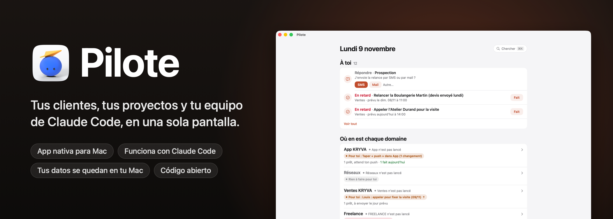
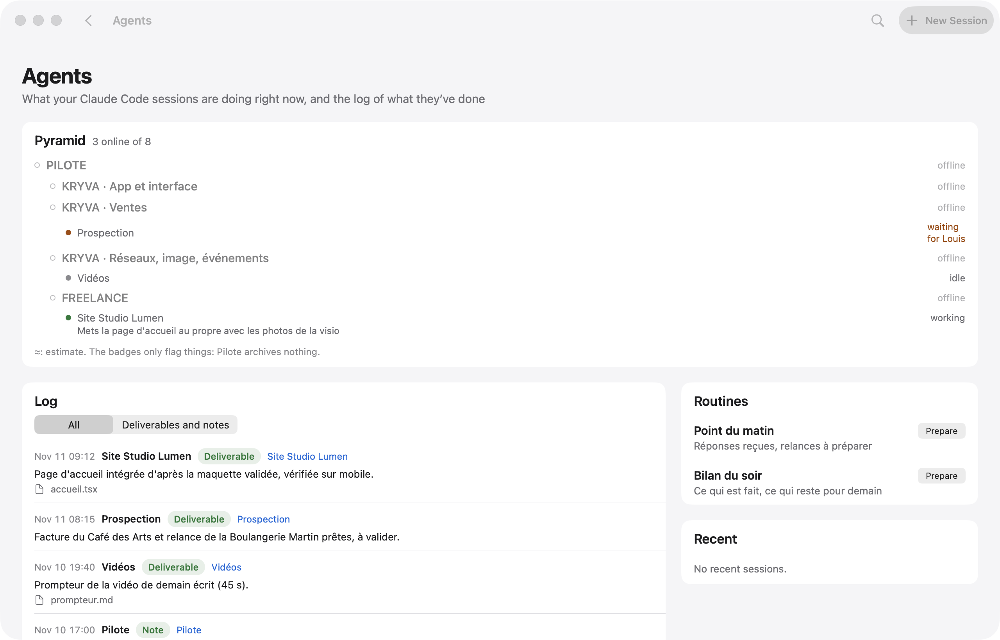
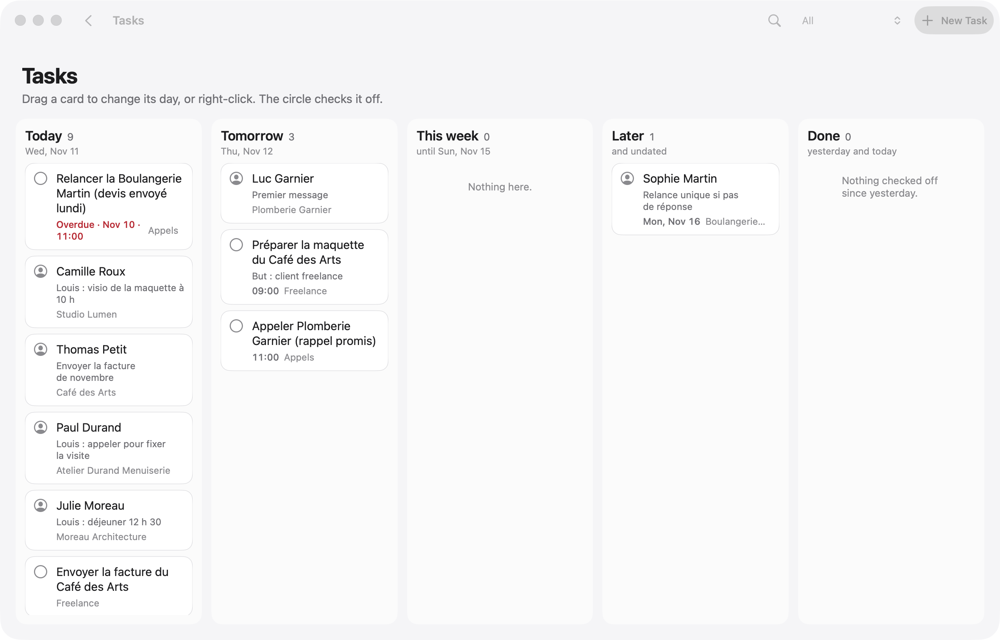

<p align="center">
  
</p>

<p align="center">
  
  
  
  
  
  <a href="../../stargazers"></a>
</p>

<p align="center">
  <a href="README.md">English</a> · <a href="README.fr.md">Français</a> · <b>Español</b> · <a href="README.pt-BR.md">Português (Brasil)</a> · <a href="README.de.md">Deutsch</a> · <a href="README.it.md">Italiano</a> · <a href="README.zh-CN.md">简体中文</a> · <a href="README.ja.md">日本語</a> · <a href="README.ko.md">한국어</a>
</p>

<p align="center">
  Creado por <b>pjk</b> (Sacha Praljak) ·
  <a href="https://sachapraljak.com/?utm_source=github&utm_medium=readme&utm_campaign=pilote">sachapraljak.com</a> ·
  <a href="https://www.instagram.com/sachaprljk/">Instagram</a> ·
  <a href="https://www.tiktok.com/@sachaprljk">TikTok</a>
</p>

<p align="center">
  <b>Si Pilote te resulta útil, una ⭐ ayuda a que otras personas lo encuentren.</b>
</p>

**Pilote es el cuaderno de bitácora de un freelance que trabaja con un equipo de agentes de Claude Code.** Una única app
nativa para Mac con todo lo que te necesita a ti: tus clientes y cada intercambio con ellos, la siguiente acción de cada
uno, tus recordatorios y tu calendario, y lo que están haciendo ahora mismo tus sesiones de Claude Code. Las sesiones
leen y escriben en Pilote a través de un servidor MCP, así que lo mantienen al día; tú solo ves lo que te necesita.
Todo se queda en tu Mac: una base de datos SQLite local, sin servidor, sin cuenta.

## Instalar con un solo prompt

Pega este prompt en Claude Code (o en cualquier agente de código) en tu Mac. Comprueba tu máquina, compila e instala Pilote, te hace una pregunta cada vez por cada conexión (puedes saltarte todas), conecta Pilote a Claude Code y termina con un resumen de lo que está conectado. Tus claves nunca pasan por el chat. El mismo texto está en [`docs/INSTALL-PROMPT.md`](docs/INSTALL-PROMPT.md); para hacerlo a mano, mira «Instalación» más abajo. El prompt sigue en inglés.

````text
You are going to install Pilote (a native Mac app + a command-line tool + an MCP server for Claude Code) on this Mac, then
connect it, asking me for what you need. Repository: https://github.com/pjksens/pilote . Work in English unless I write
to you in another language, then answer in mine.

GROUND RULES
- Ask me ONE question at a time and wait for my answer. Every connection is optional: if I say "skip" (or "no", or
  "later"), move on and leave it off.
- Before each connection, say in ONE sentence what it is for. Never turn anything on that I did not say yes to.
- Never ask me to paste an API key, token or password in this chat, never print one, never read a secret file back to me
  (no cat, no echo, no logging). To enter a key: create the file with permissions 600 and an empty placeholder, open it in
  an editor for me (`open -e <file>`), tell me exactly where to paste, wait for "done", then check it is not empty
  WITHOUT displaying it. If I paste a secret in the chat anyway, use it, never repeat it, and tell me once that it is now
  in this conversation's history, so I may want to rotate it later.
- Secrets never go inside the git repository. Never commit, never push, never change the repository.
- If a command fails, show me the last 20 lines of its output, say what you think went wrong, and stop and ask before
  trying something else. Do not invent results: if you did not check it, say you did not.

STEP 1. CHECK THE MACHINE
1. `sw_vers -productVersion` must be 15 or later.
2. `xcodebuild -version` must work (full Xcode, not only the command-line tools). If it does not: tell me to install
   Xcode from the App Store, open it once to accept the license, and stop until I say it is done.
3. `xcodegen --version`. If missing, check `brew --version`: if Homebrew exists, propose `brew install xcodegen` and run
   it only after I say yes. If Homebrew is missing, tell me to install it from https://brew.sh, and stop until I say it
   is done (do not run its install script yourself).
4. `git --version` must work.
Tell me in one line what you found.

STEP 2. GET THE CODE AND BUILD
1. Ask me where to put the code. Default: ~/pilote . Moving that folder later breaks the connection to Claude Code, so
   pick a place that stays. If the folder exists and is not a clone of pjksens/pilote, propose another name.
2. `git clone https://github.com/pjksens/pilote.git <folder>` then `cd <folder>`.
3. Warn me, in one sentence, that the next script quits Pilote if it is running and replaces ~/Applications/Pilote.app
   (it stops if another app named Pilote with a different identifier is there). Then run `./scripts/construire.sh`.
   It takes a few minutes. It installs ~/Applications/Pilote.app and puts the `pilote` tool in <folder>.
4. Check that ~/Applications/Pilote.app and <folder>/pilote exist.

STEP 3. SETTINGS (connections)
Pilote reads ONE file: ~/Library/Application Support/io.github.pjksens.pilote/reglages.json (the template is
docs/reglages.exemple.json). Without it, everything that touches an account or a network is off. Keep my answers in
memory and write the file once at the end of this step: `mkdir -p` its folder, then write it with `chmod 600`. Only
write the keys of the connections I accepted. If the file already exists, read it first and merge, never overwrite my
existing values.

Ask these questions, in this order, one at a time:
a. First name ("prenom"). Used in the app ("Camille: call back..."). Default "Vous". Then, optionally, the display
   names of my workspaces ("espaces": internal keys kryva, freelance, autre).
b. Reminders and Calendar ("rappels_calendrier": true): shows today's appointments and reminders. macOS will ask its
   permission the first time the app opens.
c. Mail.app ("mail": true): lets Pilote read received messages and create drafts. It never sends anything on its own.
d. Incoming messages ("entrants": true): the `pilote entrants` collector reads calls, texts, iMessage, WhatsApp and
   received emails on this Mac to log them in the right contact's thread. macOS may ask for extra permissions.
e. A git repository to follow ("depot_suivi": a path): the app shows its latest commits, read only.
f. Secrets folder ("dossier_secrets"). Only ask it if I accept g or h. Default ~/Secrets . Create it with chmod 700 if
   missing. It must not be inside a git repository or a synced folder (iCloud Drive, Dropbox).
g. Publishing to YouTube, Instagram and TikTok ("publication": true, needs the secrets folder). Each post waits for my
   explicit approval in the app before it goes out. Ask which of the two clients I have:
   - Google/YouTube: I need an OAuth client of type "Desktop app" from the Google Cloud console (YouTube Data API v3
     enabled), downloaded as client_secret_....json into ~/Downloads. When I tell you it is there, move the newest one
     to <dossier_secrets>/pilote-google-oauth.json and chmod 600 it (do not open it).
   - TikTok: I need the app's "Client key" and "Client secret" from the TikTok developer portal. Ask me for the Client
     key in the chat (it is public), and tell me to COPY the Client secret to the clipboard (do not paste it in the
     chat). Then run `./pilote publication client-tiktok --cle <Client key>` from the code folder: it reads the secret
     from the clipboard, stores it in <dossier_secrets>/pilote-tiktok-client.json and clears the clipboard.
   Instagram needs nothing here. The accounts themselves are connected afterwards in the app (Pilote > Publications,
   "Connecter"), tokens go to the macOS keychain. Tell me that last part.
h. Radar ("radar": true, needs the secrets folder): watches public numbers of social accounts through ScrapeCreators,
   a paid service billed per credit, and it never runs without my confirmation. If I have a key: create
   <dossier_secrets>/cle-scrapecreators.env containing the single line `SCRAPECREATORS_API_KEY=` , chmod 600, open it for
   me to paste the key after the "=".
i. Sign-ups of my own product ("comptes"): Pilote reads ONE view of a PostgREST/Supabase database, read only, to show
   who signed up and who pays. Only for people who have a product with accounts. If yes: ask for the project URL and
   the view name (default pilote_comptes), and point me to the "comptes" section of the README for the SQL view. The key
   must be a token that can ONLY read that view, NEVER a Supabase service_role / secret key: say it, and refuse one if I
   offer it. Optional: a Stripe restricted key (rk_..., "Subscriptions: Read" only). These keys ("comptes.cle",
   "comptes.stripe_cle") are read by Pilote inside reglages.json itself: write them as empty strings, then open
   reglages.json for me to paste each key between the quotes (do not retype the quotes), and validate the JSON after.
j. Contact sync with a phone ("synchro"): exchanges one workspace's contacts with two remote tables. Same rule for its
   key ("synchro.cle": a token limited to those two tables, never service_role), same editor procedure. Skip if unsure.
k. Forbidden sender domains ("domaines_interdits": a list): Pilote refuses to send an email from them. Only if I name some.
l. Gmail sending is NOT in this file: it is enabled inside the app by pasting a Gmail app password (kept in the macOS
   keychain). Tell me where to do it in the app and move on. Do not ask for the password.

When the file is written, run `<folder>/pilote reglages` and show me its output: it lists what is on and what is off.
Careful: that command says "actif" as soon as a block exists (for example "comptes" with an empty key), so do not call a
connection working unless its key file or key is really filled in (check the size or the emptiness, never the content).

STEP 4. CONNECT MY AGENT
1. Claude Code. Check `claude --version`. Run `claude mcp list`: if a server named "pilote" is already there, tell me
   what it points to and ask before replacing it. Then run, with the ABSOLUTE path:
   `claude mcp add --scope user pilote -- <folder>/pilote mcp`
   and check `claude mcp list` shows pilote as connected.
2. Optional, ask me first: a journal of what my sessions deliver. It needs a "Stop" hook in ~/.claude/settings.json
   that runs `<folder>/pilote journal-crochet`. If I say yes, show me the exact change, merge it into the existing JSON
   without touching anything else (create the file if missing), and validate the JSON afterwards.
3. Any other agent that supports MCP (Cursor, Codex, Gemini CLI, Windsurf...): Pilote is a plain stdio MCP server. Add a
   server named "pilote" with command `<folder>/pilote` and the single argument `mcp`, using that agent's own way of
   adding MCP servers (usually a JSON file with "mcpServers": {"pilote": {"command": "...", "args": ["mcp"]}}). If you
   are not sure how my agent does it, say so instead of guessing.

STEP 5. CHECK AND OPEN
1. Run `<folder>/pilote jour` and confirm it answers without error (an empty day is normal on a fresh install).
2. Run `open ~/Applications/Pilote.app`. Tell me the app is open and to accept the macOS permission prompts for the
   connections I turned on.

STEP 6. RECAP
Finish with a short table with three groups: CONNECTED (what you checked, and how), NOT CONNECTED (what I skipped, and
the one setting that turns it on later), and TO DO BY HAND (Gmail app password in the app; connecting each social
account in Pilote > Publications; the OAuth/TikTok steps I still owe; macOS permission prompts). Add that sessions opened
BEFORE this install do not see the Pilote tools: I must start a new Claude Code session (or restart my agent) to use
them. For each item, only write what you actually verified.
````

<p align="center">
  
  <br><sub>Modo demo (<code>./scripts/demo.sh</code>): datos inventados, sin personas reales.</sub>
</p>

> La interfaz de la app sigue el idioma de tu Mac: inglés, francés o español (inglés para cualquier otro idioma). Los comentarios del código, la herramienta de línea de comandos `pilote` y el servidor MCP siguen en francés. Este README existe en nueve idiomas.

## Qué hace Pilote

- **Una sola pantalla para el día.** Citas (Calendario), recordatorios de hoy y atrasados (Recordatorios, los marcas
  como hechos), mensajes preparados por Claude a la espera de tu aprobación, seguimientos pendientes, respuestas
  recibidas.
- **Clientes con su contexto.** Una libreta de direcciones por espacio de trabajo, con la etapa, la siguiente acción y
  todo el hilo de intercambios (correo, mensaje de texto, llamada, visita). Antes de una llamada, ves todo lo que se dijo.
- **Claude Code conectado.** Un servidor MCP da a tus sesiones de Claude herramientas para leer y escribir en Pilote
  (`jour`, `cherche`, `fiche`, `enregistre_contact`, `ajoute_au_fil`, `marque`, `carte`, `ou_est`, `agents`, `journal`,
  `note_au_journal`, `publications`…). Las instrucciones del servidor les dicen que busquen antes de crear, que no
  inventen nada y que no envíen nada por su cuenta.
- **Agentes.** Las sesiones de Claude Code abiertas en tu Mac, su estado y su última acción, y un diario de lo que han
  entregado (lo rellena un hook `Stop` de Claude Code).
- **Un mapa de tu trabajo.** Cada proyecto, su carpeta, su `ETAT.md` (archivo de estado), sus documentos clave; busca en
  todo (⌘K) entre proyectos, contactos, diario y archivos (Spotlight).
- **Correo bajo control.** Un correo preparado solo sale cuando tú haces clic, desde tu Gmail (SMTP, contraseña de
  aplicación guardada en el llavero de macOS, que Claude nunca lee). Texto plano, y las respuestas se quedan en el hilo
  correcto.
- **Pip, opcional.** Si [Pip](https://github.com/pjksens/heypip) (una app de notch para Mac que acompaña las llamadas) está instalada, aparece un botón “Abrir Pip” en una videollamada de tu calendario: Pip se abre con el nombre de la llamada y el contacto vinculado. Opcionalmente, Pilote lo abre solo dos minutos antes. Pip solo graba tras tu propio clic y, cuando Claude ha escrito el resumen de la llamada, Pilote lo archiva en el historial del contacto. Lee tu calendario, así que sigue `rappels_calendrier`, desactivado por defecto.
- **Publicación.** Programa vídeos en YouTube, Instagram y TikTok, con una aprobación explícita antes de que salga cada
  uno (tokens en el llavero).
- **Radar.** Vigila cuentas de redes sociales (visualizaciones, ritmo de publicación, ideas), introducidas a mano o
  mediante una fuente de pago que nunca se ejecuta sin tu confirmación.

## Con Claude Code

Tus sesiones hacen el trabajo; Pilote es donde lo ves y donde les respondes.

<p align="center">
  
  <br><sub>Lo que están haciendo tus sesiones, y un mensaje a una de ellas, sin salir de Pilote.</sub>
</p>

Cuando una sesión necesita una decisión, su pregunta aparece en la pantalla de inicio con sus botones. Tu respuesta
espera en **“Tus respuestas, listas para salir”** hasta que haces clic en **Enviar**: nada llega a una sesión por accidente.

<p align="center">
  
  <br><sub>Una sesión pregunta, tú respondes con un clic y eliges cuándo sale.</sub>
</p>

> **Cómo llegan tus respuestas a las sesiones:** [`scripts/facteur.py`](scripts/facteur.py), el “Facteur” (el cartero).
> El botón **Iniciar Facteur** de la pantalla de inicio abre una sesión de Claude Code con sus instrucciones: espera
> en segundo plano y entrega cada respuesta a la sesión correcta en unos segundos. Es la sesión que hizo la pregunta o a
> la que escribiste; si no, la indicada en `facteur.sessions` de `reglages.json`; si no, la de la tabla de `EQUIPE.md`.
> Ningún identificador de sesión está escrito en el código.

## Una advertencia

Este es **mi sistema personal, publicado tal cual**, hecho configurable: tus claves, tus carpetas y tu nombre de pila
viven en un único archivo de ajustes (ver “Ajustes”), y todo lo que toca una cuenta o un servicio en línea permanece
desactivado hasta que lo actives. Quedan huellas de mi propio uso: mis espacios de trabajo (clave interna `kryva`,
nombre visible configurable), mi equipo de sesiones de Claude, etiquetas en francés. Todos los datos reales (contactos,
mensajes, cuentas, credenciales) se eliminaron o se sustituyeron por valores inventados.

No incluido: mis propios scripts de organización (entrega de respuestas, vigilancia, importaciones), mis notas y mi base
de datos.

## Pruébalo sin conectar nada: modo demo

```bash
./scripts/demo.sh             # compila la app (sin instalarla) y la abre con datos inventados
./scripts/demo.sh --captures  # vuelve a hacer las capturas de pantalla de abajo (docs/captures)
./scripts/demo.sh --gif       # reproduce las tres demos y reconstruye los GIF (docs/media, requiere ffmpeg)
```

En modo demo (`PILOTE_DEMO=1`), Pilote ve una carpeta personal ficticia, nueva en cada arranque, en lugar de la tuya:
base de datos, sesiones de Claude, archivos. No lee Recordatorios, Calendario, Mail ni Spotlight, y nada sale (correo,
mensaje a una sesión, notificación, publicación). Las capturas y los GIF los hace la propia app, de su propia ventana:
sin permiso de grabación de pantalla.

| | |
|---|---|
|  |  |
|  |  |
|  |  |

Todos los datos de las capturas son inventados (nombres, empresas, números de teléfono en el rango de ficción francés
06 39 98 00 0x, direcciones en `.example`).

## Instalación

Necesitas macOS 15 o posterior, Xcode y [XcodeGen](https://github.com/yonaskolb/XcodeGen).

```bash
brew install xcodegen
git clone https://github.com/pjksens/pilote.git && cd pilote
./scripts/tester.sh        # pruebas unitarias (no tocan ni la app ni tu base de datos)
./scripts/construire.sh    # compila la app, la instala en ~/Applications y deja la herramienta ./pilote en su sitio
```

`construire.sh` cierra Pilote si se está ejecutando y luego reemplaza `~/Applications/Pilote.app`. Si ya hay otra app llamada Pilote (con otro identificador), se detiene sin reemplazar nada. Esta copia tiene su propio identificador (`io.github.pjksens.pilote`) y su propia carpeta de datos: nunca lee ni escribe la base de datos de otro Pilote instalado en el mismo Mac.

**Firma.** El proyecto firma de forma local (`CODE_SIGN_IDENTITY: "-"`), así que macOS vuelve a pedir permisos con cada
compilación nueva. Para conservarlos, pon tu equipo de Apple en `project.yml` (`DEVELOPMENT_TEAM`,
`CODE_SIGN_IDENTITY: "Apple Development"`).

**Permisos.** Sin ajustes, Pilote no le pide nada a macOS. Recordatorios y Calendarios solo se solicitan si activas
`rappels_calendrier`, y “controlar Mail” (lectura y borradores, nunca envío) solo si activas `mail`. La app no está en
un sandbox: lee `~/.claude` para seguir tus sesiones de Claude Code.

## Ajustes: conecta tus cuentas

Todo pasa por un único archivo JSON: `~/Library/Application Support/io.github.pjksens.pilote/reglages.json`. Plantilla:
[`docs/reglages.exemple.json`](docs/reglages.exemple.json). Pilote lo vuelve a leer en cuanto cambia.
`./pilote reglages` te dice qué está activado, qué está desactivado y qué falta.

**Sin este archivo**, Pilote funciona por sí solo en tu Mac (base de datos local, contactos, mapa, planificación,
sesiones de Claude Code) y **todo lo demás está desactivado**: no lee Recordatorios, Calendario, Mail, Contactos ni
llamadas, y no hace ninguna llamada de red a una base de datos, a Stripe ni a una red social.

Este archivo guarda tus claves: mantenlo fuera de cualquier repositorio git y legible solo por ti (`chmod 600`). Pilote
nunca escribe una clave en ningún otro sitio.

| Ajuste | Qué activa |
|---|---|
| `prenom` | Tu nombre de pila en la app (“Camille : rappeler…”). Por defecto: “Vous” (tú). |
| `espaces` | Los nombres visibles de tus espacios de trabajo (claves internas `kryva`, `freelance`, `autre`). |
| `dossiers_sessions`, `routines` | Las carpetas que se ofrecen al abrir una sesión de Claude Code, y tus instrucciones de un clic. |
| `facteur` | A dónde entrega el Facteur: `sessions` (nombre → ID `local_…`) y `rappel` (una línea añadida a cada mensaje). |
| `depot_suivi` | Un repositorio git cuyos commits recientes muestra Pilote (solo lectura, sin `fetch`). |
| `rappels_calendrier: true` | Recordatorios y Calendario (EventKit). |
| `mail: true` | Mail.app: mensajes recibidos, borradores. |
| `entrants: true` | El colector `pilote entrants`: llamadas, mensajes de texto, iMessage, WhatsApp, correos recibidos. |
| `publication: true` + `dossier_secrets` | Publicación en YouTube, Instagram, TikTok. Clientes OAuth en esa carpeta: `pilote-google-oauth.json`, `pilote-tiktok-client.json`. Tokens en el llavero. |
| `radar: true` + `dossier_secrets` | Radar mediante ScrapeCreators (de pago por crédito): `cle-scrapecreators.env` (`SCRAPECREATORS_API_KEY=…`). |
| `domaines_interdits` | Dominios desde los que Pilote se niega a enviar un correo, y que señala si ve salir uno. |
| `comptes` | Los registros de tu producto y su suscripción, solo lectura (abajo). |
| `synchro` | Los contactos de un espacio de trabajo, intercambiados con dos tablas remotas (abajo). |

El envío de correo a través de Gmail no usa este archivo: permanece desactivado hasta que pegues una contraseña de
aplicación de Gmail en la app (guardada en el llavero).

### `comptes`: tus registros, solo lectura

Pilote lee **una vista**, a través de una API REST compatible con PostgREST (Supabase, por ejemplo). No conoce ninguna
de tus tablas: la vista traduce tu esquema. Columnas esperadas:

| Columna | Contenido |
|---|---|
| `id` | id de la cuenta (texto) |
| `entreprise`, `nom`, `email`, `telephone` | texto (empresa, nombre, correo, teléfono) |
| `inscrit_le` | fecha de registro (timestamptz) |
| `devis` | un número (entero) que quieres ver junto a cada registro |
| `abonnement_stripe` | el id `sub_…` de Stripe, o null |
| `store_expire_le` | fin de la suscripción de Apple o Google, o null |
| `actif` | booleano, o null |

```sql
-- Ejemplo, para adaptar a tu esquema.
create view pilote_comptes with (security_invoker = true) as
select o.id::text as id, o.nom as entreprise, u.nom_complet as nom, u.email, u.telephone,
       o.cree_le as inscrit_le, 0 as devis, o.abonnement_stripe, o.store_expire_le, o.actif
from organisations o left join utilisateurs u on u.organisation_id = o.id;
```

**La clave.** Dale a Pilote los mínimos derechos posibles: un token que solo pueda **leer esta vista**, por ejemplo un
rol de Postgres dedicado con nada más que `select` sobre ella (consulta la documentación de tu base de datos para
obtener un token ligado a ese rol). **Nunca la clave `service_role` (o “secret”) de Supabase**: abre toda la base de
datos, en lectura y escritura, saltándose la seguridad a nivel de fila. Tampoco hagas la vista legible por el rol
`anon`: la clave “anon” es pública en tus apps.

**Stripe** (`stripe_cle`, opcional): una **clave restringida** (`rk_…`) con el único permiso “Subscriptions: Read”.
Distingue las pruebas de las cuentas de pago; sin ella, una cuenta con suscripción aparece como “Por revisar”.

**Contador** (`compteur`, opcional): un comando tuyo, ejecutado en `dossier`, que imprime una línea `ACTIFS 7 / 10`,
luego títulos de sección seguidos de líneas sangradas con dos espacios.

### `synchro`: tus contactos en un teléfono

Intercambia los contactos y el hilo de un espacio de trabajo (`espace`, por defecto: el primero) con dos tablas
(`table_contacts`, `table_evenements`; por defecto `pilote_contacts`, `pilote_evenements`) cuyas columnas son las de
`Synchro.colonnesContact` y `Synchro.colonnesEvenement` (`Shared/Synchro.swift`). Pilote **escribe** allí: dale un token
limitado a esas dos tablas (`select`, `insert`, `update`), nunca `service_role`.

## Conectar Claude Code

```bash
claude mcp add --scope user pilote -- "$(pwd)/pilote" mcp
```

Las sesiones abiertas después de este comando ven las herramientas de Pilote. Para el diario de los agentes, añade un
hook `Stop` en `~/.claude/settings.json` que ejecute `pilote journal-crochet`.

## Datos

- Base de datos: `~/Library/Application Support/io.github.pjksens.pilote/pilote.sqlite` (SQLite, WAL). La app se actualiza en cuanto otra
  conexión (la herramienta, una sesión de Claude) escribe en ella.
- Probar otra base de datos: `PILOTE_BASE=/path/test.sqlite ./pilote jour`.
- Nombre del remitente de los correos: `PILOTE_NOM`; si no, el nombre completo de tu cuenta de macOS.
- Ajustes y claves: `~/Library/Application Support/io.github.pjksens.pilote/reglages.json` (ver “Ajustes”).
- Copia de seguridad diaria: una copia JSON en iCloud Drive, carpeta `Pilote open source` (se guardan las 14 últimas), si iCloud Drive está activado.
- Ayuda de la herramienta: `./pilote aide`.

## Cómo está construido

Swift 5, SwiftUI, AppKit, EventKit, el SQLite3 del sistema, Security (llavero), CryptoKit. Sin dependencias externas.
Unas 28 000 líneas de Swift (sin contar las pruebas), 425 pruebas unitarias.

- `App/`: la app de Mac (pantallas, integraciones con Calendario, Recordatorios, Mail y Claude).
- `Shared/`: el modelo, la base de datos, las reglas (compartidas por la app, la herramienta y las pruebas).
- `CLI/`: la herramienta `pilote` y el servidor MCP (`pilote mcp`).
- `Tests/`: pruebas unitarias, sobre bases de datos temporales.

## Creado por

**pjk** (Sacha Praljak). Construyo herramientas de IA y las muestro en vídeos cortos. Pilote está hecho con Claude Code.

- Sitio web: [sachapraljak.com](https://sachapraljak.com/?utm_source=github&utm_medium=readme&utm_campaign=pilote)
- Instagram: [@sachaprljk](https://www.instagram.com/sachaprljk/)
- TikTok: [@sachaprljk](https://www.tiktok.com/@sachaprljk)

Si Pilote te resulta útil, una ⭐ en el repositorio y un seguimiento ayudan muchísimo.

## Licencia

MIT, ver [LICENSE](LICENSE).
