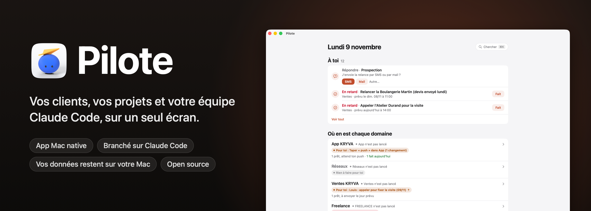
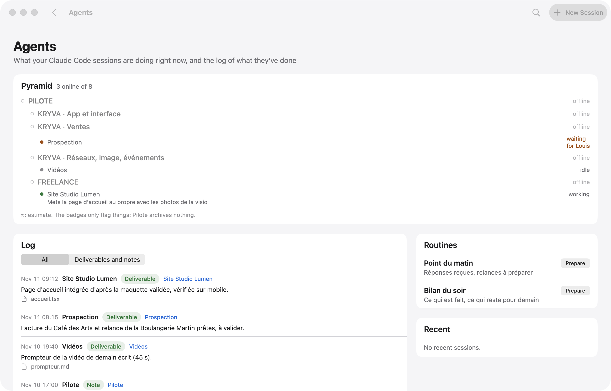
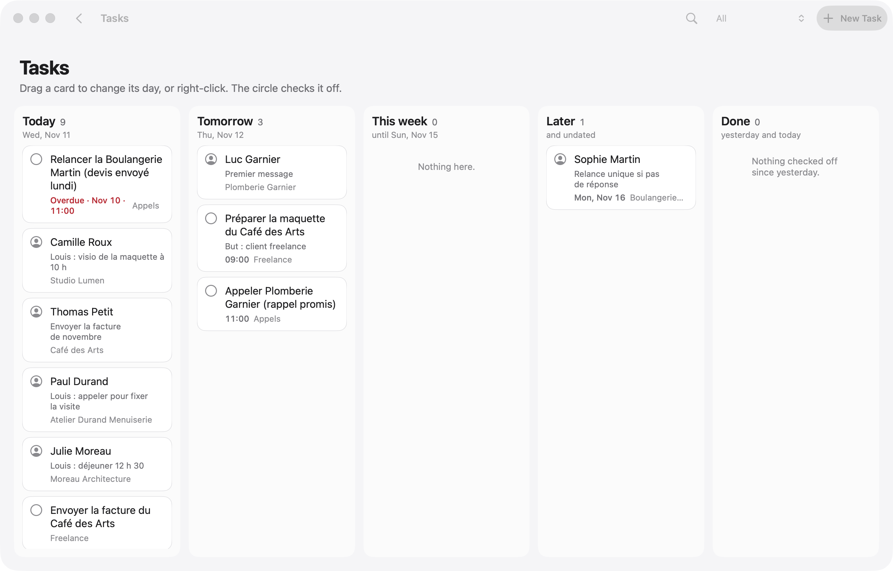

<p align="center">
  
</p>

<p align="center">
  
  
  
  
  
  <a href="../../stargazers"></a>
</p>

<p align="center">
  <a href="README.md">English</a> · <b>Français</b> · <a href="README.es.md">Español</a> · <a href="README.pt-BR.md">Português (Brasil)</a> · <a href="README.de.md">Deutsch</a> · <a href="README.it.md">Italiano</a> · <a href="README.zh-CN.md">简体中文</a> · <a href="README.ja.md">日本語</a> · <a href="README.ko.md">한국어</a>
</p>

<p align="center">
  Fait par <b>pjk</b> (Sacha Praljak) ·
  <a href="https://sachapraljak.com/?utm_source=github&utm_medium=readme&utm_campaign=pilote">sachapraljak.com</a> ·
  <a href="https://www.instagram.com/sachaprljk/">Instagram</a> ·
  <a href="https://www.tiktok.com/@sachaprljk">TikTok</a>
</p>

<p align="center">
  <b>Si Pilote vous sert, une ⭐ aide d'autres personnes à le trouver.</b>
</p>

**Pilote est le carnet de bord d'un freelance qui travaille avec une équipe d'agents Claude Code.** Une app Mac native
pour tout ce qui vous attend : vos clients et chaque échange avec eux, la prochaine action pour chacun, vos rappels et
votre agenda, et ce que font vos sessions Claude Code en ce moment. Les sessions lisent et écrivent dans Pilote par un
serveur MCP : ce sont elles qui le tiennent à jour, vous ne voyez que ce qui a besoin de vous. Tout reste sur le Mac :
une base SQLite locale, aucun serveur, aucun compte.

## Installer en un prompt

Collez ce prompt dans Claude Code (ou n'importe quel agent de code) sur votre Mac. Il vérifie votre machine, construit et installe Pilote, vous pose une question à la fois pour chaque connexion (vous pouvez tout passer), branche Pilote à Claude Code, puis termine par un récap de ce qui est branché. Vos clés ne passent jamais par le chat. Même texte dans [`docs/INSTALL-PROMPT.md`](docs/INSTALL-PROMPT.md) ; pour le faire à la main, voir « Installer » plus bas. Le prompt reste en anglais.

````text
You are going to install Pilote (a native Mac app + a command-line tool + an MCP server for Claude Code) on this Mac, then
connect it, asking me for what you need. Repository: https://github.com/pjksens/pilote . Work in English unless I write
to you in another language, then answer in mine.

GROUND RULES
- Ask me ONE question at a time and wait for my answer. Every connection is optional: if I say "skip" (or "no", or
  "later"), move on and leave it off.
- Before each connection, say in ONE sentence what it is for. Never turn anything on that I did not say yes to.
- Never ask me to paste an API key, token or password in this chat, never print one, never read a secret file back to me
  (no cat, no echo, no logging). To enter a key: create the file with permissions 600 and an empty placeholder, open it in
  an editor for me (`open -e <file>`), tell me exactly where to paste, wait for "done", then check it is not empty
  WITHOUT displaying it. If I paste a secret in the chat anyway, use it, never repeat it, and tell me once that it is now
  in this conversation's history, so I may want to rotate it later.
- Secrets never go inside the git repository. Never commit, never push, never change the repository.
- If a command fails, show me the last 20 lines of its output, say what you think went wrong, and stop and ask before
  trying something else. Do not invent results: if you did not check it, say you did not.

STEP 1. CHECK THE MACHINE
1. `sw_vers -productVersion` must be 15 or later.
2. `xcodebuild -version` must work (full Xcode, not only the command-line tools). If it does not: tell me to install
   Xcode from the App Store, open it once to accept the license, and stop until I say it is done.
3. `xcodegen --version`. If missing, check `brew --version`: if Homebrew exists, propose `brew install xcodegen` and run
   it only after I say yes. If Homebrew is missing, tell me to install it from https://brew.sh, and stop until I say it
   is done (do not run its install script yourself).
4. `git --version` must work.
Tell me in one line what you found.

STEP 2. GET THE CODE AND BUILD
1. Ask me where to put the code. Default: ~/pilote . Moving that folder later breaks the connection to Claude Code, so
   pick a place that stays. If the folder exists and is not a clone of pjksens/pilote, propose another name.
2. `git clone https://github.com/pjksens/pilote.git <folder>` then `cd <folder>`.
3. Warn me, in one sentence, that the next script quits Pilote if it is running and replaces ~/Applications/Pilote.app
   (it stops if another app named Pilote with a different identifier is there). Then run `./scripts/construire.sh`.
   It takes a few minutes. It installs ~/Applications/Pilote.app and puts the `pilote` tool in <folder>.
4. Check that ~/Applications/Pilote.app and <folder>/pilote exist.

STEP 3. SETTINGS (connections)
Pilote reads ONE file: ~/Library/Application Support/io.github.pjksens.pilote/reglages.json (the template is
docs/reglages.exemple.json). Without it, everything that touches an account or a network is off. Keep my answers in
memory and write the file once at the end of this step: `mkdir -p` its folder, then write it with `chmod 600`. Only
write the keys of the connections I accepted. If the file already exists, read it first and merge, never overwrite my
existing values.

Ask these questions, in this order, one at a time:
a. First name ("prenom"). Used in the app ("Camille: call back..."). Default "Vous". Then, optionally, the display
   names of my workspaces ("espaces": internal keys kryva, freelance, autre).
b. Reminders and Calendar ("rappels_calendrier": true): shows today's appointments and reminders. macOS will ask its
   permission the first time the app opens.
c. Mail.app ("mail": true): lets Pilote read received messages and create drafts. It never sends anything on its own.
d. Incoming messages ("entrants": true): the `pilote entrants` collector reads calls, texts, iMessage, WhatsApp and
   received emails on this Mac to log them in the right contact's thread. macOS may ask for extra permissions.
e. A git repository to follow ("depot_suivi": a path): the app shows its latest commits, read only.
f. Secrets folder ("dossier_secrets"). Only ask it if I accept g or h. Default ~/Secrets . Create it with chmod 700 if
   missing. It must not be inside a git repository or a synced folder (iCloud Drive, Dropbox).
g. Publishing to YouTube, Instagram and TikTok ("publication": true, needs the secrets folder). Each post waits for my
   explicit approval in the app before it goes out. Ask which of the two clients I have:
   - Google/YouTube: I need an OAuth client of type "Desktop app" from the Google Cloud console (YouTube Data API v3
     enabled), downloaded as client_secret_....json into ~/Downloads. When I tell you it is there, move the newest one
     to <dossier_secrets>/pilote-google-oauth.json and chmod 600 it (do not open it).
   - TikTok: I need the app's "Client key" and "Client secret" from the TikTok developer portal. Ask me for the Client
     key in the chat (it is public), and tell me to COPY the Client secret to the clipboard (do not paste it in the
     chat). Then run `./pilote publication client-tiktok --cle <Client key>` from the code folder: it reads the secret
     from the clipboard, stores it in <dossier_secrets>/pilote-tiktok-client.json and clears the clipboard.
   Instagram needs nothing here. The accounts themselves are connected afterwards in the app (Pilote > Publications,
   "Connecter"), tokens go to the macOS keychain. Tell me that last part.
h. Radar ("radar": true, needs the secrets folder): watches public numbers of social accounts through ScrapeCreators,
   a paid service billed per credit, and it never runs without my confirmation. If I have a key: create
   <dossier_secrets>/cle-scrapecreators.env containing the single line `SCRAPECREATORS_API_KEY=` , chmod 600, open it for
   me to paste the key after the "=".
i. Sign-ups of my own product ("comptes"): Pilote reads ONE view of a PostgREST/Supabase database, read only, to show
   who signed up and who pays. Only for people who have a product with accounts. If yes: ask for the project URL and
   the view name (default pilote_comptes), and point me to the "comptes" section of the README for the SQL view. The key
   must be a token that can ONLY read that view, NEVER a Supabase service_role / secret key: say it, and refuse one if I
   offer it. Optional: a Stripe restricted key (rk_..., "Subscriptions: Read" only). These keys ("comptes.cle",
   "comptes.stripe_cle") are read by Pilote inside reglages.json itself: write them as empty strings, then open
   reglages.json for me to paste each key between the quotes (do not retype the quotes), and validate the JSON after.
j. Contact sync with a phone ("synchro"): exchanges one workspace's contacts with two remote tables. Same rule for its
   key ("synchro.cle": a token limited to those two tables, never service_role), same editor procedure. Skip if unsure.
k. Forbidden sender domains ("domaines_interdits": a list): Pilote refuses to send an email from them. Only if I name some.
l. Gmail sending is NOT in this file: it is enabled inside the app by pasting a Gmail app password (kept in the macOS
   keychain). Tell me where to do it in the app and move on. Do not ask for the password.

When the file is written, run `<folder>/pilote reglages` and show me its output: it lists what is on and what is off.
Careful: that command says "actif" as soon as a block exists (for example "comptes" with an empty key), so do not call a
connection working unless its key file or key is really filled in (check the size or the emptiness, never the content).

STEP 4. CONNECT MY AGENT
1. Claude Code. Check `claude --version`. Run `claude mcp list`: if a server named "pilote" is already there, tell me
   what it points to and ask before replacing it. Then run, with the ABSOLUTE path:
   `claude mcp add --scope user pilote -- <folder>/pilote mcp`
   and check `claude mcp list` shows pilote as connected.
2. Optional, ask me first: a journal of what my sessions deliver. It needs a "Stop" hook in ~/.claude/settings.json
   that runs `<folder>/pilote journal-crochet`. If I say yes, show me the exact change, merge it into the existing JSON
   without touching anything else (create the file if missing), and validate the JSON afterwards.
3. Any other agent that supports MCP (Cursor, Codex, Gemini CLI, Windsurf...): Pilote is a plain stdio MCP server. Add a
   server named "pilote" with command `<folder>/pilote` and the single argument `mcp`, using that agent's own way of
   adding MCP servers (usually a JSON file with "mcpServers": {"pilote": {"command": "...", "args": ["mcp"]}}). If you
   are not sure how my agent does it, say so instead of guessing.

STEP 5. CHECK AND OPEN
1. Run `<folder>/pilote jour` and confirm it answers without error (an empty day is normal on a fresh install).
2. Run `open ~/Applications/Pilote.app`. Tell me the app is open and to accept the macOS permission prompts for the
   connections I turned on.

STEP 6. RECAP
Finish with a short table with three groups: CONNECTED (what you checked, and how), NOT CONNECTED (what I skipped, and
the one setting that turns it on later), and TO DO BY HAND (Gmail app password in the app; connecting each social
account in Pilote > Publications; the OAuth/TikTok steps I still owe; macOS permission prompts). Add that sessions opened
BEFORE this install do not see the Pilote tools: I must start a new Claude Code session (or restart my agent) to use
them. For each item, only write what you actually verified.
````

<p align="center">
  
  <br><sub>Mode démo (<code>./scripts/demo.sh</code>) : données inventées, aucune vraie personne.</sub>
</p>

> L'interface de l'app suit la langue de votre Mac : français, anglais ou espagnol (anglais pour toute autre langue). Les commentaires du code, l'outil en ligne de commande `pilote` et le serveur MCP restent en français. Ce README existe en neuf langues.

## Ce que fait Pilote

- **Un seul écran pour la journée** : rendez-vous (Calendrier), rappels du jour et en retard (Rappels, cochables),
  messages préparés par Claude à valider, relances dues, réponses reçues.
- **Les clients avec leur contexte** : un carnet par espace de travail, avec l'étape, la prochaine action et le fil
  complet de chaque échange (mail, SMS, appel, visite). Avant un appel, vous voyez tout ce qui a été dit.
- **Claude Code branché dessus** : un serveur MCP donne aux sessions Claude des outils pour lire et écrire dans Pilote
  (`jour`, `cherche`, `fiche`, `enregistre_contact`, `ajoute_au_fil`, `marque`, `carte`, `ou_est`, `agents`, `journal`,
  `note_au_journal`, `publications`…). Les consignes du serveur imposent de chercher avant de créer, de ne rien inventer et
  de ne rien envoyer seul.
- **Agents** : les sessions Claude Code ouvertes sur le Mac, leur état et leur dernière action ; un journal des livrables,
  rempli par un crochet « Stop » de Claude Code.
- **Carte de l'espace de travail** : chaque projet, son dossier, son `ETAT.md`, ses documents clés ; recherche partout
  (⌘K) dans les projets, contacts, journal et fichiers (Spotlight).
- **Envoi de mail sous contrôle** : un mail préparé ne part que sur un clic, depuis Gmail (SMTP, mot de passe
  d'application rangé dans le trousseau du Mac, jamais lu par Claude). Texte brut, réponse dans le bon fil.
- **Pip, facultatif.** Si [Pip](https://github.com/pjksens/heypip) (une app d'encoche pour Mac qui suit les appels) est installée, un bouton « Lancer Pip » apparaît sur une visio de votre agenda : Pip s'ouvre avec le nom de l'appel et le contact lié. En option, Pilote l'ouvre tout seul deux minutes avant. Pip n'enregistre qu'après votre propre clic ; quand Claude a écrit le résumé de l'appel, Pilote le range dans le fil du contact. Elle lit votre agenda : elle suit donc `rappels_calendrier`, coupé par défaut.
- **Publications** : programmation de vidéos sur YouTube, Instagram et TikTok, avec validation explicite avant chaque
  envoi (jetons dans le trousseau).
- **Radar** : veille de comptes de réseaux sociaux (vues, rythme, idées), saisie à la main ou par une source payante qui
  ne se lance jamais sans confirmation.

## Avec Claude Code

Vos sessions font le travail ; Pilote est l'endroit où vous le voyez et où vous leur répondez.

<p align="center">
  
  <br><sub>Ce que font vos sessions, et un message à l'une d'elles, sans quitter Pilote.</sub>
</p>

Quand une session a besoin d'une décision, sa question arrive sur l'accueil avec ses boutons. Votre réponse attend dans
**« Vos réponses, prêtes à partir »** jusqu'à votre clic sur **Envoyer** : rien n'arrive à une session par accident.

<p align="center">
  
  <br><sub>Une session demande, vous répondez d'un clic, et vous choisissez quand ça part.</sub>
</p>

> **Comment vos réponses arrivent aux sessions :** [`scripts/facteur.py`](scripts/facteur.py), le « Facteur ». Le bouton
> **Démarrer le Facteur** de l'écran d'accueil ouvre une session Claude Code avec sa consigne : elle attend en
> arrière-plan et remet chaque réponse à la bonne session en quelques secondes. C'est la session qui a posé la question
> ou à qui vous écrivez ; sinon celle nommée dans `facteur.sessions` de `reglages.json` ; sinon celle du tableau de
> `EQUIPE.md`. Aucun identifiant de session n'est écrit dans le code.

## Avertissement

C'est **mon système personnel, publié tel quel**, rendu modulable : vos clés, vos dossiers et votre prénom se règlent
dans un fichier (section « Réglages »), et tout ce qui touche un compte ou un service en ligne est coupé tant que vous ne
l'activez pas. Il reste des traces de mon usage : mes espaces de travail (clé interne `kryva`, nom affiché réglable), mon
équipe de sessions Claude, des libellés en français. Toutes les données réelles (contacts, messages, comptes,
identifiants) ont été retirées ou remplacées par des valeurs inventées.

Pas inclus : mes scripts d'organisation (remise des décisions aux sessions, veille, imports), mes notes et ma base.

## Essayer sans rien brancher : le mode démo

```bash
./scripts/demo.sh             # construit l'app (sans l'installer) et l'ouvre avec des données inventées
./scripts/demo.sh --captures  # refait les captures ci-dessous (docs/captures)
./scripts/demo.sh --gif       # rejoue les trois démos et refait les GIF (docs/media, ffmpeg requis)
```

En démo (`PILOTE_DEMO=1`), Pilote voit un dossier personnel fictif, neuf à chaque lancement, au lieu du vôtre : base,
sessions Claude, fichiers. Il ne lit ni Rappels, ni Calendrier, ni Mail, ni Spotlight, et rien ne part (mail, message à
une session, notification, publication). Les captures et les GIF sont pris par l'app elle-même, sur sa propre fenêtre :
aucune permission d'enregistrement de l'écran.

| | |
|---|---|
|  |  |
|  |  |
|  |  |

Toutes les données des captures sont inventées (noms, entreprises, numéros en 06 39 98 00 0x, adresses en `.example`).

## Installer

Il faut macOS 15 ou plus récent, Xcode et [XcodeGen](https://github.com/yonaskolb/XcodeGen).

```bash
brew install xcodegen
git clone https://github.com/pjksens/pilote.git && cd pilote
./scripts/tester.sh        # tests unitaires (ne touchent ni l'app ni votre base)
./scripts/construire.sh    # construit l'app, l'installe dans ~/Applications et pose l'outil ./pilote
```

`construire.sh` ferme Pilote s'il tourne, puis remplace `~/Applications/Pilote.app`. Si une autre app nommée Pilote s'y trouve (autre identifiant), il s'arrête sans rien remplacer. Cette copie a son propre identifiant (`io.github.pjksens.pilote`) et son propre dossier de données : elle ne lit ni n'écrit jamais la base d'un autre Pilote installé sur le même Mac.

**Signature.** Le projet signe en local (`CODE_SIGN_IDENTITY: "-"`). macOS redemande alors les autorisations à chaque
nouvelle version. Pour les garder, mettez votre équipe Apple dans `project.yml` (`DEVELOPMENT_TEAM`,
`CODE_SIGN_IDENTITY: "Apple Development"`).

**Autorisations.** Sans réglages, Pilote ne demande rien à macOS. Rappels et Calendriers ne sont demandés que si vous
activez `rappels_calendrier`, « contrôler Mail » (lecture et brouillons, jamais d'envoi) que si vous activez `mail`.
L'app n'est pas dans le bac à sable : elle lit `~/.claude` pour suivre les sessions Claude Code.

## Réglages : brancher vos comptes

Tout passe par un fichier JSON : `~/Library/Application Support/io.github.pjksens.pilote/reglages.json`. Modèle :
[`docs/reglages.exemple.json`](docs/reglages.exemple.json). Pilote le relit dès qu'il change. `./pilote reglages` dit ce
qui est actif, ce qui est coupé et ce qui manque.

**Sans ce fichier**, Pilote marche seul sur le Mac (base locale, contacts, carte, planning, sessions Claude Code) et
**tout le reste est coupé** : aucune lecture de Rappels, Calendrier, Mail, Contacts ou appels, aucun appel réseau à une
base, à Stripe ou à un réseau social.

Ce fichier contient vos clés : gardez-le hors de tout dépôt git et lisible par vous seul (`chmod 600`). Pilote n'écrit
jamais une clé ailleurs.

| Réglage | Ce qu'il active |
|---|---|
| `prenom` | Votre prénom dans l'app (« Camille : rappeler… »). Défaut : « Vous ». |
| `espaces` | Les noms affichés de vos espaces de travail (clés internes `kryva`, `freelance`, `autre`). |
| `dossiers_sessions`, `routines` | Les dossiers proposés pour ouvrir une session Claude Code, et vos consignes lancées d'un clic. |
| `facteur` | Où le Facteur remet : `sessions` (nom → identifiant `local_…`) et `rappel` (une ligne ajoutée à chaque courrier). |
| `depot_suivi` | Un dépôt git dont Pilote montre les commits récents (lecture seule, sans `fetch`). |
| `rappels_calendrier: true` | Rappels et Calendrier (EventKit). |
| `mail: true` | Mail.app : messages reçus, brouillons. |
| `entrants: true` | Le capteur `pilote entrants` : appels, SMS, iMessage, WhatsApp, mails reçus. |
| `publication: true` + `dossier_secrets` | Publication YouTube, Instagram, TikTok. Clients OAuth dans le dossier : `pilote-google-oauth.json`, `pilote-tiktok-client.json`. Jetons dans le trousseau. |
| `radar: true` + `dossier_secrets` | Radar par ScrapeCreators (payant au crédit) : `cle-scrapecreators.env` (`SCRAPECREATORS_API_KEY=…`). |
| `domaines_interdits` | Domaines depuis lesquels Pilote refuse d'envoyer un mail, et qu'il signale s'il en voit partir. |
| `comptes` | Les inscrits de votre produit et leur abonnement, en lecture seule (ci-dessous). |
| `synchro` | Contacts d'un espace échangés avec deux tables distantes (ci-dessous). |

L'envoi de mail par Gmail ne passe pas par ce fichier : il reste coupé tant que vous n'avez pas collé un mot de passe
d'application Gmail dans l'app (rangé dans le trousseau).

### `comptes` : vos inscrits, en lecture seule

Pilote lit **une seule vue**, par une API REST compatible PostgREST (Supabase par exemple). Il ne connaît aucune de vos
tables : c'est la vue qui traduit votre schéma. Colonnes attendues :

| Colonne | Contenu |
|---|---|
| `id` | identifiant du compte (texte) |
| `entreprise`, `nom`, `email`, `telephone` | texte |
| `inscrit_le` | date d'inscription (timestamptz) |
| `devis` | un nombre (entier) que vous voulez voir à côté de chaque inscrit |
| `abonnement_stripe` | l'identifiant `sub_…` Stripe, ou null |
| `store_expire_le` | fin de l'abonnement Apple ou Google, ou null |
| `actif` | booléen, ou null |

```sql
-- Exemple, à adapter à votre schéma.
create view pilote_comptes with (security_invoker = true) as
select o.id::text as id, o.nom as entreprise, u.nom_complet as nom, u.email, u.telephone,
       o.cree_le as inscrit_le, 0 as devis, o.abonnement_stripe, o.store_expire_le, o.actif
from organisations o left join utilisateurs u on u.organisation_id = o.id;
```

**La clé.** Donnez à Pilote le moins de droits possible : un jeton qui ne peut que **lire cette vue**, par exemple un rôle
Postgres dédié qui n'a que `select` dessus (voir la documentation de votre base pour obtenir un jeton lié à ce rôle).
**Jamais la clé `service_role`** (ou « secret ») de Supabase : elle ouvre toute la base, en lecture et en écriture, en
contournant la sécurité par ligne. Ne rendez pas non plus cette vue lisible par le rôle `anon` : la clé « anon » est
publique dans vos apps.

**Stripe** (`stripe_cle`, optionnel) : une **clé restreinte** (`rk_…`) avec la seule permission « Subscriptions : Read ».
Elle sépare l'essai du payant ; sans elle, un compte avec abonnement s'affiche « À vérifier ».

**Compteur** (`compteur`, optionnel) : une commande à vous, lancée dans `dossier`, qui imprime une ligne `ACTIFS 7 / 10`
puis des titres de section suivis de lignes en retrait de deux espaces.

### `synchro` : vos contacts sur un téléphone

Échange les contacts et le fil d'un espace (`espace`, défaut : le premier) avec deux tables (`table_contacts`,
`table_evenements` ; défaut `pilote_contacts`, `pilote_evenements`) dont les colonnes sont celles de
`Synchro.colonnesContact` et `Synchro.colonnesEvenement` (`Shared/Synchro.swift`). Pilote y **écrit** : donnez-lui un
jeton limité à ces deux tables (`select`, `insert`, `update`), jamais `service_role`.

## Brancher Claude Code

```bash
claude mcp add --scope user pilote -- "$(pwd)/pilote" mcp
```

Les sessions ouvertes après cette commande voient les outils Pilote. Pour le journal des agents, ajoutez un crochet
« Stop » dans `~/.claude/settings.json` qui lance `pilote journal-crochet`.

## Données

- Base : `~/Library/Application Support/io.github.pjksens.pilote/pilote.sqlite` (SQLite, WAL). L'app se met à jour dès qu'une autre
  connexion (l'outil, une session Claude) y écrit.
- Essayer sur une autre base : `PILOTE_BASE=/chemin/essai.sqlite ./pilote jour`.
- Nom de l'expéditeur des mails : `PILOTE_NOM`, sinon le nom complet de votre compte macOS.
- Réglages et clés : `~/Library/Application Support/io.github.pjksens.pilote/reglages.json` (section « Réglages »).
- Sauvegarde du jour : une copie JSON dans iCloud Drive, dossier `Pilote open source` (les 14 dernières), si iCloud Drive est activé.
- Aide de l'outil : `./pilote aide`.

## Comment c'est fait

Swift 5, SwiftUI, AppKit, EventKit, SQLite3 du système, Security (trousseau), CryptoKit. Aucune dépendance externe.
Environ 28 000 lignes de Swift (hors tests), 425 tests unitaires.

- `App/` : l'app Mac (écrans, intégrations Calendrier, Rappels, Mail, Claude).
- `Shared/` : le modèle, la base, les règles (partagés par l'app, l'outil et les tests).
- `CLI/` : l'outil `pilote` et le serveur MCP (`pilote mcp`).
- `Tests/` : tests unitaires, sur des bases temporaires.

## Fait par

**pjk** (Sacha Praljak). Je construis des outils d'IA et je les montre en vidéos courtes. Pilote est construit avec
Claude Code.

- Site : [sachapraljak.com](https://sachapraljak.com/?utm_source=github&utm_medium=readme&utm_campaign=pilote)
- Instagram : [@sachaprljk](https://www.instagram.com/sachaprljk/)
- TikTok : [@sachaprljk](https://www.tiktok.com/@sachaprljk)

Si Pilote vous sert, une ⭐ sur le dépôt et un abonnement aident beaucoup.

## Licence

MIT, voir [LICENSE](LICENSE).
