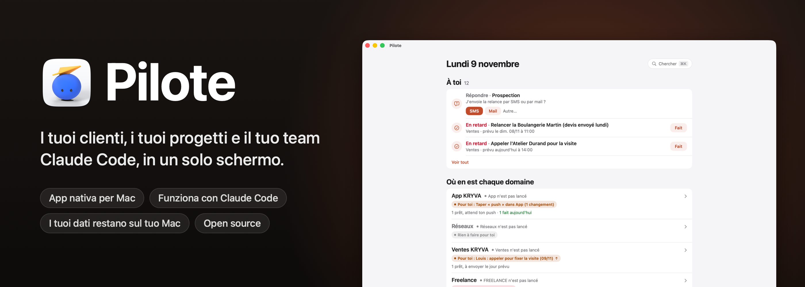
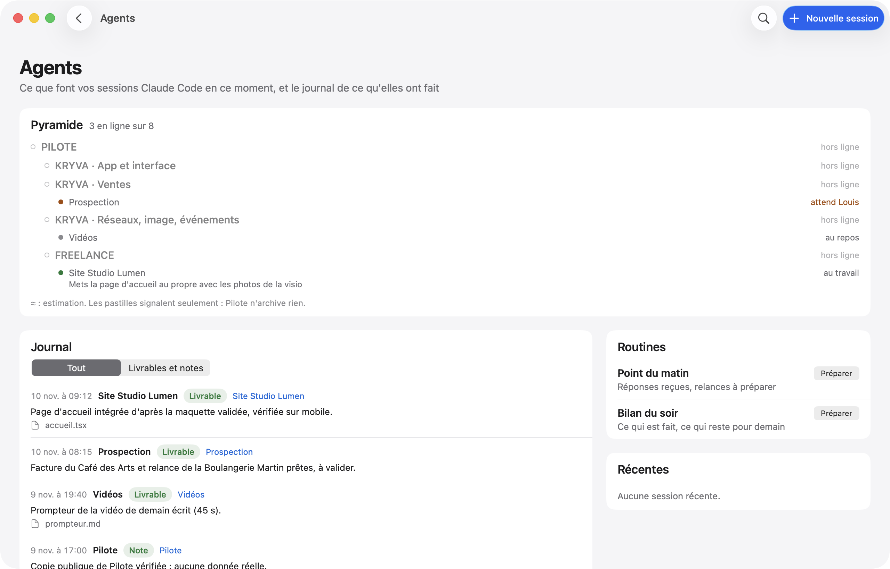
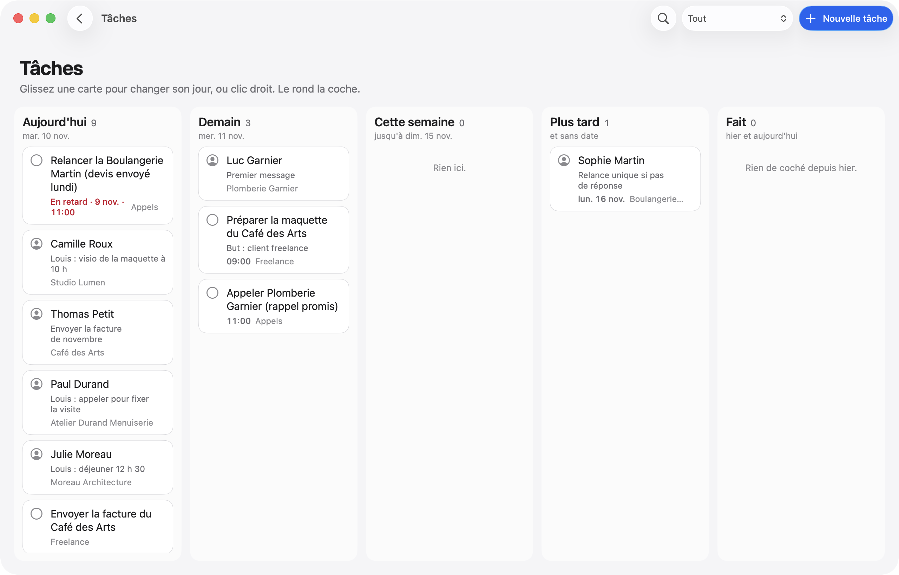

<p align="center">
  
</p>

<p align="center">
  
  
  
  
  
  <a href="../../stargazers"></a>
</p>

<p align="center">
  <a href="README.md">English</a> · <a href="README.fr.md">Français</a> · <a href="README.es.md">Español</a> · <a href="README.pt-BR.md">Português (Brasil)</a> · <a href="README.de.md">Deutsch</a> · <b>Italiano</b> · <a href="README.zh-CN.md">简体中文</a> · <a href="README.ja.md">日本語</a> · <a href="README.ko.md">한국어</a>
</p>

<p align="center">
  Creato da <b>pjk</b> (Sacha Praljak) ·
  <a href="https://sachapraljak.com/?utm_source=github&utm_medium=readme&utm_campaign=pilote">sachapraljak.com</a> ·
  <a href="https://www.instagram.com/sachaprljk/">Instagram</a> ·
  <a href="https://www.tiktok.com/@sachaprljk">TikTok</a>
</p>

<p align="center">
  <b>Se Pilote ti è utile, una ⭐ aiuta altre persone a trovarlo.</b>
</p>

**Pilote è il diario di bordo di un freelance che lavora con un team di agenti Claude Code.** Un'unica app nativa per
Mac per tutto ciò che ha bisogno di te: i tuoi clienti e ogni scambio con loro, la prossima azione per ciascuno, i tuoi
promemoria e il tuo calendario, e ciò che le tue sessioni di Claude Code stanno facendo in questo momento. Le sessioni
leggono e scrivono su Pilote tramite un server MCP, quindi lo tengono aggiornato; tu vedi solo ciò che ha bisogno di te.
Tutto resta sul tuo Mac: un database SQLite locale, nessun server, nessun account.

<p align="center">
  
  <br><sub>Modalità demo (<code>./scripts/demo.sh</code>): dati inventati, nessuna persona reale.</sub>
</p>

> L'interfaccia dell'app e i commenti del suo codice sono in francese. Questo README esiste in nove lingue; l'app, per ora, no.

## Cosa fa Pilote

- **Uno schermo per la giornata.** Appuntamenti (Calendario), promemoria di oggi e in ritardo (Promemoria, li spunti),
  messaggi preparati da Claude in attesa della tua approvazione, follow-up in scadenza, risposte ricevute.
- **Clienti con il loro contesto.** Una rubrica per ogni spazio di lavoro, con la fase, la prossima azione e l'intero
  filo di ogni scambio (e-mail, SMS, chiamata, visita). Prima di una chiamata, vedi tutto ciò che è stato detto.
- **Claude Code collegato.** Un server MCP dà alle tue sessioni di Claude strumenti per leggere e scrivere su Pilote
  (`jour`, `cherche`, `fiche`, `enregistre_contact`, `ajoute_au_fil`, `marque`, `carte`, `ou_est`, `agents`, `journal`,
  `note_au_journal`, `publications`…). Le istruzioni del server dicono loro di cercare prima di creare, di non inventare
  nulla e di non inviare nulla di propria iniziativa.
- **Agenti.** Le sessioni di Claude Code aperte sul tuo Mac, il loro stato e la loro ultima azione, e un diario di ciò
  che hanno consegnato (compilato da un hook `Stop` di Claude Code).
- **Una mappa del tuo lavoro.** Ogni progetto, la sua cartella, il suo `ETAT.md` (file di stato), i suoi documenti
  chiave; cerca in tutto (⌘K) tra progetti, contatti, diario e file (Spotlight).
- **E-mail sotto controllo.** Un'e-mail preparata parte solo quando fai clic, dal tuo Gmail (SMTP, password per app
  conservata nel portachiavi di macOS, mai letta da Claude). Testo semplice, e le risposte restano nel thread giusto.
- **Pubblicazione.** Programma video su YouTube, Instagram e TikTok, con un'approvazione esplicita prima che ciascuno
  esca (token nel portachiavi).
- **Radar.** Tieni d'occhio account di social media (visualizzazioni, ritmo di pubblicazione, idee), inseriti a mano o
  tramite una fonte a pagamento che non parte mai senza la tua conferma.

## Con Claude Code

Le tue sessioni fanno il lavoro; Pilote è il posto dove lo vedi e dove rispondi loro.

<p align="center">
  
  <br><sub>Cosa stanno facendo le tue sessioni, e un messaggio a una di loro, senza uscire da Pilote.</sub>
</p>

Quando una sessione ha bisogno di una decisione, la sua domanda compare nella schermata iniziale con i suoi pulsanti. La
tua risposta aspetta in **“Vos réponses, prêtes à partir”** (le tue risposte, pronte a partire) finché non fai clic su
**Envoyer** (invia): niente arriva a una sessione per caso.

<p align="center">
  
  <br><sub>Una sessione chiede, tu rispondi con un clic e scegli quando parte.</sub>
</p>

> **Come le tue risposte arrivano alle sessioni:** [`scripts/facteur.py`](scripts/facteur.py), il “Facteur” (il postino).
> Il pulsante **Démarrer le Facteur** nella schermata iniziale apre una sessione di Claude Code con le sue istruzioni:
> resta in attesa in background e consegna ogni risposta alla sessione giusta in pochi secondi. È la sessione che ha fatto
> la domanda o a cui hai scritto; altrimenti quella indicata in `facteur.sessions` di `reglages.json`; altrimenti quella
> della tabella di `EQUIPE.md`. Nessun identificativo di sessione è scritto nel codice.

## Un avvertimento

Questo è **il mio sistema personale, pubblicato così com'è**, reso configurabile: le tue chiavi, le tue cartelle e il tuo
nome stanno in un unico file di impostazioni (vedi “Impostazioni”), e tutto ciò che tocca un account o un servizio
online resta spento finché non lo accendi. Restano tracce del mio uso: i miei spazi di lavoro (chiave interna `kryva`,
nome visualizzato configurabile), il mio team di sessioni di Claude, etichette in francese. Tutti i dati reali (contatti,
messaggi, account, credenziali) sono stati rimossi o sostituiti con valori inventati.

Non inclusi: i miei script di organizzazione (consegna delle risposte, monitoraggio, importazioni), le mie note e il mio
database.

## Provalo senza collegare nulla: modalità demo

```bash
./scripts/demo.sh             # compila l'app (senza installarla) e la apre con dati inventati
./scripts/demo.sh --captures  # rifà gli screenshot qui sotto (docs/captures)
./scripts/demo.sh --gif       # riproduce le tre demo e ricostruisce le GIF (docs/media, richiede ffmpeg)
```

In modalità demo (`PILOTE_DEMO=1`), Pilote vede una cartella home fittizia, nuova a ogni avvio, al posto della tua:
database, sessioni di Claude, file. Non legge Promemoria, Calendario, Mail né Spotlight, e nulla esce (e-mail,
messaggio a una sessione, notifica, post). Gli screenshot e le GIF li fa l'app stessa, della propria finestra: nessun
permesso di registrazione dello schermo.

| | |
|---|---|
|  |  |
|  |  |
|  |  |

Ogni dato negli screenshot è inventato (nomi, aziende, numeri di telefono nell'intervallo di finzione francese
06 39 98 00 0x, indirizzi in `.example`).

## Installazione

Ti servono macOS 15 o successivo, Xcode e [XcodeGen](https://github.com/yonaskolb/XcodeGen).

```bash
brew install xcodegen
git clone https://github.com/pjksens/pilote.git && cd pilote
./scripts/tester.sh        # test unitari (non toccano né l'app né il tuo database)
./scripts/construire.sh    # compila l'app, la installa in ~/Applications e mette a posto lo strumento ./pilote
```

`construire.sh` chiude Pilote se è in esecuzione, poi sostituisce `~/Applications/Pilote.app`. Se c'è già un'altra app chiamata Pilote (con un altro identificatore), si ferma senza sostituire nulla. Questa copia ha il suo identificatore (`io.github.pjksens.pilote`) e la sua cartella di dati: non legge né scrive mai il database di un altro Pilote installato sullo stesso Mac.

**Firma.** Il progetto firma in locale (`CODE_SIGN_IDENTITY: "-"`), quindi macOS chiede di nuovo i permessi a ogni nuova
build. Per mantenerli, inserisci il tuo team Apple in `project.yml` (`DEVELOPMENT_TEAM`,
`CODE_SIGN_IDENTITY: "Apple Development"`).

**Permessi.** Senza impostazioni, Pilote non chiede nulla a macOS. Promemoria e Calendari vengono richiesti solo se
attivi `rappels_calendrier`, “controllare Mail” (lettura e bozze, mai invio) solo se attivi `mail`. L'app non è in
sandbox: legge `~/.claude` per seguire le tue sessioni di Claude Code.

## Impostazioni: collega i tuoi account

Tutto passa da un unico file JSON: `~/Library/Application Support/io.github.pjksens.pilote/reglages.json`. Modello:
[`docs/reglages.exemple.json`](docs/reglages.exemple.json). Pilote lo rilegge non appena cambia.
`./pilote reglages` ti dice cosa è acceso, cosa è spento e cosa manca.

**Senza questo file**, Pilote funziona da solo sul tuo Mac (database locale, contatti, mappa, pianificazione, sessioni
di Claude Code) e **tutto il resto è spento**: nessuna lettura di Promemoria, Calendario, Mail, Contatti o chiamate,
nessuna chiamata di rete a un database, a Stripe o a un social network.

Questo file contiene le tue chiavi: tienilo fuori da qualsiasi repository git e leggibile solo da te (`chmod 600`).
Pilote non scrive mai una chiave altrove.

| Impostazione | Cosa attiva |
|---|---|
| `prenom` | Il tuo nome nell'app (“Camille : rappeler…”). Predefinito: “Vous” (tu). |
| `espaces` | I nomi visualizzati dei tuoi spazi di lavoro (chiavi interne `kryva`, `freelance`, `autre`). |
| `dossiers_sessions`, `routines` | Le cartelle proposte quando apri una sessione di Claude Code, e le tue istruzioni con un clic. |
| `facteur` | Dove consegna il Facteur: `sessions` (nome → ID `local_…`) e `rappel` (una riga aggiunta a ogni messaggio). |
| `depot_suivi` | Un repository git di cui Pilote mostra i commit recenti (sola lettura, nessun `fetch`). |
| `rappels_calendrier: true` | Promemoria e Calendario (EventKit). |
| `mail: true` | Mail.app: messaggi ricevuti, bozze. |
| `entrants: true` | Il collettore `pilote entrants`: chiamate, SMS, iMessage, WhatsApp, e-mail ricevute. |
| `publication: true` + `dossier_secrets` | Pubblicazione su YouTube, Instagram, TikTok. Client OAuth in quella cartella: `pilote-google-oauth.json`, `pilote-tiktok-client.json`. Token nel portachiavi. |
| `radar: true` + `dossier_secrets` | Radar tramite ScrapeCreators (a pagamento per credito): `cle-scrapecreators.env` (`SCRAPECREATORS_API_KEY=…`). |
| `domaines_interdits` | Domini da cui Pilote rifiuta di inviare un'e-mail, e che segnala se ne vede uscire una. |
| `comptes` | Le iscrizioni al tuo prodotto e il loro abbonamento, sola lettura (sotto). |
| `synchro` | I contatti di uno spazio di lavoro, scambiati con due tabelle remote (sotto). |

L'invio di e-mail tramite Gmail non usa questo file: resta spento finché non incolli una password per app di Gmail
nell'app (conservata nel portachiavi).

### `comptes`: le tue iscrizioni, sola lettura

Pilote legge **una vista**, tramite un'API REST compatibile con PostgREST (per esempio Supabase). Non conosce nessuna
delle tue tabelle: la vista traduce il tuo schema. Colonne attese:

| Colonna | Contenuto |
|---|---|
| `id` | id dell'account (testo) |
| `entreprise`, `nom`, `email`, `telephone` | testo (azienda, nome, e-mail, telefono) |
| `inscrit_le` | data di iscrizione (timestamptz) |
| `devis` | un numero (intero) che vuoi vedere accanto a ogni iscrizione |
| `abonnement_stripe` | l'id Stripe `sub_…`, oppure null |
| `store_expire_le` | fine dell'abbonamento Apple o Google, oppure null |
| `actif` | booleano, oppure null |

```sql
-- Esempio, da adattare al tuo schema.
create view pilote_comptes with (security_invoker = true) as
select o.id::text as id, o.nom as entreprise, u.nom_complet as nom, u.email, u.telephone,
       o.cree_le as inscrit_le, 0 as devis, o.abonnement_stripe, o.store_expire_le, o.actif
from organisations o left join utilisateurs u on u.organisation_id = o.id;
```

**La chiave.** Dai a Pilote il minimo dei diritti possibili: un token che possa solo **leggere questa vista**, per
esempio un ruolo Postgres dedicato con nient'altro che `select` su di essa (consulta la documentazione del tuo database
per ottenere un token legato a quel ruolo). **Mai la chiave `service_role` (o “secret”) di Supabase**: apre l'intero
database, in lettura e scrittura, aggirando la row level security. Non rendere la vista leggibile nemmeno dal ruolo
`anon`: la chiave “anon” è pubblica nelle tue app.

**Stripe** (`stripe_cle`, facoltativo): una **chiave con restrizioni** (`rk_…`) con la sola autorizzazione
“Subscriptions: Read”. Distingue le prove dagli account paganti; senza di essa, un account con un abbonamento compare
come “À vérifier” (da verificare).

**Contatore** (`compteur`, facoltativo): un tuo comando, eseguito in `dossier`, che stampa una riga `ACTIFS 7 / 10`, poi
titoli di sezione seguiti da righe rientrate di due spazi.

### `synchro`: i tuoi contatti su un telefono

Scambia i contatti e il filo di uno spazio di lavoro (`espace`, predefinito: il primo) con due tabelle
(`table_contacts`, `table_evenements`; predefinite `pilote_contacts`, `pilote_evenements`) le cui colonne sono quelle di
`Synchro.colonnesContact` e `Synchro.colonnesEvenement` (`Shared/Synchro.swift`). Pilote **scrive** lì: dagli un token
limitato a quelle due tabelle (`select`, `insert`, `update`), mai `service_role`.

## Collegare Claude Code

```bash
claude mcp add --scope user pilote -- "$(pwd)/pilote" mcp
```

Le sessioni aperte dopo questo comando vedono gli strumenti di Pilote. Per il diario degli agenti, aggiungi un hook
`Stop` in `~/.claude/settings.json` che esegua `pilote journal-crochet`.

## Dati

- Database: `~/Library/Application Support/io.github.pjksens.pilote/pilote.sqlite` (SQLite, WAL). L'app si aggiorna non appena un'altra
  connessione (lo strumento, una sessione di Claude) vi scrive.
- Provare un altro database: `PILOTE_BASE=/path/test.sqlite ./pilote jour`.
- Nome del mittente delle e-mail: `PILOTE_NOM`, altrimenti il nome completo del tuo account macOS.
- Impostazioni e chiavi: `~/Library/Application Support/io.github.pjksens.pilote/reglages.json` (vedi “Impostazioni”).
- Backup giornaliero: una copia JSON in iCloud Drive, cartella `Pilote open source` (si tengono le ultime 14), se iCloud Drive è attivo.
- Aiuto dello strumento: `./pilote aide`.

## Come è costruito

Swift 5, SwiftUI, AppKit, EventKit, l'SQLite3 di sistema, Security (portachiavi), CryptoKit. Nessuna dipendenza esterna.
Circa 28.000 righe di Swift (test esclusi), 425 test unitari.

- `App/`: l'app per Mac (schermate, integrazioni con Calendario, Promemoria, Mail e Claude).
- `Shared/`: il modello, il database, le regole (condivisi da app, strumento e test).
- `CLI/`: lo strumento `pilote` e il server MCP (`pilote mcp`).
- `Tests/`: test unitari, su database temporanei.

## Creato da

**pjk** (Sacha Praljak). Costruisco strumenti di IA e li mostro in brevi video. Pilote è costruito con Claude Code.

- Sito: [sachapraljak.com](https://sachapraljak.com/?utm_source=github&utm_medium=readme&utm_campaign=pilote)
- Instagram: [@sachaprljk](https://www.instagram.com/sachaprljk/)
- TikTok: [@sachaprljk](https://www.tiktok.com/@sachaprljk)

Se Pilote ti è utile, una ⭐ sul repo e un follow aiutano molto.

## Licenza

MIT, vedi [LICENSE](LICENSE).
