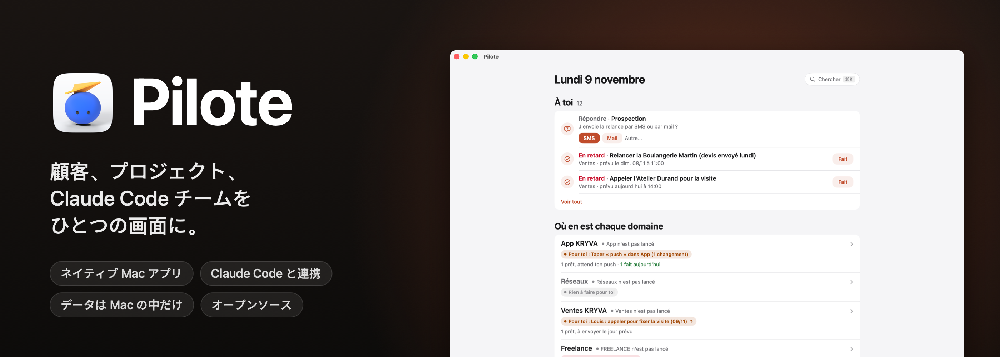

<p align="center">
  
</p>

<p align="center">
  
  
  
  
  
  <a href="../../stargazers"></a>
</p>

<p align="center">
  <a href="README.md">English</a> · <a href="README.fr.md">Français</a> · <a href="README.es.md">Español</a> · <a href="README.pt-BR.md">Português (Brasil)</a> · <a href="README.de.md">Deutsch</a> · <a href="README.it.md">Italiano</a> · <a href="README.zh-CN.md">简体中文</a> · <b>日本語</b> · <a href="README.ko.md">한국어</a>
</p>

<p align="center">
  作者：<b>pjk</b>（Sacha Praljak）·
  <a href="https://sachapraljak.com/?utm_source=github&utm_medium=readme&utm_campaign=pilote">sachapraljak.com</a> ·
  <a href="https://www.instagram.com/sachaprljk/">Instagram</a> ·
  <a href="https://www.tiktok.com/@sachaprljk">TikTok</a>
</p>

<p align="center">
  <b>Pilote が役に立ったら、⭐ を付けてください。ほかの人がこのプロジェクトを見つけやすくなります。</b>
</p>

**Pilote は、Claude Code エージェントのチームと働くフリーランスのための業務ログです。** あなたの対応が必要なことをすべて集めた、macOS ネイティブのアプリです。クライアントとのやり取りのすべて、クライアントごとの次のアクション、リマインダーとカレンダー、そして Claude Code のセッションがいま何をしているか。セッションは MCP サーバー経由で Pilote を読み書きするので、Pilote は常に最新の状態に保たれ、あなたには対応が必要なことだけが見えます。すべてあなたの Mac の中で完結します。ローカルの SQLite データベースを使い、サーバーもアカウントも不要です。

## 1 つのプロンプトでインストール

このプロンプトを Mac 上の Claude Code（または任意のコーディングエージェント）に貼り付けてください。マシンを確認し、Pilote をビルドしてインストールし、接続ごとに 1 つずつ質問し（すべてスキップ可）、Pilote を Claude Code に接続して、最後に何が接続されたかをまとめて表示します。キーがチャットを通ることはありません。同じ内容は [`docs/INSTALL-PROMPT.md`](docs/INSTALL-PROMPT.md) にもあります。手動で行う場合は下の「インストール」を参照してください。プロンプトは英語のままです。

````text
You are going to install Pilote (a native Mac app + a command-line tool + an MCP server for Claude Code) on this Mac, then
connect it, asking me for what you need. Repository: https://github.com/pjksens/pilote . Work in English unless I write
to you in another language, then answer in mine.

GROUND RULES
- Ask me ONE question at a time and wait for my answer. Every connection is optional: if I say "skip" (or "no", or
  "later"), move on and leave it off.
- Before each connection, say in ONE sentence what it is for. Never turn anything on that I did not say yes to.
- Never ask me to paste an API key, token or password in this chat, never print one, never read a secret file back to me
  (no cat, no echo, no logging). To enter a key: create the file with permissions 600 and an empty placeholder, open it in
  an editor for me (`open -e <file>`), tell me exactly where to paste, wait for "done", then check it is not empty
  WITHOUT displaying it. If I paste a secret in the chat anyway, use it, never repeat it, and tell me once that it is now
  in this conversation's history, so I may want to rotate it later.
- Secrets never go inside the git repository. Never commit, never push, never change the repository.
- If a command fails, show me the last 20 lines of its output, say what you think went wrong, and stop and ask before
  trying something else. Do not invent results: if you did not check it, say you did not.

STEP 1. CHECK THE MACHINE
1. `sw_vers -productVersion` must be 15 or later.
2. `xcodebuild -version` must work (full Xcode, not only the command-line tools). If it does not: tell me to install
   Xcode from the App Store, open it once to accept the license, and stop until I say it is done.
3. `xcodegen --version`. If missing, check `brew --version`: if Homebrew exists, propose `brew install xcodegen` and run
   it only after I say yes. If Homebrew is missing, tell me to install it from https://brew.sh, and stop until I say it
   is done (do not run its install script yourself).
4. `git --version` must work.
Tell me in one line what you found.

STEP 2. GET THE CODE AND BUILD
1. Ask me where to put the code. Default: ~/pilote . Moving that folder later breaks the connection to Claude Code, so
   pick a place that stays. If the folder exists and is not a clone of pjksens/pilote, propose another name.
2. `git clone https://github.com/pjksens/pilote.git <folder>` then `cd <folder>`.
3. Warn me, in one sentence, that the next script quits Pilote if it is running and replaces ~/Applications/Pilote.app
   (it stops if another app named Pilote with a different identifier is there). Then run `./scripts/construire.sh`.
   It takes a few minutes. It installs ~/Applications/Pilote.app and puts the `pilote` tool in <folder>.
4. Check that ~/Applications/Pilote.app and <folder>/pilote exist.

STEP 3. SETTINGS (connections)
Pilote reads ONE file: ~/Library/Application Support/io.github.pjksens.pilote/reglages.json (the template is
docs/reglages.exemple.json). Without it, everything that touches an account or a network is off. Keep my answers in
memory and write the file once at the end of this step: `mkdir -p` its folder, then write it with `chmod 600`. Only
write the keys of the connections I accepted. If the file already exists, read it first and merge, never overwrite my
existing values.

Ask these questions, in this order, one at a time:
a. First name ("prenom"). Used in the app ("Camille: call back..."). Default "Vous". Then, optionally, the display
   names of my workspaces ("espaces": internal keys kryva, freelance, autre).
b. Reminders and Calendar ("rappels_calendrier": true): shows today's appointments and reminders. macOS will ask its
   permission the first time the app opens.
c. Mail.app ("mail": true): lets Pilote read received messages and create drafts. It never sends anything on its own.
d. Incoming messages ("entrants": true): the `pilote entrants` collector reads calls, texts, iMessage, WhatsApp and
   received emails on this Mac to log them in the right contact's thread. macOS may ask for extra permissions.
e. A git repository to follow ("depot_suivi": a path): the app shows its latest commits, read only.
f. Secrets folder ("dossier_secrets"). Only ask it if I accept g or h. Default ~/Secrets . Create it with chmod 700 if
   missing. It must not be inside a git repository or a synced folder (iCloud Drive, Dropbox).
g. Publishing to YouTube, Instagram and TikTok ("publication": true, needs the secrets folder). Each post waits for my
   explicit approval in the app before it goes out. Ask which of the two clients I have:
   - Google/YouTube: I need an OAuth client of type "Desktop app" from the Google Cloud console (YouTube Data API v3
     enabled), downloaded as client_secret_....json into ~/Downloads. When I tell you it is there, move the newest one
     to <dossier_secrets>/pilote-google-oauth.json and chmod 600 it (do not open it).
   - TikTok: I need the app's "Client key" and "Client secret" from the TikTok developer portal. Ask me for the Client
     key in the chat (it is public), and tell me to COPY the Client secret to the clipboard (do not paste it in the
     chat). Then run `./pilote publication client-tiktok --cle <Client key>` from the code folder: it reads the secret
     from the clipboard, stores it in <dossier_secrets>/pilote-tiktok-client.json and clears the clipboard.
   Instagram needs nothing here. The accounts themselves are connected afterwards in the app (Pilote > Publications,
   "Connecter"), tokens go to the macOS keychain. Tell me that last part.
h. Radar ("radar": true, needs the secrets folder): watches public numbers of social accounts through ScrapeCreators,
   a paid service billed per credit, and it never runs without my confirmation. If I have a key: create
   <dossier_secrets>/cle-scrapecreators.env containing the single line `SCRAPECREATORS_API_KEY=` , chmod 600, open it for
   me to paste the key after the "=".
i. Sign-ups of my own product ("comptes"): Pilote reads ONE view of a PostgREST/Supabase database, read only, to show
   who signed up and who pays. Only for people who have a product with accounts. If yes: ask for the project URL and
   the view name (default pilote_comptes), and point me to the "comptes" section of the README for the SQL view. The key
   must be a token that can ONLY read that view, NEVER a Supabase service_role / secret key: say it, and refuse one if I
   offer it. Optional: a Stripe restricted key (rk_..., "Subscriptions: Read" only). These keys ("comptes.cle",
   "comptes.stripe_cle") are read by Pilote inside reglages.json itself: write them as empty strings, then open
   reglages.json for me to paste each key between the quotes (do not retype the quotes), and validate the JSON after.
j. Contact sync with a phone ("synchro"): exchanges one workspace's contacts with two remote tables. Same rule for its
   key ("synchro.cle": a token limited to those two tables, never service_role), same editor procedure. Skip if unsure.
k. Forbidden sender domains ("domaines_interdits": a list): Pilote refuses to send an email from them. Only if I name some.
l. Gmail sending is NOT in this file: it is enabled inside the app by pasting a Gmail app password (kept in the macOS
   keychain). Tell me where to do it in the app and move on. Do not ask for the password.

When the file is written, run `<folder>/pilote reglages` and show me its output: it lists what is on and what is off.
Careful: that command says "actif" as soon as a block exists (for example "comptes" with an empty key), so do not call a
connection working unless its key file or key is really filled in (check the size or the emptiness, never the content).

STEP 4. CONNECT MY AGENT
1. Claude Code. Check `claude --version`. Run `claude mcp list`: if a server named "pilote" is already there, tell me
   what it points to and ask before replacing it. Then run, with the ABSOLUTE path:
   `claude mcp add --scope user pilote -- <folder>/pilote mcp`
   and check `claude mcp list` shows pilote as connected.
2. Optional, ask me first: a journal of what my sessions deliver. It needs a "Stop" hook in ~/.claude/settings.json
   that runs `<folder>/pilote journal-crochet`. If I say yes, show me the exact change, merge it into the existing JSON
   without touching anything else (create the file if missing), and validate the JSON afterwards.
3. Any other agent that supports MCP (Cursor, Codex, Gemini CLI, Windsurf...): Pilote is a plain stdio MCP server. Add a
   server named "pilote" with command `<folder>/pilote` and the single argument `mcp`, using that agent's own way of
   adding MCP servers (usually a JSON file with "mcpServers": {"pilote": {"command": "...", "args": ["mcp"]}}). If you
   are not sure how my agent does it, say so instead of guessing.

STEP 5. CHECK AND OPEN
1. Run `<folder>/pilote jour` and confirm it answers without error (an empty day is normal on a fresh install).
2. Run `open ~/Applications/Pilote.app`. Tell me the app is open and to accept the macOS permission prompts for the
   connections I turned on.

STEP 6. RECAP
Finish with a short table with three groups: CONNECTED (what you checked, and how), NOT CONNECTED (what I skipped, and
the one setting that turns it on later), and TO DO BY HAND (Gmail app password in the app; connecting each social
account in Pilote > Publications; the OAuth/TikTok steps I still owe; macOS permission prompts). Add that sessions opened
BEFORE this install do not see the Pilote tools: I must start a new Claude Code session (or restart my agent) to use
them. For each item, only write what you actually verified.
````

<p align="center">
  
  <br><sub>デモモード（<code>./scripts/demo.sh</code>）：架空のデータで、実在の人物は登場しません。</sub>
</p>

> アプリの画面表示とコード内のコメントはフランス語です。この README は 9 言語で用意されていますが、アプリ自体は（まだ）対応していません。

## Pilote でできること

- **1 日をひとつの画面で。** 予定（カレンダー）、今日と期限切れのリマインダー（そのままチェックして完了できます）、Claude が用意してあなたの承認を待っているメッセージ、期限が来たフォローアップ、届いた返信。
- **文脈つきのクライアント管理。** ワークスペースごとに 1 つのアドレス帳があり、ステージ、次のアクション、すべてのやり取り（メール、SMS、通話、訪問）の履歴を残せます。通話の前に、これまでの経緯をすべて確認できます。
- **Claude Code と接続。** MCP サーバーが、Claude のセッションに Pilote を読み書きするためのツール（`jour`、`cherche`、`fiche`、`enregistre_contact`、`ajoute_au_fil`、`marque`、`carte`、`ou_est`、`agents`、`journal`、`note_au_journal`、`publications` など）を提供します。サーバーの指示により、セッションは作成する前に検索し、何も捏造せず、勝手に何も送信しません。
- **エージェント。** Mac で開いている Claude Code のセッション、その状態と直近の動作、そして成果物のジャーナル（Claude Code の `Stop` フックが記録します）。
- **仕事のマップ。** すべてのプロジェクト、そのフォルダー、`ETAT.md`（状態ファイル）、主要なドキュメント。プロジェクト、連絡先、ジャーナル、ファイル（Spotlight）を横断してすべてを検索できます（⌘K）。
- **メールは自分の手で。** 用意されたメールは、あなたがクリックしたときだけ、あなた自身の Gmail から送信されます（SMTP。アプリパスワードは macOS のキーチェーンに保存され、Claude が読むことはありません）。プレーンテキストで、返信は正しいスレッドにまとまります。
- **投稿。** YouTube、Instagram、TikTok への動画投稿を予約できます。公開の前には毎回、明示的な承認が必要です（トークンはキーチェーンに保存）。
- **レーダー。** SNS アカウントを観察します（再生数、投稿のペース、アイデア）。手入力のほか、有料のデータソース経由でも取得できますが、あなたの確認なしに実行されることはありません。

## Claude Code と使う

作業はセッションが行い、Pilote はその様子を見て、返事をする場所です。

<p align="center">
  
  <br><sub>セッションがいま何をしているかを確認し、Pilote を離れずにそのうちの 1 つへメッセージを送れます。</sub>
</p>

セッションが判断を必要とすると、その質問がボタンつきでホーム画面に表示されます。あなたの回答は **「Vos réponses, prêtes à partir」**（あなたの回答、送信待ち）に置かれ、**Envoyer**（送信）をクリックするまで保留されます。セッションに誤って何かが届くことはありません。

<p align="center">
  
  <br><sub>セッションが質問し、あなたはワンクリックで答え、送り出すタイミングも自分で決めます。</sub>
</p>

> **回答がセッションに届く仕組み：** [`scripts/facteur.py`](scripts/facteur.py)、「Facteur」（郵便配達員）です。ホーム画面の **Démarrer le Facteur** ボタンを押すと、指示付きの Claude Code セッションが開きます。このセッションはバックグラウンドで待機し、各回答を数秒以内に適切なセッションへ届けます。届け先は質問したセッション、またはあなたがメッセージを書いたセッションです。なければ `reglages.json` の `facteur.sessions` で指定したセッション、それもなければ `EQUIPE.md` の表にあるセッションです。コードにはセッション ID を一切書いていません。

## ご注意

これは**私個人のシステムを、そのまま公開したもの**ですが、設定で調整できるようにしてあります。キー、フォルダー、名前は 1 つの設定ファイルにまとまっており（「設定」を参照）、アカウントやオンラインサービスに触れる機能は、あなたがオンにするまですべてオフのままです。私自身の使い方の痕跡は残っています。私のワークスペース（内部キーは `kryva`、表示名は変更可能）、Claude セッションのチーム、フランス語のラベルなどです。実際のデータ（連絡先、メッセージ、アカウント、認証情報）はすべて削除するか、架空の値に置き換えてあります。

含まれていないもの：私自身の運用スクリプト（回答の配送、監視、インポート）、私のメモ、私のデータベース。

## 何も接続せずに試す：デモモード

```bash
./scripts/demo.sh             # アプリをビルドし（インストールはせず）、架空のデータで開きます
./scripts/demo.sh --captures  # 下のスクリーンショットを撮り直します（docs/captures）
./scripts/demo.sh --gif       # 3 つのデモを再生して GIF を作り直します（docs/media、ffmpeg が必要）
```

デモモード（`PILOTE_DEMO=1`）では、Pilote はあなたのホームフォルダーの代わりに、起動のたびに新しくなる架空のホームフォルダーを見ます。データベース、Claude セッション、ファイルのすべてがそうです。リマインダー、カレンダー、メール、Spotlight は読み込まず、外部には何も送信されません（メール、セッションへのメッセージ、通知、投稿）。スクリーンショットと GIF はアプリが自分自身のウィンドウを撮影するため、画面収録の権限は不要です。

| | |
|---|---|
|  |  |
|  |  |
|  |  |

スクリーンショットに写っているデータはすべて架空のものです（名前、会社名、フランスの架空用番号帯 06 39 98 00 0x の電話番号、`.example` のアドレス）。

## インストール

macOS 15 以降、Xcode、[XcodeGen](https://github.com/yonaskolb/XcodeGen) が必要です。

```bash
brew install xcodegen
git clone https://github.com/pjksens/pilote.git && cd pilote
./scripts/tester.sh        # ユニットテスト（アプリにもあなたのデータベースにも触れません）
./scripts/construire.sh    # アプリをビルドして ~/Applications にインストールし、./pilote ツールを配置します
```

`construire.sh` は、Pilote が起動していれば終了させてから、`~/Applications/Pilote.app` を置き換えます。そこに別の Pilote という名前のアプリ（別の識別子）がある場合は、何も置き換えずに停止します。このコピーは独自の識別子（`io.github.pjksens.pilote`）と独自のデータフォルダを持ち、同じ Mac にある別の Pilote のデータベースを読み書きすることはありません。

**署名。** このプロジェクトはローカル署名（`CODE_SIGN_IDENTITY: "-"`）を使うため、ビルドし直すたびに macOS が権限を再度確認してきます。権限を保持したい場合は、`project.yml` に自分の Apple チームを設定してください（`DEVELOPMENT_TEAM`、`CODE_SIGN_IDENTITY: "Apple Development"`）。

**権限。** 設定がなければ、Pilote は macOS に何も要求しません。リマインダーとカレンダーは `rappels_calendrier` をオンにしたときだけ、「Mail の制御」（読み取りと下書きのみで、送信はしません）は `mail` をオンにしたときだけ要求されます。アプリはサンドボックス化されていません。Claude Code のセッションを追跡するために `~/.claude` を読み込みます。

## 設定：アカウントを接続する

設定はすべて 1 つの JSON ファイル `~/Library/Application Support/io.github.pjksens.pilote/reglages.json` で行います。テンプレートは [`docs/reglages.exemple.json`](docs/reglages.exemple.json) です。Pilote はファイルが変更されるとすぐに読み直します。`./pilote reglages` を実行すると、何がオンで、何がオフで、何が足りないかが分かります。

**このファイルがなくても**、Pilote は Mac の中だけで単独で動作します（ローカルデータベース、連絡先、マップ、スケジュール、Claude Code のセッション）。**それ以外はすべてオフ**です。リマインダー、カレンダー、メール、連絡先、通話は読み込まれず、データベース、Stripe、SNS へのネットワーク通信も行われません。

このファイルにはキーが入ります。git リポジトリには入れず、自分だけが読めるようにしてください（`chmod 600`）。Pilote がキーをほかの場所に書き込むことはありません。

| 設定 | オンにするもの |
|---|---|
| `prenom` | アプリ内で使うあなたの名前（「Camille : rappeler…」）。既定値：「Vous」（あなた）。 |
| `espaces` | ワークスペースの表示名（内部キーは `kryva`、`freelance`、`autre`）。 |
| `dossiers_sessions`, `routines` | Claude Code のセッションを開くときに候補として出るフォルダーと、ワンクリックで使える指示。 |
| `facteur` | Facteur の届け先：`sessions`（名前 → `local_…` ID）と `rappel`（各メッセージに添える 1 行）。 |
| `depot_suivi` | Pilote が最近のコミットを表示する git リポジトリ（読み取り専用で、`fetch` は行いません）。 |
| `rappels_calendrier: true` | リマインダーとカレンダー（EventKit）。 |
| `mail: true` | Mail.app：受信メッセージ、下書き。 |
| `entrants: true` | `pilote entrants` コレクター：通話、SMS、iMessage、WhatsApp、受信メール。 |
| `publication: true` + `dossier_secrets` | YouTube、Instagram、TikTok への投稿。OAuth クライアントはそのフォルダーに置きます：`pilote-google-oauth.json`、`pilote-tiktok-client.json`。トークンはキーチェーンに保存されます。 |
| `radar: true` + `dossier_secrets` | ScrapeCreators 経由のレーダー（クレジット従量課金）：`cle-scrapecreators.env`（`SCRAPECREATORS_API_KEY=…`）。 |
| `domaines_interdits` | Pilote がメールの送信を拒否するドメイン。そのドメインからの送信を見つけた場合は警告を出します。 |
| `comptes` | あなたのプロダクトのサインアップとそのサブスクリプション（読み取り専用。下記参照）。 |
| `synchro` | 1 つのワークスペースの連絡先を、2 つのリモートテーブルと同期します（下記参照）。 |

Gmail でのメール送信にはこのファイルを使いません。アプリに Gmail のアプリパスワードを貼り付けるまでオフのままです（パスワードはキーチェーンに保存されます）。

### `comptes`：サインアップを読み取り専用で見る

Pilote は、PostgREST 互換の REST API（たとえば Supabase）を通して**1 つのビュー**を読み込みます。あなたのテーブルのことは何も知りません。スキーマの違いはビューが吸収します。必要な列は次のとおりです。

| 列 | 内容 |
|---|---|
| `id` | アカウント ID（text） |
| `entreprise`, `nom`, `email`, `telephone` | テキスト（会社名、氏名、メールアドレス、電話番号） |
| `inscrit_le` | サインアップ日（timestamptz） |
| `devis` | 各サインアップの横に表示したい数値（整数） |
| `abonnement_stripe` | Stripe の `sub_…` ID、または null |
| `store_expire_le` | Apple または Google のサブスクリプションの終了日、または null |
| `actif` | boolean、または null |

```sql
-- 例です。ご自身のスキーマに合わせて調整してください。
create view pilote_comptes with (security_invoker = true) as
select o.id::text as id, o.nom as entreprise, u.nom_complet as nom, u.email, u.telephone,
       o.cree_le as inscrit_le, 0 as devis, o.abonnement_stripe, o.store_expire_le, o.actif
from organisations o left join utilisateurs u on u.organisation_id = o.id;
```

**キー。** Pilote に与える権限は最小限にしてください。**このビューの読み取りだけ**ができるトークンが理想です。たとえば、そのビューに対する `select` 権限だけを持つ専用の Postgres ロールを作ります（そのロールに紐づくトークンの取得方法は、お使いのデータベースのドキュメントを参照してください）。**Supabase の `service_role`（または「secret」）キーは絶対に使わないでください**。このキーはデータベース全体を読み書きでき、行レベルセキュリティも回避します。また、ビューを `anon` ロールから読めるようにするのも避けてください。「anon」キーはあなたのアプリの中で公開されています。

**Stripe**（`stripe_cle`、任意）：「Subscriptions: Read」の権限だけを持つ**制限付きキー**（`rk_…`）を使います。トライアル中のアカウントと有料アカウントを見分けるためのもので、これがない場合、サブスクリプションのあるアカウントは「À vérifier」（要確認）と表示されます。

**カウンター**（`compteur`、任意）：`dossier` で実行されるあなたのコマンドです。`ACTIFS 7 / 10` という行を出力し、続けてセクションの見出しと、その下に 2 スペースでインデントした行を出力します。

### `synchro`：連絡先をスマートフォンで使う

1 つのワークスペース（`espace`、既定は最初のもの）の連絡先とやり取りの履歴を、2 つのテーブル（`table_contacts`、`table_evenements`。既定は `pilote_contacts`、`pilote_evenements`）と同期します。列は `Synchro.colonnesContact` と `Synchro.colonnesEvenement`（`Shared/Synchro.swift`）のものと同じです。Pilote はそこに**書き込みます**。その 2 つのテーブルだけに限定したトークン（`select`、`insert`、`update`）を渡してください。`service_role` は絶対に渡さないでください。

## Claude Code に接続する

```bash
claude mcp add --scope user pilote -- "$(pwd)/pilote" mcp
```

このコマンドの後に開いたセッションでは、Pilote のツールが使えるようになります。エージェントのジャーナルを使うには、`~/.claude/settings.json` に `pilote journal-crochet` を実行する `Stop` フックを追加してください。

## データ

- データベース：`~/Library/Application Support/io.github.pjksens.pilote/pilote.sqlite`（SQLite、WAL）。ほかの接続（ツールや Claude のセッション）が書き込むと、アプリも即座に更新されます。
- 別のデータベースを試す：`PILOTE_BASE=/path/test.sqlite ./pilote jour`。
- メールの送信者名：`PILOTE_NOM`。未設定の場合は、macOS アカウントのフルネームを使います。
- 設定とキー：`~/Library/Application Support/io.github.pjksens.pilote/reglages.json`（「設定」を参照）。
- 毎日のバックアップ：iCloud Drive が有効な場合、`Pilote open source` フォルダに JSON のコピーを保存します（最新 14 件を保持）。
- ツールのヘルプ：`./pilote aide`。

## 仕組み

Swift 5、SwiftUI、AppKit、EventKit、システム標準の SQLite3、Security（キーチェーン）、CryptoKit。外部依存はありません。Swift のコードはおよそ 28,000 行（テストを除く）、ユニットテストは 425 件です。

- `App/`：Mac アプリ（画面、カレンダー、リマインダー、メール、Claude との連携）。
- `Shared/`：モデル、データベース、ルール（アプリ、ツール、テストで共有）。
- `CLI/`：`pilote` ツールと MCP サーバー（`pilote mcp`）。
- `Tests/`：一時データベースを使うユニットテスト。

## 作者

**pjk**（Sacha Praljak）。AI ツールを作り、短い動画で紹介しています。Pilote は Claude Code で作られています。

- サイト：[sachapraljak.com](https://sachapraljak.com/?utm_source=github&utm_medium=readme&utm_campaign=pilote)
- Instagram：[@sachaprljk](https://www.instagram.com/sachaprljk/)
- TikTok：[@sachaprljk](https://www.tiktok.com/@sachaprljk)

Pilote が役に立ったら、リポジトリへの ⭐ とフォローをいただけると大きな励みになります。

## ライセンス

MIT。[LICENSE](LICENSE) を参照してください。
