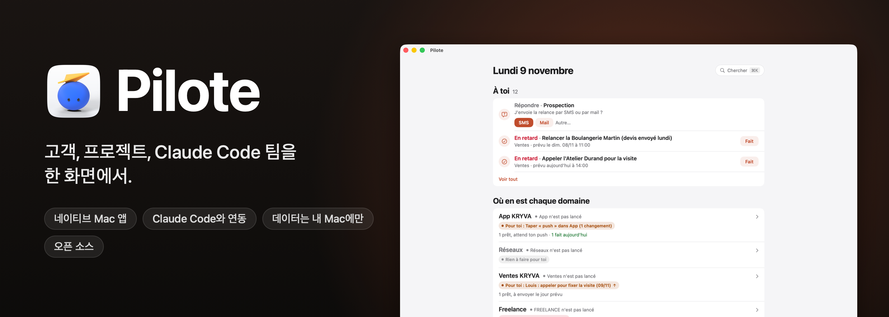

<p align="center">
  
</p>

<p align="center">
  
  
  
  
  
  <a href="../../stargazers"></a>
</p>

<p align="center">
  <a href="README.md">English</a> · <a href="README.fr.md">Français</a> · <a href="README.es.md">Español</a> · <a href="README.pt-BR.md">Português (Brasil)</a> · <a href="README.de.md">Deutsch</a> · <a href="README.it.md">Italiano</a> · <a href="README.zh-CN.md">简体中文</a> · <a href="README.ja.md">日本語</a> · <b>한국어</b>
</p>

<p align="center">
  만든 사람: <b>pjk</b>(Sacha Praljak) ·
  <a href="https://sachapraljak.com/?utm_source=github&utm_medium=readme&utm_campaign=pilote">sachapraljak.com</a> ·
  <a href="https://www.instagram.com/sachaprljk/">Instagram</a> ·
  <a href="https://www.tiktok.com/@sachaprljk">TikTok</a>
</p>

<p align="center">
  <b>Pilote가 도움이 되셨다면 ⭐ 하나가 다른 사람들이 이 프로젝트를 찾는 데 도움이 됩니다.</b>
</p>

**Pilote는 Claude Code 에이전트 팀과 함께 일하는 프리랜서의 업무 일지입니다.** 사용자의 손이 필요한 모든 것을 한곳에 모은 네이티브 Mac 앱입니다. 고객과 주고받은 모든 내용, 고객별 다음 행동, 미리 알림과 캘린더, 그리고 Claude Code 세션이 지금 무엇을 하고 있는지까지 볼 수 있습니다. 세션은 MCP 서버를 통해 Pilote를 읽고 쓰므로 Pilote는 항상 최신 상태로 유지되고, 사용자에게는 직접 처리해야 할 것만 보입니다. 모든 것은 사용자의 Mac 안에 머뭅니다. 로컬 SQLite 데이터베이스를 쓰며, 서버도 계정도 필요 없습니다.

<p align="center">
  
  <br><sub>데모 모드(<code>./scripts/demo.sh</code>): 가상의 데이터이며 실제 인물은 없습니다.</sub>
</p>

> 앱의 인터페이스와 코드 주석은 프랑스어로 되어 있습니다. 이 README는 9개 언어로 제공되지만, 앱은 (아직) 그렇지 않습니다.

## Pilote가 하는 일

- **하루를 한 화면에서.** 일정(캘린더), 오늘과 기한이 지난 미리 알림(바로 체크할 수 있습니다), Claude가 준비해 두고 승인을 기다리는 메시지, 기한이 된 후속 연락, 받은 답장.
- **맥락이 담긴 고객 관리.** 워크스페이스마다 주소록 하나가 있고, 단계, 다음 행동, 모든 대화(이메일, 문자, 통화, 방문)의 전체 기록이 들어 있습니다. 통화하기 전에 지금까지 오간 내용을 모두 볼 수 있습니다.
- **Claude Code와 연결.** MCP 서버가 Claude 세션에 Pilote를 읽고 쓰는 도구(`jour`, `cherche`, `fiche`, `enregistre_contact`, `ajoute_au_fil`, `marque`, `carte`, `ou_est`, `agents`, `journal`, `note_au_journal`, `publications` 등)를 제공합니다. 서버의 지침은 세션이 만들기 전에 먼저 검색하고, 아무것도 지어내지 않으며, 스스로 아무것도 보내지 않도록 합니다.
- **에이전트.** Mac에서 열려 있는 Claude Code 세션, 각 세션의 상태와 마지막 동작, 그리고 세션이 결과물로 낸 내용의 일지(Claude Code의 `Stop` 훅이 채웁니다).
- **업무 지도.** 모든 프로젝트, 해당 폴더, `ETAT.md`(상태 파일), 핵심 문서. 프로젝트, 연락처, 일지, 파일(Spotlight)을 가로질러 전부 검색할 수 있습니다(⌘K).
- **이메일은 사용자가 통제합니다.** 준비된 이메일은 사용자가 클릭할 때만, 사용자 본인의 Gmail에서 발송됩니다(SMTP, 앱 비밀번호는 macOS 키체인에 저장되며 Claude는 절대 읽지 않습니다). 일반 텍스트이며, 답장은 올바른 스레드에 이어집니다.
- **게시.** YouTube, Instagram, TikTok에 동영상 게시를 예약하며, 하나하나 올라가기 전에 명시적인 승인을 받습니다(토큰은 키체인에 저장).
- **레이더.** 소셜 미디어 계정(조회수, 게시 주기, 아이디어)을 살펴봅니다. 직접 입력하거나 유료 데이터 소스로 가져올 수 있으며, 유료 소스는 사용자의 확인 없이는 실행되지 않습니다.

## Claude Code와 함께 쓰기

작업은 세션이 하고, Pilote는 그 상황을 보고 세션에 답하는 곳입니다.

<p align="center">
  
  <br><sub>세션이 지금 무엇을 하는지 확인하고, Pilote를 떠나지 않고 그중 하나에 메시지를 보낼 수 있습니다.</sub>
</p>

세션이 결정을 필요로 하면 그 질문이 선택 버튼과 함께 홈 화면에 나타납니다. 사용자의 답변은 **“Vos réponses, prêtes à partir”**(사용자의 답변, 발송 준비 완료)에 보관되며 **Envoyer**(보내기)를 클릭할 때까지 대기합니다. 어떤 것도 실수로 세션에 전달되지 않습니다.

<p align="center">
  
  <br><sub>세션이 질문하면 한 번의 클릭으로 답하고, 언제 보낼지는 사용자가 정합니다.</sub>
</p>

> **답변이 세션에 전달되는 방식:** [`scripts/facteur.py`](scripts/facteur.py), 즉 “Facteur”(우편배달부)입니다. 홈 화면의 **Démarrer le Facteur** 버튼을 누르면 지침이 담긴 Claude Code 세션이 열립니다. 이 세션은 백그라운드에서 기다리다가 각 답변을 몇 초 안에 알맞은 세션에 전달합니다. 전달 대상은 질문한 세션 또는 사용자가 메시지를 쓴 세션이며, 없으면 `reglages.json`의 `facteur.sessions`에 지정한 세션, 그것도 없으면 `EQUIPE.md` 표에 있는 세션입니다. 코드에는 세션 ID가 전혀 적혀 있지 않습니다.

## 주의 사항

이것은 **제가 개인적으로 쓰는 시스템을 있는 그대로 공개한 것**이며, 설정할 수 있도록 만들었습니다. 키, 폴더, 이름은 하나의 설정 파일에 모여 있고(“설정” 참고), 계정이나 온라인 서비스와 관련된 기능은 사용자가 켜기 전까지 모두 꺼져 있습니다. 제가 쓰던 흔적은 남아 있습니다. 제 워크스페이스(내부 키 `kryva`, 표시 이름은 설정 가능), 제 Claude 세션 팀, 프랑스어 레이블 등입니다. 실제 데이터(연락처, 메시지, 계정, 자격 증명)는 모두 삭제했거나 가상의 값으로 바꿨습니다.

포함되지 않은 것: 제 개인 업무용 스크립트(답변 전달, 감시, 가져오기), 제 메모, 제 데이터베이스.

## 아무것도 연결하지 않고 써 보기: 데모 모드

```bash
./scripts/demo.sh             # 앱을 빌드하고(설치하지 않고) 가상의 데이터로 엽니다
./scripts/demo.sh --captures  # 아래 스크린샷을 다시 찍습니다(docs/captures)
./scripts/demo.sh --gif       # 세 가지 데모를 재생해 GIF를 다시 만듭니다(docs/media, ffmpeg 필요)
```

데모 모드(`PILOTE_DEMO=1`)에서 Pilote는 사용자의 홈 폴더 대신, 실행할 때마다 새로 만들어지는 가상의 홈 폴더를 봅니다. 데이터베이스, Claude 세션, 파일 모두 마찬가지입니다. 미리 알림, 캘린더, 메일, Spotlight는 읽지 않으며, 밖으로 나가는 것도 없습니다(이메일, 세션에 보내는 메시지, 알림, 게시). 스크린샷과 GIF는 앱이 자기 창을 스스로 촬영하므로 화면 기록 권한이 필요 없습니다.

| | |
|---|---|
|  |  |
|  |  |
|  |  |

스크린샷의 모든 데이터는 가상입니다(이름, 회사, 프랑스의 가상 번호 대역 06 39 98 00 0x 전화번호, `.example` 주소).

## 설치

macOS 15 이상, Xcode, [XcodeGen](https://github.com/yonaskolb/XcodeGen)이 필요합니다.

```bash
brew install xcodegen
git clone https://github.com/pjksens/pilote.git && cd pilote
./scripts/tester.sh        # 단위 테스트(앱이나 사용자의 데이터베이스는 건드리지 않습니다)
./scripts/construire.sh    # 앱을 빌드해 ~/Applications에 설치하고 ./pilote 도구를 배치합니다
```

`construire.sh`는 Pilote가 실행 중이면 종료한 뒤 `~/Applications/Pilote.app`을 교체합니다. 그 자리에 Pilote라는 이름의 다른 앱(다른 식별자)이 있으면 아무것도 교체하지 않고 멈춥니다. 이 사본은 자체 식별자(`io.github.pjksens.pilote`)와 자체 데이터 폴더를 가지므로, 같은 Mac에 설치된 다른 Pilote의 데이터베이스를 읽거나 쓰지 않습니다.

**서명.** 이 프로젝트는 로컬 서명(`CODE_SIGN_IDENTITY: "-"`)을 사용하므로, 새로 빌드할 때마다 macOS가 권한을 다시 요청합니다. 권한을 유지하려면 `project.yml`에 사용자의 Apple 팀을 지정하세요(`DEVELOPMENT_TEAM`, `CODE_SIGN_IDENTITY: "Apple Development"`).

**권한.** 설정이 없으면 Pilote는 macOS에 아무것도 요청하지 않습니다. 미리 알림과 캘린더는 `rappels_calendrier`를 켠 경우에만, “Mail 제어”(읽기와 임시 보관만 하며 발송은 하지 않습니다)는 `mail`을 켠 경우에만 요청합니다. 앱은 샌드박스에서 실행되지 않습니다. Claude Code 세션을 따라가기 위해 `~/.claude`를 읽습니다.

## 설정: 계정 연결하기

모든 설정은 JSON 파일 하나로 합니다: `~/Library/Application Support/io.github.pjksens.pilote/reglages.json`. 템플릿은 [`docs/reglages.exemple.json`](docs/reglages.exemple.json)입니다. Pilote는 파일이 바뀌는 즉시 다시 읽습니다. `./pilote reglages`를 실행하면 무엇이 켜져 있고, 무엇이 꺼져 있고, 무엇이 빠져 있는지 알려 줍니다.

**이 파일이 없어도** Pilote는 사용자의 Mac에서 혼자 동작합니다(로컬 데이터베이스, 연락처, 지도, 일정, Claude Code 세션). 그리고 **그 밖의 모든 것은 꺼져 있습니다.** 미리 알림, 캘린더, 메일, 연락처, 통화를 읽지 않으며, 데이터베이스나 Stripe, 소셜 네트워크로 가는 네트워크 호출도 없습니다.

이 파일에는 사용자의 키가 들어 있습니다. 어떤 git 저장소에도 넣지 말고, 본인만 읽을 수 있게 하세요(`chmod 600`). Pilote는 키를 다른 어떤 곳에도 기록하지 않습니다.

| 설정 | 켜지는 기능 |
|---|---|
| `prenom` | 앱에 표시되는 사용자의 이름(“Camille : rappeler…”). 기본값: “Vous”(당신). |
| `espaces` | 워크스페이스의 표시 이름(내부 키 `kryva`, `freelance`, `autre`). |
| `dossiers_sessions`, `routines` | Claude Code 세션을 열 때 제안되는 폴더와, 한 번의 클릭으로 쓰는 지침. |
| `facteur` | Facteur의 전달 대상: `sessions`(이름 → `local_…` ID)와 `rappel`(모든 메시지에 덧붙이는 한 줄). |
| `depot_suivi` | Pilote가 최근 커밋을 보여 주는 git 저장소(읽기 전용이며 `fetch`는 하지 않습니다). |
| `rappels_calendrier: true` | 미리 알림과 캘린더(EventKit). |
| `mail: true` | Mail.app: 받은 메시지, 임시 보관 메일. |
| `entrants: true` | `pilote entrants` 수집기: 통화, 문자, iMessage, WhatsApp, 받은 이메일. |
| `publication: true` + `dossier_secrets` | YouTube, Instagram, TikTok 게시. OAuth 클라이언트는 해당 폴더에 둡니다: `pilote-google-oauth.json`, `pilote-tiktok-client.json`. 토큰은 키체인에 저장됩니다. |
| `radar: true` + `dossier_secrets` | ScrapeCreators를 통한 레이더(크레딧 단위 유료): `cle-scrapecreators.env`(`SCRAPECREATORS_API_KEY=…`). |
| `domaines_interdits` | Pilote가 이메일 발송을 거부하는 도메인. 해당 도메인에서 발송된 메일이 보이면 표시합니다. |
| `comptes` | 사용자 제품의 가입자와 구독 정보(읽기 전용, 아래 참고). |
| `synchro` | 한 워크스페이스의 연락처를 원격 테이블 두 개와 주고받습니다(아래 참고). |

Gmail을 통한 이메일 발송에는 이 파일을 쓰지 않습니다. 앱에 Gmail 앱 비밀번호를 붙여 넣기 전까지는 꺼져 있습니다(비밀번호는 키체인에 저장됩니다).

### `comptes`: 가입자 정보, 읽기 전용

Pilote는 PostgREST 호환 REST API(예: Supabase)를 통해 **뷰 하나**를 읽습니다. 사용자의 테이블은 전혀 알지 못하며, 스키마의 차이는 뷰가 옮겨 줍니다. 필요한 컬럼은 다음과 같습니다.

| 컬럼 | 내용 |
|---|---|
| `id` | 계정 id(text) |
| `entreprise`, `nom`, `email`, `telephone` | 텍스트(회사, 이름, 이메일, 전화번호) |
| `inscrit_le` | 가입일(timestamptz) |
| `devis` | 가입자 옆에 표시하고 싶은 숫자(정수) |
| `abonnement_stripe` | Stripe의 `sub_…` id, 또는 null |
| `store_expire_le` | Apple 또는 Google 구독의 종료일, 또는 null |
| `actif` | boolean 또는 null |

```sql
-- 예시입니다. 사용자의 스키마에 맞게 수정하세요.
create view pilote_comptes with (security_invoker = true) as
select o.id::text as id, o.nom as entreprise, u.nom_complet as nom, u.email, u.telephone,
       o.cree_le as inscrit_le, 0 as devis, o.abonnement_stripe, o.store_expire_le, o.actif
from organisations o left join utilisateurs u on u.organisation_id = o.id;
```

**키.** Pilote에는 가능한 한 적은 권한만 주세요. **이 뷰만 읽을 수 있는** 토큰이 좋습니다. 예를 들어 그 뷰에 `select` 권한만 가진 전용 Postgres 역할을 만드는 방식입니다(그 역할에 연결된 토큰을 얻는 방법은 사용 중인 데이터베이스의 문서를 참고하세요). **Supabase의 `service_role`(또는 “secret”) 키는 절대 사용하지 마세요.** 이 키는 행 수준 보안(row level security)을 우회하여 데이터베이스 전체를 읽고 쓸 수 있습니다. 뷰를 `anon` 역할이 읽을 수 있게 하는 것도 안 됩니다. “anon” 키는 사용자의 앱에서 공개되어 있기 때문입니다.

**Stripe**(`stripe_cle`, 선택): “Subscriptions: Read” 권한 하나만 가진 **제한된 키**(`rk_…`)입니다. 체험 계정과 유료 계정을 구분하는 데 쓰이며, 이 키가 없으면 구독이 있는 계정은 “À vérifier”(확인 필요)로 표시됩니다.

**카운터**(`compteur`, 선택): `dossier`에서 실행되는 사용자의 명령어로, `ACTIFS 7 / 10` 한 줄을 출력하고, 이어서 섹션 제목과 그 아래에 공백 두 칸으로 들여쓴 줄들을 출력합니다.

### `synchro`: 휴대폰에서 쓰는 연락처

한 워크스페이스(`espace`, 기본값은 첫 번째 워크스페이스)의 연락처와 대화 기록을 두 개의 테이블(`table_contacts`, `table_evenements`. 기본값은 `pilote_contacts`, `pilote_evenements`)과 주고받습니다. 컬럼은 `Synchro.colonnesContact`와 `Synchro.colonnesEvenement`(`Shared/Synchro.swift`)의 것과 같습니다. Pilote는 여기에 **씁니다.** 그 두 테이블로만 제한된 토큰(`select`, `insert`, `update`)을 주고, `service_role`은 절대 주지 마세요.

## Claude Code 연결하기

```bash
claude mcp add --scope user pilote -- "$(pwd)/pilote" mcp
```

이 명령을 실행한 뒤에 연 세션에서는 Pilote 도구가 보입니다. 에이전트 일지를 쓰려면 `~/.claude/settings.json`에 `pilote journal-crochet`을 실행하는 `Stop` 훅을 추가하세요.

## 데이터

- 데이터베이스: `~/Library/Application Support/io.github.pjksens.pilote/pilote.sqlite`(SQLite, WAL). 다른 연결(도구나 Claude 세션)이 쓰기를 하면 앱이 곧바로 갱신됩니다.
- 다른 데이터베이스로 시험하기: `PILOTE_BASE=/path/test.sqlite ./pilote jour`.
- 이메일의 발신자 이름: `PILOTE_NOM`. 없으면 macOS 계정의 전체 이름을 씁니다.
- 설정과 키: `~/Library/Application Support/io.github.pjksens.pilote/reglages.json`(“설정” 참고).
- 매일 백업: iCloud Drive가 켜져 있으면 `Pilote open source` 폴더에 JSON 사본을 저장합니다(최근 14개 보관).
- 도구 도움말: `./pilote aide`.

## 구성 방식

Swift 5, SwiftUI, AppKit, EventKit, 시스템 SQLite3, Security(키체인), CryptoKit. 외부 의존성은 없습니다. Swift 코드는 약 28,000줄(테스트 제외), 단위 테스트는 425개입니다.

- `App/`: Mac 앱(화면, 캘린더, 미리 알림, 메일, Claude 연동).
- `Shared/`: 모델, 데이터베이스, 규칙(앱, 도구, 테스트가 함께 사용).
- `CLI/`: `pilote` 도구와 MCP 서버(`pilote mcp`).
- `Tests/`: 임시 데이터베이스를 사용하는 단위 테스트.

## 만든 사람

**pjk**(Sacha Praljak). AI 도구를 만들고 짧은 영상으로 소개합니다. Pilote는 Claude Code로 만들었습니다.

- 사이트: [sachapraljak.com](https://sachapraljak.com/?utm_source=github&utm_medium=readme&utm_campaign=pilote)
- Instagram: [@sachaprljk](https://www.instagram.com/sachaprljk/)
- TikTok: [@sachaprljk](https://www.tiktok.com/@sachaprljk)

Pilote가 도움이 되셨다면 저장소에 ⭐ 하나와 팔로우를 남겨 주시면 큰 힘이 됩니다.

## 라이선스

MIT. [LICENSE](LICENSE)를 참고하세요.
