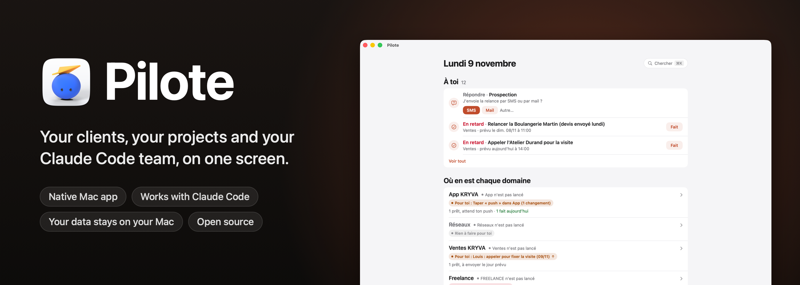
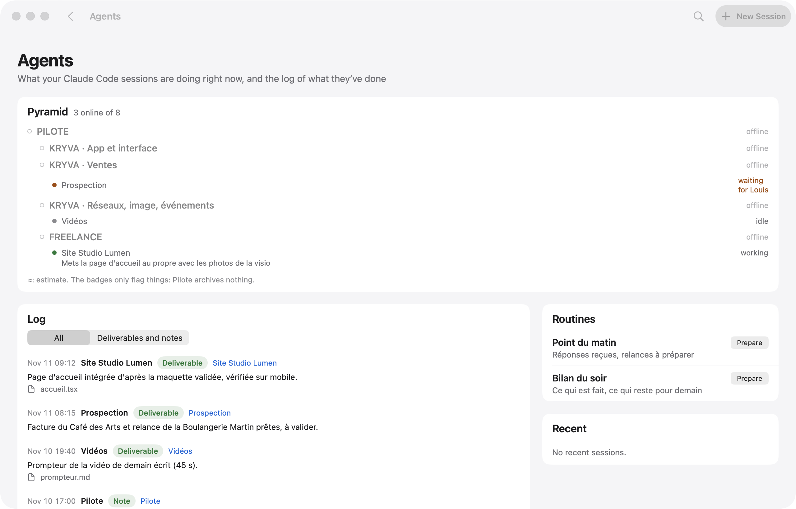
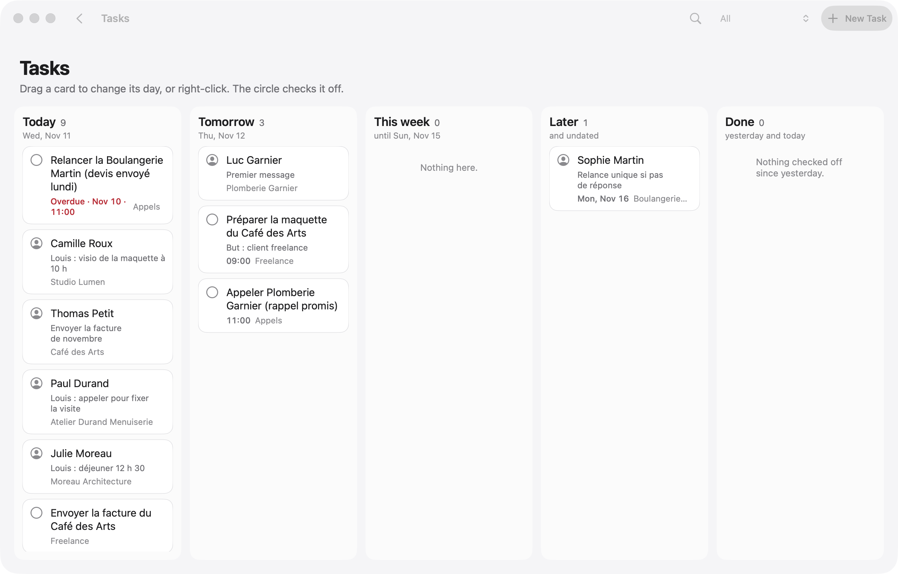

<p align="center">
  
</p>

<p align="center">
  
  
  
  
  
  <a href="../../stargazers"></a>
</p>

<p align="center">
  <b>English</b> · <a href="README.fr.md">Français</a> · <a href="README.es.md">Español</a> · <a href="README.pt-BR.md">Português (Brasil)</a> · <a href="README.de.md">Deutsch</a> · <a href="README.it.md">Italiano</a> · <a href="README.zh-CN.md">简体中文</a> · <a href="README.ja.md">日本語</a> · <a href="README.ko.md">한국어</a>
</p>

<p align="center">
  Made by <b>pjk</b> (Sacha Praljak) ·
  <a href="https://sachapraljak.com/?utm_source=github&utm_medium=readme&utm_campaign=pilote">sachapraljak.com</a> ·
  <a href="https://www.instagram.com/sachaprljk/">Instagram</a> ·
  <a href="https://www.tiktok.com/@sachaprljk">TikTok</a>
</p>

<p align="center">
  <b>If Pilote helps you, a ⭐ helps other people find it.</b>
</p>

**Pilote is the logbook of a freelancer who works with a team of Claude Code agents.** One native Mac app for
everything that needs you: your clients and every exchange with them, the next action for each one, your reminders and
your calendar, and what your Claude Code sessions are doing right now. The sessions read and write Pilote through an
MCP server, so they keep it up to date; you only see what needs you. Everything stays on your Mac: a local SQLite
database, no server, no account.

## Install in one prompt

Paste this prompt in Claude Code (or any coding agent) on your Mac. It checks your machine, builds and installs Pilote, asks you one question at a time for each connection (you can skip any), connects Pilote to Claude Code, then ends with a recap of what is plugged in. Your keys never go through the chat. Same text in [`docs/INSTALL-PROMPT.md`](docs/INSTALL-PROMPT.md); to do it by hand, see “Install” below.

````text
You are going to install Pilote (a native Mac app + a command-line tool + an MCP server for Claude Code) on this Mac, then
connect it, asking me for what you need. Repository: https://github.com/pjksens/pilote . Work in English unless I write
to you in another language, then answer in mine.

GROUND RULES
- Ask me ONE question at a time and wait for my answer. Every connection is optional: if I say "skip" (or "no", or
  "later"), move on and leave it off.
- Before each connection, say in ONE sentence what it is for. Never turn anything on that I did not say yes to.
- Never ask me to paste an API key, token or password in this chat, never print one, never read a secret file back to me
  (no cat, no echo, no logging). To enter a key: create the file with permissions 600 and an empty placeholder, open it in
  an editor for me (`open -e <file>`), tell me exactly where to paste, wait for "done", then check it is not empty
  WITHOUT displaying it. If I paste a secret in the chat anyway, use it, never repeat it, and tell me once that it is now
  in this conversation's history, so I may want to rotate it later.
- Secrets never go inside the git repository. Never commit, never push, never change the repository.
- If a command fails, show me the last 20 lines of its output, say what you think went wrong, and stop and ask before
  trying something else. Do not invent results: if you did not check it, say you did not.

STEP 1. CHECK THE MACHINE
1. `sw_vers -productVersion` must be 15 or later.
2. `xcodebuild -version` must work (full Xcode, not only the command-line tools). If it does not: tell me to install
   Xcode from the App Store, open it once to accept the license, and stop until I say it is done.
3. `xcodegen --version`. If missing, check `brew --version`: if Homebrew exists, propose `brew install xcodegen` and run
   it only after I say yes. If Homebrew is missing, tell me to install it from https://brew.sh, and stop until I say it
   is done (do not run its install script yourself).
4. `git --version` must work.
Tell me in one line what you found.

STEP 2. GET THE CODE AND BUILD
1. Ask me where to put the code. Default: ~/pilote . Moving that folder later breaks the connection to Claude Code, so
   pick a place that stays. If the folder exists and is not a clone of pjksens/pilote, propose another name.
2. `git clone https://github.com/pjksens/pilote.git <folder>` then `cd <folder>`.
3. Warn me, in one sentence, that the next script quits Pilote if it is running and replaces ~/Applications/Pilote.app
   (it stops if another app named Pilote with a different identifier is there). Then run `./scripts/construire.sh`.
   It takes a few minutes. It installs ~/Applications/Pilote.app and puts the `pilote` tool in <folder>.
4. Check that ~/Applications/Pilote.app and <folder>/pilote exist.

STEP 3. SETTINGS (connections)
Pilote reads ONE file: ~/Library/Application Support/io.github.pjksens.pilote/reglages.json (the template is
docs/reglages.exemple.json). Without it, everything that touches an account or a network is off. Keep my answers in
memory and write the file once at the end of this step: `mkdir -p` its folder, then write it with `chmod 600`. Only
write the keys of the connections I accepted. If the file already exists, read it first and merge, never overwrite my
existing values.

Ask these questions, in this order, one at a time:
a. First name ("prenom"). Used in the app ("Camille: call back..."). Default "Vous". Then, optionally, the display
   names of my workspaces ("espaces": internal keys kryva, freelance, autre).
b. Reminders and Calendar ("rappels_calendrier": true): shows today's appointments and reminders. macOS will ask its
   permission the first time the app opens.
c. Mail.app ("mail": true): lets Pilote read received messages and create drafts. It never sends anything on its own.
d. Incoming messages ("entrants": true): the `pilote entrants` collector reads calls, texts, iMessage, WhatsApp and
   received emails on this Mac to log them in the right contact's thread. macOS may ask for extra permissions.
e. A git repository to follow ("depot_suivi": a path): the app shows its latest commits, read only.
f. Secrets folder ("dossier_secrets"). Only ask it if I accept g or h. Default ~/Secrets . Create it with chmod 700 if
   missing. It must not be inside a git repository or a synced folder (iCloud Drive, Dropbox).
g. Publishing to YouTube, Instagram and TikTok ("publication": true, needs the secrets folder). Each post waits for my
   explicit approval in the app before it goes out. Ask which of the two clients I have:
   - Google/YouTube: I need an OAuth client of type "Desktop app" from the Google Cloud console (YouTube Data API v3
     enabled), downloaded as client_secret_....json into ~/Downloads. When I tell you it is there, move the newest one
     to <dossier_secrets>/pilote-google-oauth.json and chmod 600 it (do not open it).
   - TikTok: I need the app's "Client key" and "Client secret" from the TikTok developer portal. Ask me for the Client
     key in the chat (it is public), and tell me to COPY the Client secret to the clipboard (do not paste it in the
     chat). Then run `./pilote publication client-tiktok --cle <Client key>` from the code folder: it reads the secret
     from the clipboard, stores it in <dossier_secrets>/pilote-tiktok-client.json and clears the clipboard.
   Instagram needs nothing here. The accounts themselves are connected afterwards in the app (Pilote > Publications,
   "Connecter"), tokens go to the macOS keychain. Tell me that last part.
h. Radar ("radar": true, needs the secrets folder): watches public numbers of social accounts through ScrapeCreators,
   a paid service billed per credit, and it never runs without my confirmation. If I have a key: create
   <dossier_secrets>/cle-scrapecreators.env containing the single line `SCRAPECREATORS_API_KEY=` , chmod 600, open it for
   me to paste the key after the "=".
i. Sign-ups of my own product ("comptes"): Pilote reads ONE view of a PostgREST/Supabase database, read only, to show
   who signed up and who pays. Only for people who have a product with accounts. If yes: ask for the project URL and
   the view name (default pilote_comptes), and point me to the "comptes" section of the README for the SQL view. The key
   must be a token that can ONLY read that view, NEVER a Supabase service_role / secret key: say it, and refuse one if I
   offer it. Optional: a Stripe restricted key (rk_..., "Subscriptions: Read" only). These keys ("comptes.cle",
   "comptes.stripe_cle") are read by Pilote inside reglages.json itself: write them as empty strings, then open
   reglages.json for me to paste each key between the quotes (do not retype the quotes), and validate the JSON after.
j. Contact sync with a phone ("synchro"): exchanges one workspace's contacts with two remote tables. Same rule for its
   key ("synchro.cle": a token limited to those two tables, never service_role), same editor procedure. Skip if unsure.
k. Forbidden sender domains ("domaines_interdits": a list): Pilote refuses to send an email from them. Only if I name some.
l. Gmail sending is NOT in this file: it is enabled inside the app by pasting a Gmail app password (kept in the macOS
   keychain). Tell me where to do it in the app and move on. Do not ask for the password.

When the file is written, run `<folder>/pilote reglages` and show me its output: it lists what is on and what is off.
Careful: that command says "actif" as soon as a block exists (for example "comptes" with an empty key), so do not call a
connection working unless its key file or key is really filled in (check the size or the emptiness, never the content).

STEP 4. CONNECT MY AGENT
1. Claude Code. Check `claude --version`. Run `claude mcp list`: if a server named "pilote" is already there, tell me
   what it points to and ask before replacing it. Then run, with the ABSOLUTE path:
   `claude mcp add --scope user pilote -- <folder>/pilote mcp`
   and check `claude mcp list` shows pilote as connected.
2. Optional, ask me first: a journal of what my sessions deliver. It needs a "Stop" hook in ~/.claude/settings.json
   that runs `<folder>/pilote journal-crochet`. If I say yes, show me the exact change, merge it into the existing JSON
   without touching anything else (create the file if missing), and validate the JSON afterwards.
3. Any other agent that supports MCP (Cursor, Codex, Gemini CLI, Windsurf...): Pilote is a plain stdio MCP server. Add a
   server named "pilote" with command `<folder>/pilote` and the single argument `mcp`, using that agent's own way of
   adding MCP servers (usually a JSON file with "mcpServers": {"pilote": {"command": "...", "args": ["mcp"]}}). If you
   are not sure how my agent does it, say so instead of guessing.

STEP 5. CHECK AND OPEN
1. Run `<folder>/pilote jour` and confirm it answers without error (an empty day is normal on a fresh install).
2. Run `open ~/Applications/Pilote.app`. Tell me the app is open and to accept the macOS permission prompts for the
   connections I turned on.

STEP 6. RECAP
Finish with a short table with three groups: CONNECTED (what you checked, and how), NOT CONNECTED (what I skipped, and
the one setting that turns it on later), and TO DO BY HAND (Gmail app password in the app; connecting each social
account in Pilote > Publications; the OAuth/TikTok steps I still owe; macOS permission prompts). Add that sessions opened
BEFORE this install do not see the Pilote tools: I must start a new Claude Code session (or restart my agent) to use
them. For each item, only write what you actually verified.
````

<p align="center">
  
  <br><sub>Demo mode (<code>./scripts/demo.sh</code>): invented data, no real people.</sub>
</p>

> The app follows your Mac's language: English, French or Spanish (English for any other language). Code comments, the `pilote` command-line tool and the MCP server stay in French. This README exists in nine languages.

## What Pilote does

- **One screen for the day.** Appointments (Calendar), today's and overdue reminders (Reminders, tick them off), messages
  prepared by Claude waiting for your approval, follow-ups that are due, replies you received.
- **Clients with their context.** One address book per workspace, with the stage, the next action and the full thread of
  every exchange (email, text, call, visit). Before a call, you see everything that was said.
- **Claude Code plugged in.** An MCP server gives your Claude sessions tools to read and write Pilote (`jour`, `cherche`,
  `fiche`, `enregistre_contact`, `ajoute_au_fil`, `marque`, `carte`, `ou_est`, `agents`, `journal`, `note_au_journal`,
  `publications`…). The server's instructions tell them to search before creating, to invent nothing and to send nothing
  on their own.
- **Agents.** The Claude Code sessions open on your Mac, their state and their last action, and a journal of what they
  delivered (filled by a Claude Code `Stop` hook).
- **A map of your work.** Every project, its folder, its `ETAT.md` (status file), its key documents; search everything
  (⌘K) across projects, contacts, journal and files (Spotlight).
- **Email under control.** A prepared email leaves only when you click, from your Gmail (SMTP, app password kept in the
  macOS keychain, never read by Claude). Plain text, replies stay in the right thread.
- **Pip, optional.** If [Pip](https://github.com/pjksens/heypip) (a Mac notch app that follows calls) is installed, a “Launch Pip” button appears on a video call from your calendar: Pip opens with the call's name and the linked contact. Optionally Pilote opens it by itself two minutes before. Pip only records after your own click, and once Claude has written the call's summary, Pilote files it in the contact's thread. It reads your calendar, so it follows `rappels_calendrier`, off by default.
- **Publishing.** Schedule videos on YouTube, Instagram and TikTok, with an explicit approval before each one goes out
  (tokens in the keychain).
- **Radar.** Watch social media accounts (views, posting rhythm, ideas), entered by hand or through a paid source that
  never runs without your confirmation.

## With Claude Code

Your sessions do the work; Pilote is where you see it and where you answer them.

<p align="center">
  
  <br><sub>What your sessions are doing, and a message to one of them, without leaving Pilote.</sub>
</p>

When a session needs a decision, its question shows up on the home screen with its buttons. Your answer waits in
**“Your replies, ready to go”** until you click **Send**: nothing reaches a
session by accident.

<p align="center">
  
  <br><sub>A session asks, you answer in one click, and you choose when it leaves.</sub>
</p>

> **How your answers reach the sessions:** [`scripts/facteur.py`](scripts/facteur.py), the “Facteur” (mail carrier).
> The **Start Facteur** button on the home screen opens a Claude Code session with its instructions: it waits in
> the background and hands each answer to the right session within seconds. That is the session that asked or that you
> wrote to; otherwise the one named in `facteur.sessions` in `reglages.json`; otherwise the one in the table of
> `EQUIPE.md`. No session ID is written in the code.

## A word of warning

This is **my personal system, published as is**, made configurable: your keys, your folders and your first name live in
one settings file (see “Settings”), and everything that touches an account or an online service stays off until you turn
it on. Traces of my own use remain: my workspaces (internal key `kryva`, display name configurable), my team of Claude
sessions, French labels. All real data (contacts, messages, accounts, credentials) was removed or replaced with
invented values.

Not included: my own organisation scripts (answer delivery, watch, imports), my notes and my database.

## Try it without connecting anything: demo mode

```bash
./scripts/demo.sh             # builds the app (without installing it) and opens it with invented data
./scripts/demo.sh --captures  # retakes the screenshots below (docs/captures)
./scripts/demo.sh --gif       # replays the three demos and rebuilds the GIFs (docs/media, needs ffmpeg)
```

In demo mode (`PILOTE_DEMO=1`), Pilote sees a fictional home folder, fresh at every launch, instead of yours: database,
Claude sessions, files. It reads neither Reminders, Calendar, Mail nor Spotlight, and nothing leaves (email, message to a
session, notification, post). Screenshots and GIFs are taken by the app itself, of its own window: no screen recording
permission.

| | |
|---|---|
|  |  |
|  |  |
|  |  |

Every piece of data in the screenshots is invented (names, companies, phone numbers in the French fiction range
06 39 98 00 0x, addresses in `.example`).

## Install

You need macOS 15 or later, Xcode and [XcodeGen](https://github.com/yonaskolb/XcodeGen).

```bash
brew install xcodegen
git clone https://github.com/pjksens/pilote.git && cd pilote
./scripts/tester.sh        # unit tests (they touch neither the app nor your database)
./scripts/construire.sh    # builds the app, installs it in ~/Applications and puts the ./pilote tool in place
```

`construire.sh` quits Pilote if it is running, then replaces `~/Applications/Pilote.app`. If another app named Pilote is already there (another identifier), it stops and replaces nothing. This copy has its own identifier (`io.github.pjksens.pilote`) and its own data folder: it never reads or writes the database of another Pilote installed on the same Mac.

**Signing.** The project signs locally (`CODE_SIGN_IDENTITY: "-"`), so macOS asks for permissions again with every new
build. To keep them, put your Apple team in `project.yml` (`DEVELOPMENT_TEAM`, `CODE_SIGN_IDENTITY: "Apple Development"`).

**Permissions.** Without settings, Pilote asks macOS for nothing. Reminders and Calendars are requested only if you turn
on `rappels_calendrier`, “control Mail” (reading and drafts, never sending) only if you turn on `mail`. The app is not
sandboxed: it reads `~/.claude` to follow your Claude Code sessions.

## Settings: connect your accounts

Everything goes through one JSON file: `~/Library/Application Support/io.github.pjksens.pilote/reglages.json`. Template:
[`docs/reglages.exemple.json`](docs/reglages.exemple.json). Pilote rereads it as soon as it changes.
`./pilote reglages` tells you what is on, what is off and what is missing.

**Without this file**, Pilote works on its own on your Mac (local database, contacts, map, planning, Claude Code
sessions) and **everything else is off**: no reading of Reminders, Calendar, Mail, Contacts or calls, no network call to
a database, to Stripe or to a social network.

This file holds your keys: keep it out of any git repository and readable by you only (`chmod 600`). Pilote never writes
a key anywhere else.

| Setting | What it turns on |
|---|---|
| `prenom` | Your first name in the app (“Camille: call back…”). Default: “Vous” (you). |
| `espaces` | The display names of your workspaces (internal keys `kryva`, `freelance`, `autre`). |
| `dossiers_sessions`, `routines` | The folders offered when you open a Claude Code session, and your one-click instructions. |
| `facteur` | Where the Facteur delivers: `sessions` (name → `local_…` ID) and `rappel` (a line added to every message). |
| `depot_suivi` | A git repository whose recent commits Pilote shows (read only, no `fetch`). |
| `rappels_calendrier: true` | Reminders and Calendar (EventKit). |
| `mail: true` | Mail.app: received messages, drafts. |
| `entrants: true` | The `pilote entrants` collector: calls, texts, iMessage, WhatsApp, received emails. |
| `publication: true` + `dossier_secrets` | Publishing to YouTube, Instagram, TikTok. OAuth clients in that folder: `pilote-google-oauth.json`, `pilote-tiktok-client.json`. Tokens in the keychain. |
| `radar: true` + `dossier_secrets` | Radar through ScrapeCreators (paid per credit): `cle-scrapecreators.env` (`SCRAPECREATORS_API_KEY=…`). |
| `domaines_interdits` | Domains Pilote refuses to send an email from, and flags if it sees one go out. |
| `comptes` | The sign-ups of your product and their subscription, read only (below). |
| `synchro` | The contacts of one workspace, exchanged with two remote tables (below). |

Sending email through Gmail does not use this file: it stays off until you paste a Gmail app password in the app (kept in
the keychain).

### `comptes`: your sign-ups, read only

Pilote reads **one view**, through a PostgREST-compatible REST API (Supabase, for example). It knows none of your
tables: the view translates your schema. Expected columns:

| Column | Content |
|---|---|
| `id` | account id (text) |
| `entreprise`, `nom`, `email`, `telephone` | text (company, name, email, phone) |
| `inscrit_le` | sign-up date (timestamptz) |
| `devis` | a number (integer) you want to see next to each sign-up |
| `abonnement_stripe` | the Stripe `sub_…` id, or null |
| `store_expire_le` | end of the Apple or Google subscription, or null |
| `actif` | boolean, or null |

```sql
-- Example, to adapt to your schema.
create view pilote_comptes with (security_invoker = true) as
select o.id::text as id, o.nom as entreprise, u.nom_complet as nom, u.email, u.telephone,
       o.cree_le as inscrit_le, 0 as devis, o.abonnement_stripe, o.store_expire_le, o.actif
from organisations o left join utilisateurs u on u.organisation_id = o.id;
```

**The key.** Give Pilote as few rights as possible: a token that can only **read this view**, for example a dedicated
Postgres role with nothing but `select` on it (see your database's documentation to get a token tied to that role).
**Never the Supabase `service_role` (or “secret”) key**: it opens the whole database, read and write, bypassing row level
security. Do not make the view readable by the `anon` role either: the “anon” key is public in your apps.

**Stripe** (`stripe_cle`, optional): a **restricted key** (`rk_…`) with the single permission “Subscriptions: Read”. It
tells trials from paying accounts; without it, an account with a subscription shows as “To check”.

**Counter** (`compteur`, optional): a command of yours, run in `dossier`, that prints a line `ACTIFS 7 / 10`, then
section titles followed by lines indented by two spaces.

### `synchro`: your contacts on a phone

Exchanges the contacts and the thread of one workspace (`espace`, default: the first one) with two tables
(`table_contacts`, `table_evenements`; default `pilote_contacts`, `pilote_evenements`) whose columns are those of
`Synchro.colonnesContact` and `Synchro.colonnesEvenement` (`Shared/Synchro.swift`). Pilote **writes** there: give it a
token limited to those two tables (`select`, `insert`, `update`), never `service_role`.

## Connect Claude Code

```bash
claude mcp add --scope user pilote -- "$(pwd)/pilote" mcp
```

Sessions opened after this command see the Pilote tools. For the agents' journal, add a `Stop` hook in
`~/.claude/settings.json` that runs `pilote journal-crochet`.

## Data

- Database: `~/Library/Application Support/io.github.pjksens.pilote/pilote.sqlite` (SQLite, WAL). The app updates as soon as another
  connection (the tool, a Claude session) writes to it.
- Try another database: `PILOTE_BASE=/path/test.sqlite ./pilote jour`.
- Sender name for emails: `PILOTE_NOM`, otherwise the full name of your macOS account.
- Settings and keys: `~/Library/Application Support/io.github.pjksens.pilote/reglages.json` (see “Settings”).
- Daily backup: a JSON copy in iCloud Drive, folder `Pilote open source` (the last 14 are kept), if iCloud Drive is on.
- Tool help: `./pilote aide`.

## How it is built

Swift 5, SwiftUI, AppKit, EventKit, the system's SQLite3, Security (keychain), CryptoKit. No external dependency. About
28,000 lines of Swift (tests excluded), 425 unit tests.

- `App/`: the Mac app (screens, Calendar, Reminders, Mail and Claude integrations).
- `Shared/`: the model, the database, the rules (shared by the app, the tool and the tests).
- `CLI/`: the `pilote` tool and the MCP server (`pilote mcp`).
- `Tests/`: unit tests, on temporary databases.

## Made by

**pjk** (Sacha Praljak). I build AI tools and show them in short videos. Pilote is built with Claude Code.

- Site: [sachapraljak.com](https://sachapraljak.com/?utm_source=github&utm_medium=readme&utm_campaign=pilote)
- Instagram: [@sachaprljk](https://www.instagram.com/sachaprljk/)
- TikTok: [@sachaprljk](https://www.tiktok.com/@sachaprljk)

If Pilote helps you, a ⭐ on the repo and a follow help a lot.

## License

MIT, see [LICENSE](LICENSE).
