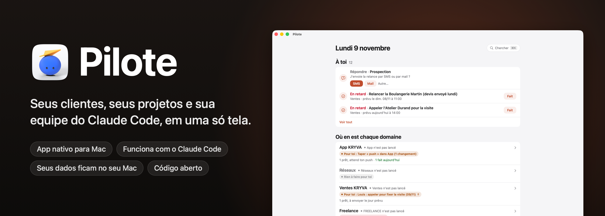

<p align="center">
  
</p>

<p align="center">
  
  
  
  
  
  <a href="../../stargazers"></a>
</p>

<p align="center">
  <a href="README.md">English</a> · <a href="README.fr.md">Français</a> · <a href="README.es.md">Español</a> · <b>Português (Brasil)</b> · <a href="README.de.md">Deutsch</a> · <a href="README.it.md">Italiano</a> · <a href="README.zh-CN.md">简体中文</a> · <a href="README.ja.md">日本語</a> · <a href="README.ko.md">한국어</a>
</p>

<p align="center">
  Feito por <b>pjk</b> (Sacha Praljak) ·
  <a href="https://sachapraljak.com/?utm_source=github&utm_medium=readme&utm_campaign=pilote">sachapraljak.com</a> ·
  <a href="https://www.instagram.com/sachaprljk/">Instagram</a> ·
  <a href="https://www.tiktok.com/@sachaprljk">TikTok</a>
</p>

<p align="center">
  <b>Se o Pilote ajuda você, uma ⭐ ajuda outras pessoas a encontrá-lo.</b>
</p>

**O Pilote é o diário de bordo de um freelancer que trabalha com uma equipe de agentes do Claude Code.** Um único app
nativo para Mac com tudo o que precisa de você: seus clientes e cada conversa com eles, a próxima ação de cada um, seus
lembretes e sua agenda, e o que suas sessões do Claude Code estão fazendo agora mesmo. As sessões leem e escrevem no
Pilote por meio de um servidor MCP, então elas o mantêm atualizado; você só vê o que precisa de você. Tudo fica no seu
Mac: um banco de dados SQLite local, sem servidor, sem conta.

<p align="center">
  
  <br><sub>Modo demo (<code>./scripts/demo.sh</code>): dados inventados, nenhuma pessoa real.</sub>
</p>

> A interface do app e os comentários do código estão em francês. Este README existe em nove idiomas; o app, ainda não.

## O que o Pilote faz

- **Uma tela para o dia.** Compromissos (Calendário), lembretes de hoje e atrasados (Lembretes, você os marca como
  feitos), mensagens preparadas pelo Claude aguardando sua aprovação, acompanhamentos que vencem, respostas recebidas.
- **Clientes com o seu contexto.** Uma agenda de contatos por espaço de trabalho, com a etapa, a próxima ação e todo o
  histórico de conversas (e-mail, mensagem de texto, ligação, visita). Antes de uma ligação, você vê tudo o que foi dito.
- **Claude Code conectado.** Um servidor MCP dá às suas sessões do Claude ferramentas para ler e escrever no Pilote
  (`jour`, `cherche`, `fiche`, `enregistre_contact`, `ajoute_au_fil`, `marque`, `carte`, `ou_est`, `agents`, `journal`,
  `note_au_journal`, `publications`…). As instruções do servidor mandam que elas busquem antes de criar, não inventem
  nada e não enviem nada por conta própria.
- **Agentes.** As sessões do Claude Code abertas no seu Mac, o estado delas e a última ação, e um diário do que
  entregaram (preenchido por um hook `Stop` do Claude Code).
- **Um mapa do seu trabalho.** Cada projeto, sua pasta, seu `ETAT.md` (arquivo de status), seus documentos principais;
  busque em tudo (⌘K) entre projetos, contatos, diário e arquivos (Spotlight).
- **E-mail sob controle.** Um e-mail preparado só sai quando você clica, a partir do seu Gmail (SMTP, senha de app
  guardada no chaveiro do macOS, nunca lida pelo Claude). Texto simples, e as respostas ficam na conversa certa.
- **Publicação.** Agende vídeos no YouTube, Instagram e TikTok, com uma aprovação explícita antes de cada um sair
  (tokens no chaveiro).
- **Radar.** Acompanhe contas de redes sociais (visualizações, ritmo de postagem, ideias), inseridas à mão ou por meio
  de uma fonte paga que nunca roda sem a sua confirmação.

## Com o Claude Code

Suas sessões fazem o trabalho; o Pilote é onde você o vê e onde você responde a elas.

<p align="center">
  
  <br><sub>O que suas sessões estão fazendo, e uma mensagem para uma delas, sem sair do Pilote.</sub>
</p>

Quando uma sessão precisa de uma decisão, a pergunta dela aparece na tela inicial com seus botões. Sua resposta espera em
**“Vos réponses, prêtes à partir”** (suas respostas, prontas para sair) até você clicar em **Envoyer** (enviar): nada
chega a uma sessão por acidente.

<p align="center">
  
  <br><sub>Uma sessão pergunta, você responde com um clique e escolhe quando sai.</sub>
</p>

> **Como suas respostas chegam às sessões:** [`scripts/facteur.py`](scripts/facteur.py), o “Facteur” (o carteiro).
> O botão **Démarrer le Facteur** da tela inicial abre uma sessão do Claude Code com as instruções dele: ela espera em
> segundo plano e entrega cada resposta à sessão certa em poucos segundos. É a sessão que fez a pergunta ou para a qual
> você escreveu; se não, a indicada em `facteur.sessions` no `reglages.json`; se não, a da tabela do `EQUIPE.md`.
> Nenhum identificador de sessão está escrito no código.

## Um aviso

Este é o **meu sistema pessoal, publicado como está**, tornado configurável: suas chaves, suas pastas e seu primeiro
nome ficam em um único arquivo de configurações (veja “Configurações”), e tudo o que toca uma conta ou um serviço online
permanece desligado até você ligar. Restam vestígios do meu próprio uso: meus espaços de trabalho (chave interna
`kryva`, nome de exibição configurável), minha equipe de sessões do Claude, rótulos em francês. Todos os dados reais
(contatos, mensagens, contas, credenciais) foram removidos ou substituídos por valores inventados.

Não incluídos: meus próprios scripts de organização (entrega de respostas, monitoramento, importações), minhas notas e
meu banco de dados.

## Experimente sem conectar nada: modo demo

```bash
./scripts/demo.sh             # compila o app (sem instalá-lo) e o abre com dados inventados
./scripts/demo.sh --captures  # refaz as capturas de tela abaixo (docs/captures)
./scripts/demo.sh --gif       # reproduz as três demos e refaz os GIFs (docs/media, requer ffmpeg)
```

No modo demo (`PILOTE_DEMO=1`), o Pilote enxerga uma pasta pessoal fictícia, nova a cada abertura, no lugar da sua:
banco de dados, sessões do Claude, arquivos. Ele não lê Lembretes, Calendário, Mail nem Spotlight, e nada sai (e-mail,
mensagem para uma sessão, notificação, postagem). As capturas de tela e os GIFs são feitos pelo próprio app, da sua
própria janela: sem permissão de gravação de tela.

| | |
|---|---|
|  |  |
|  |  |
|  |  |

Todos os dados das capturas de tela são inventados (nomes, empresas, números de telefone na faixa de ficção francesa
06 39 98 00 0x, endereços em `.example`).

## Instalação

Você precisa do macOS 15 ou posterior, do Xcode e do [XcodeGen](https://github.com/yonaskolb/XcodeGen).

```bash
brew install xcodegen
git clone https://github.com/pjksens/pilote.git && cd pilote
./scripts/tester.sh        # testes unitários (não tocam no app nem no seu banco de dados)
./scripts/construire.sh    # compila o app, instala em ~/Applications e coloca a ferramenta ./pilote no lugar
```

O `construire.sh` fecha o Pilote se ele estiver rodando e depois substitui `~/Applications/Pilote.app`. Se já houver outro app chamado Pilote (com outro identificador), ele para sem substituir nada. Esta cópia tem seu próprio identificador (`io.github.pjksens.pilote`) e sua própria pasta de dados: ela nunca lê nem grava o banco de dados de outro Pilote instalado no mesmo Mac.

**Assinatura.** O projeto assina localmente (`CODE_SIGN_IDENTITY: "-"`), então o macOS pede as permissões de novo a cada
nova compilação. Para mantê-las, coloque o seu time da Apple em `project.yml` (`DEVELOPMENT_TEAM`,
`CODE_SIGN_IDENTITY: "Apple Development"`).

**Permissões.** Sem configurações, o Pilote não pede nada ao macOS. Lembretes e Calendários só são solicitados se você
ativar `rappels_calendrier`, e “controlar o Mail” (leitura e rascunhos, nunca envio) só se você ativar `mail`. O app não
usa sandbox: ele lê `~/.claude` para acompanhar suas sessões do Claude Code.

## Configurações: conecte suas contas

Tudo passa por um único arquivo JSON: `~/Library/Application Support/io.github.pjksens.pilote/reglages.json`. Modelo:
[`docs/reglages.exemple.json`](docs/reglages.exemple.json). O Pilote o relê assim que ele muda.
`./pilote reglages` diz o que está ligado, o que está desligado e o que está faltando.

**Sem este arquivo**, o Pilote funciona sozinho no seu Mac (banco de dados local, contatos, mapa, planejamento, sessões
do Claude Code) e **todo o resto fica desligado**: nenhuma leitura de Lembretes, Calendário, Mail, Contatos ou
ligações, nenhuma chamada de rede a um banco de dados, ao Stripe ou a uma rede social.

Este arquivo guarda suas chaves: mantenha-o fora de qualquer repositório git e legível somente por você (`chmod 600`).
O Pilote nunca grava uma chave em nenhum outro lugar.

| Configuração | O que ela liga |
|---|---|
| `prenom` | Seu primeiro nome no app (“Camille : rappeler…”). Padrão: “Vous” (você). |
| `espaces` | Os nomes de exibição dos seus espaços de trabalho (chaves internas `kryva`, `freelance`, `autre`). |
| `dossiers_sessions`, `routines` | As pastas oferecidas ao abrir uma sessão do Claude Code, e suas instruções de um clique. |
| `facteur` | Para onde o Facteur entrega: `sessions` (nome → ID `local_…`) e `rappel` (uma linha adicionada a cada mensagem). |
| `depot_suivi` | Um repositório git cujos commits recentes o Pilote mostra (somente leitura, sem `fetch`). |
| `rappels_calendrier: true` | Lembretes e Calendário (EventKit). |
| `mail: true` | Mail.app: mensagens recebidas, rascunhos. |
| `entrants: true` | O coletor `pilote entrants`: ligações, mensagens de texto, iMessage, WhatsApp, e-mails recebidos. |
| `publication: true` + `dossier_secrets` | Publicação no YouTube, Instagram, TikTok. Clientes OAuth nessa pasta: `pilote-google-oauth.json`, `pilote-tiktok-client.json`. Tokens no chaveiro. |
| `radar: true` + `dossier_secrets` | Radar via ScrapeCreators (pago por crédito): `cle-scrapecreators.env` (`SCRAPECREATORS_API_KEY=…`). |
| `domaines_interdits` | Domínios a partir dos quais o Pilote se recusa a enviar um e-mail, e que ele sinaliza se vir um sair. |
| `comptes` | Os cadastros do seu produto e a assinatura deles, somente leitura (abaixo). |
| `synchro` | Os contatos de um espaço de trabalho, trocados com duas tabelas remotas (abaixo). |

O envio de e-mail pelo Gmail não usa este arquivo: ele permanece desligado até você colar uma senha de app do Gmail no
app (guardada no chaveiro).

### `comptes`: seus cadastros, somente leitura

O Pilote lê **uma view**, por meio de uma API REST compatível com PostgREST (Supabase, por exemplo). Ele não conhece
nenhuma das suas tabelas: a view traduz o seu esquema. Colunas esperadas:

| Coluna | Conteúdo |
|---|---|
| `id` | id da conta (texto) |
| `entreprise`, `nom`, `email`, `telephone` | texto (empresa, nome, e-mail, telefone) |
| `inscrit_le` | data de cadastro (timestamptz) |
| `devis` | um número (inteiro) que você quer ver ao lado de cada cadastro |
| `abonnement_stripe` | o id `sub_…` do Stripe, ou null |
| `store_expire_le` | fim da assinatura da Apple ou do Google, ou null |
| `actif` | booleano, ou null |

```sql
-- Exemplo, para adaptar ao seu esquema.
create view pilote_comptes with (security_invoker = true) as
select o.id::text as id, o.nom as entreprise, u.nom_complet as nom, u.email, u.telephone,
       o.cree_le as inscrit_le, 0 as devis, o.abonnement_stripe, o.store_expire_le, o.actif
from organisations o left join utilisateurs u on u.organisation_id = o.id;
```

**A chave.** Dê ao Pilote o mínimo possível de direitos: um token que só possa **ler esta view**, por exemplo um papel
(role) dedicado do Postgres com nada além de `select` nela (veja a documentação do seu banco de dados para obter um
token vinculado a esse papel). **Nunca a chave `service_role` (ou “secret”) do Supabase**: ela abre o banco de dados
inteiro, em leitura e escrita, ignorando a segurança em nível de linha. Também não deixe a view legível pelo papel
`anon`: a chave “anon” é pública nos seus apps.

**Stripe** (`stripe_cle`, opcional): uma **chave restrita** (`rk_…`) com a única permissão “Subscriptions: Read”. Ela
distingue testes de contas pagantes; sem ela, uma conta com assinatura aparece como “À vérifier” (a verificar).

**Contador** (`compteur`, opcional): um comando seu, executado em `dossier`, que imprime uma linha `ACTIFS 7 / 10`, depois
títulos de seção seguidos de linhas recuadas com dois espaços.

### `synchro`: seus contatos em um celular

Troca os contatos e o histórico de um espaço de trabalho (`espace`, padrão: o primeiro) com duas tabelas
(`table_contacts`, `table_evenements`; padrão `pilote_contacts`, `pilote_evenements`) cujas colunas são as de
`Synchro.colonnesContact` e `Synchro.colonnesEvenement` (`Shared/Synchro.swift`). O Pilote **escreve** ali: dê a ele um
token limitado a essas duas tabelas (`select`, `insert`, `update`), nunca o `service_role`.

## Conectar o Claude Code

```bash
claude mcp add --scope user pilote -- "$(pwd)/pilote" mcp
```

As sessões abertas depois deste comando enxergam as ferramentas do Pilote. Para o diário dos agentes, adicione um hook
`Stop` em `~/.claude/settings.json` que execute `pilote journal-crochet`.

## Dados

- Banco de dados: `~/Library/Application Support/io.github.pjksens.pilote/pilote.sqlite` (SQLite, WAL). O app se atualiza assim que outra
  conexão (a ferramenta, uma sessão do Claude) escreve nele.
- Testar outro banco de dados: `PILOTE_BASE=/path/test.sqlite ./pilote jour`.
- Nome do remetente dos e-mails: `PILOTE_NOM`; caso contrário, o nome completo da sua conta do macOS.
- Configurações e chaves: `~/Library/Application Support/io.github.pjksens.pilote/reglages.json` (veja “Configurações”).
- Backup diário: uma cópia JSON no iCloud Drive, pasta `Pilote open source` (as 14 últimas são mantidas), se o iCloud Drive estiver ativado.
- Ajuda da ferramenta: `./pilote aide`.

## Como é construído

Swift 5, SwiftUI, AppKit, EventKit, o SQLite3 do sistema, Security (chaveiro), CryptoKit. Nenhuma dependência externa.
Cerca de 28.000 linhas de Swift (sem contar os testes), 425 testes unitários.

- `App/`: o app para Mac (telas, integrações com Calendário, Lembretes, Mail e Claude).
- `Shared/`: o modelo, o banco de dados, as regras (compartilhados pelo app, pela ferramenta e pelos testes).
- `CLI/`: a ferramenta `pilote` e o servidor MCP (`pilote mcp`).
- `Tests/`: testes unitários, em bancos de dados temporários.

## Feito por

**pjk** (Sacha Praljak). Eu crio ferramentas de IA e as mostro em vídeos curtos. O Pilote é feito com o Claude Code.

- Site: [sachapraljak.com](https://sachapraljak.com/?utm_source=github&utm_medium=readme&utm_campaign=pilote)
- Instagram: [@sachaprljk](https://www.instagram.com/sachaprljk/)
- TikTok: [@sachaprljk](https://www.tiktok.com/@sachaprljk)

Se o Pilote ajuda você, uma ⭐ no repositório e um follow ajudam muito.

## Licença

MIT, veja [LICENSE](LICENSE).
