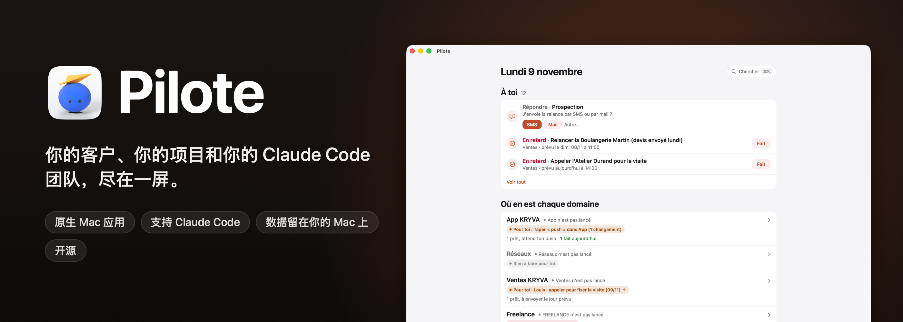
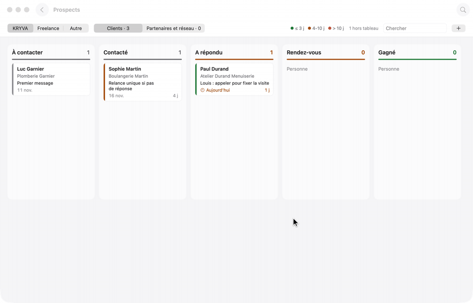
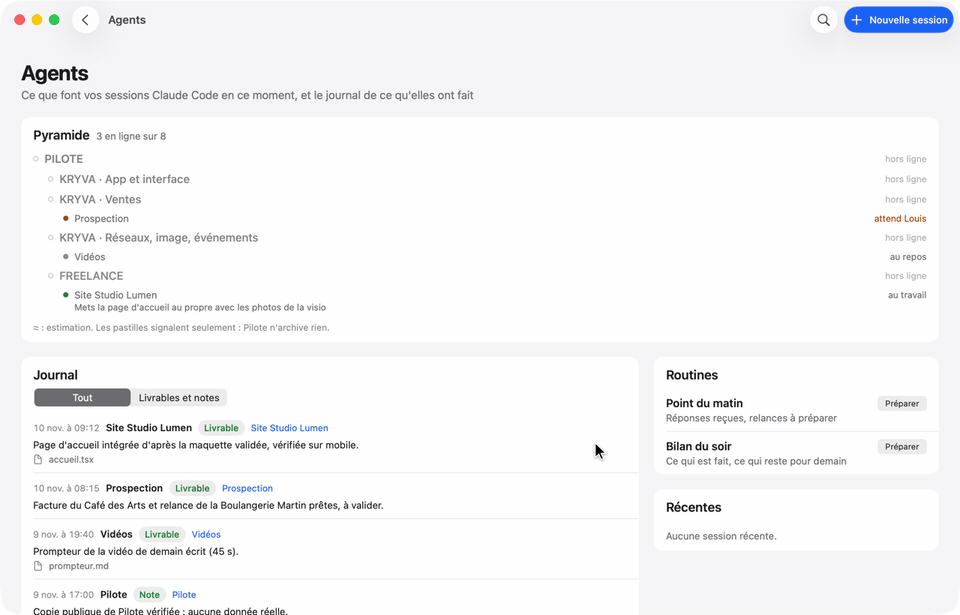
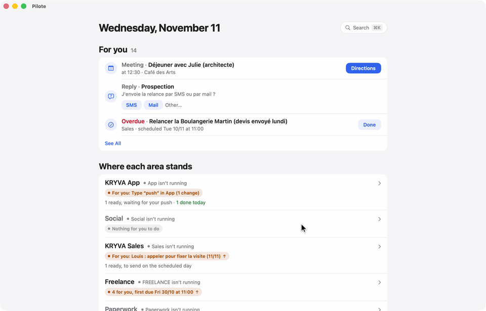
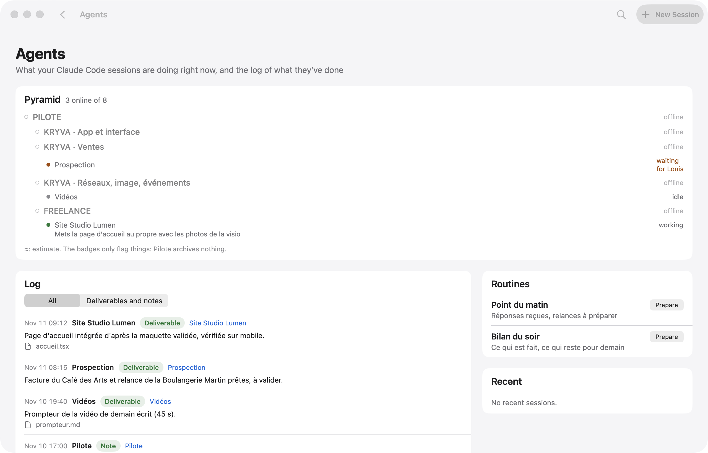
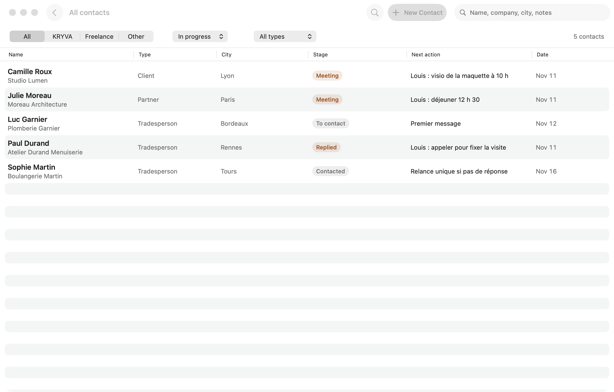
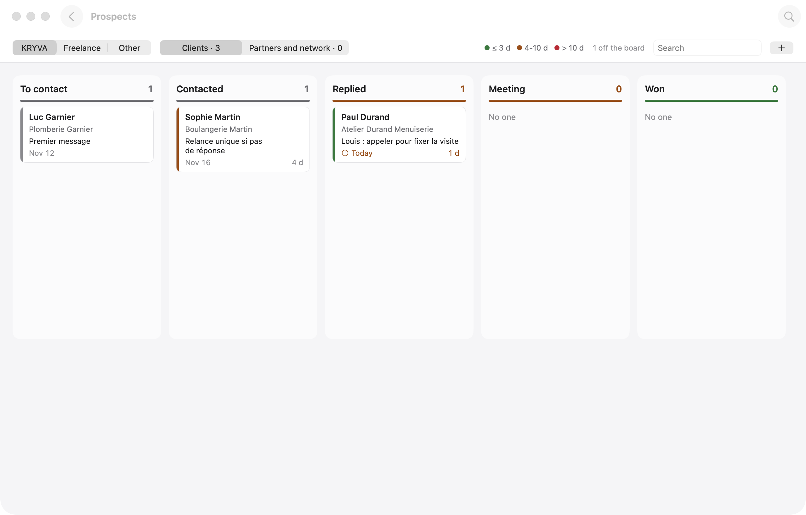
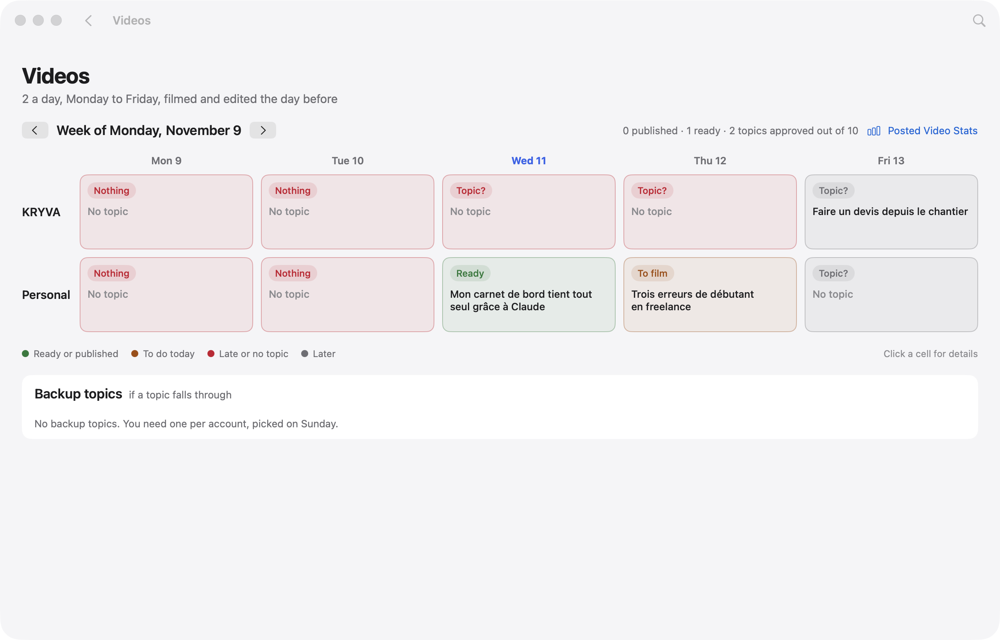
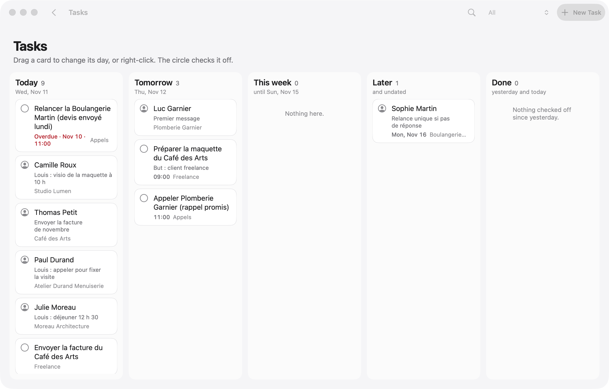
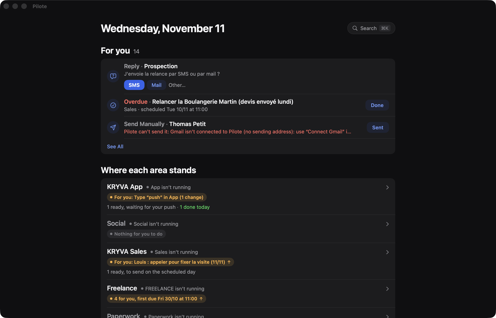

<p align="center">
  
</p>

<p align="center">
  
  
  
  
  
  <a href="../../stargazers"></a>
</p>

<p align="center">
  <a href="README.md">English</a> · <a href="README.fr.md">Français</a> · <a href="README.es.md">Español</a> · <a href="README.pt-BR.md">Português (Brasil)</a> · <a href="README.de.md">Deutsch</a> · <a href="README.it.md">Italiano</a> · <b>简体中文</b> · <a href="README.ja.md">日本語</a> · <a href="README.ko.md">한국어</a>
</p>

<p align="center">
  作者：<b>pjk</b>（Sacha Praljak）·
  <a href="https://sachapraljak.com/?utm_source=github&utm_medium=readme&utm_campaign=pilote">sachapraljak.com</a> ·
  <a href="https://www.instagram.com/sachaprljk/">Instagram</a> ·
  <a href="https://www.tiktok.com/@sachaprljk">TikTok</a>
</p>

<p align="center">
  <b>如果 Pilote 对你有帮助，点一个 ⭐ 能让更多人发现它。</b>
</p>

**Pilote 是一位与 Claude Code 智能体团队协作的自由职业者的工作日志。** 这是一款原生 Mac 应用，把所有需要你处理的事放在一处：你的客户以及与他们的每一次往来、每位客户的下一步行动、你的提醒事项和日历，以及你的 Claude Code 会话此刻正在做什么。这些会话通过 MCP 服务器读写 Pilote，因此它们会让 Pilote 保持最新；你只会看到需要你出面的事。一切都留在你的 Mac 上：本地 SQLite 数据库，没有服务器，也不需要账号。

## 用一条提示词完成安装

把这条提示词粘贴到你 Mac 上的 Claude Code（或任何编程智能体）中。它会检查你的电脑，构建并安装 Pilote，针对每个连接逐个向你提问（都可以跳过），把 Pilote 连接到 Claude Code，最后给出已连接内容的汇总。你的密钥不会经过聊天。相同内容也在 [`docs/INSTALL-PROMPT.md`](docs/INSTALL-PROMPT.md)。如需手动安装，请见下方“安装”。提示词保持英文。

````text
You are going to install Pilote (a native Mac app + a command-line tool + an MCP server for Claude Code) on this Mac, then
connect it, asking me for what you need. Repository: https://github.com/pjksens/pilote . Work in English unless I write
to you in another language, then answer in mine.

GROUND RULES
- Ask me ONE question at a time and wait for my answer. Every connection is optional: if I say "skip" (or "no", or
  "later"), move on and leave it off.
- Before each connection, say in ONE sentence what it is for. Never turn anything on that I did not say yes to.
- Never ask me to paste an API key, token or password in this chat, never print one, never read a secret file back to me
  (no cat, no echo, no logging). To enter a key: create the file with permissions 600 and an empty placeholder, open it in
  an editor for me (`open -e <file>`), tell me exactly where to paste, wait for "done", then check it is not empty
  WITHOUT displaying it. If I paste a secret in the chat anyway, use it, never repeat it, and tell me once that it is now
  in this conversation's history, so I may want to rotate it later.
- Secrets never go inside the git repository. Never commit, never push, never change the repository.
- If a command fails, show me the last 20 lines of its output, say what you think went wrong, and stop and ask before
  trying something else. Do not invent results: if you did not check it, say you did not.

STEP 1. CHECK THE MACHINE
1. `sw_vers -productVersion` must be 15 or later.
2. `xcodebuild -version` must work (full Xcode, not only the command-line tools). If it does not: tell me to install
   Xcode from the App Store, open it once to accept the license, and stop until I say it is done.
3. `xcodegen --version`. If missing, check `brew --version`: if Homebrew exists, propose `brew install xcodegen` and run
   it only after I say yes. If Homebrew is missing, tell me to install it from https://brew.sh, and stop until I say it
   is done (do not run its install script yourself).
4. `git --version` must work.
Tell me in one line what you found.

STEP 2. GET THE CODE AND BUILD
1. Ask me where to put the code. Default: ~/pilote . Moving that folder later breaks the connection to Claude Code, so
   pick a place that stays. If the folder exists and is not a clone of pjksens/pilote, propose another name.
2. `git clone https://github.com/pjksens/pilote.git <folder>` then `cd <folder>`.
3. Warn me, in one sentence, that the next script quits Pilote if it is running and replaces ~/Applications/Pilote.app
   (it stops if another app named Pilote with a different identifier is there). Then run `./scripts/construire.sh`.
   It takes a few minutes. It installs ~/Applications/Pilote.app and puts the `pilote` tool in <folder>.
4. Check that ~/Applications/Pilote.app and <folder>/pilote exist.

STEP 3. SETTINGS (connections)
Pilote reads ONE file: ~/Library/Application Support/io.github.pjksens.pilote/reglages.json (the template is
docs/reglages.exemple.json). Without it, everything that touches an account or a network is off. Keep my answers in
memory and write the file once at the end of this step: `mkdir -p` its folder, then write it with `chmod 600`. Only
write the keys of the connections I accepted. If the file already exists, read it first and merge, never overwrite my
existing values.

Ask these questions, in this order, one at a time:
a. First name ("prenom"). Used in the app ("Camille: call back..."). Default "Vous". Then, optionally, the display
   names of my workspaces ("espaces": internal keys kryva, freelance, autre).
b. Reminders and Calendar ("rappels_calendrier": true): shows today's appointments and reminders. macOS will ask its
   permission the first time the app opens.
c. Mail.app ("mail": true): lets Pilote read received messages and create drafts. It never sends anything on its own.
d. Incoming messages ("entrants": true): the `pilote entrants` collector reads calls, texts, iMessage, WhatsApp and
   received emails on this Mac to log them in the right contact's thread. macOS may ask for extra permissions.
e. A git repository to follow ("depot_suivi": a path): the app shows its latest commits, read only.
f. Secrets folder ("dossier_secrets"). Only ask it if I accept g or h. Default ~/Secrets . Create it with chmod 700 if
   missing. It must not be inside a git repository or a synced folder (iCloud Drive, Dropbox).
g. Publishing to YouTube, Instagram and TikTok ("publication": true, needs the secrets folder). Each post waits for my
   explicit approval in the app before it goes out. Ask which of the two clients I have:
   - Google/YouTube: I need an OAuth client of type "Desktop app" from the Google Cloud console (YouTube Data API v3
     enabled), downloaded as client_secret_....json into ~/Downloads. When I tell you it is there, move the newest one
     to <dossier_secrets>/pilote-google-oauth.json and chmod 600 it (do not open it).
   - TikTok: I need the app's "Client key" and "Client secret" from the TikTok developer portal. Ask me for the Client
     key in the chat (it is public), and tell me to COPY the Client secret to the clipboard (do not paste it in the
     chat). Then run `./pilote publication client-tiktok --cle <Client key>` from the code folder: it reads the secret
     from the clipboard, stores it in <dossier_secrets>/pilote-tiktok-client.json and clears the clipboard.
   Instagram needs nothing here. The accounts themselves are connected afterwards in the app (Pilote > Publications,
   "Connecter"), tokens go to the macOS keychain. Tell me that last part.
h. Radar ("radar": true, needs the secrets folder): watches public numbers of social accounts through ScrapeCreators,
   a paid service billed per credit, and it never runs without my confirmation. If I have a key: create
   <dossier_secrets>/cle-scrapecreators.env containing the single line `SCRAPECREATORS_API_KEY=` , chmod 600, open it for
   me to paste the key after the "=".
i. Sign-ups of my own product ("comptes"): Pilote reads ONE view of a PostgREST/Supabase database, read only, to show
   who signed up and who pays. Only for people who have a product with accounts. If yes: ask for the project URL and
   the view name (default pilote_comptes), and point me to the "comptes" section of the README for the SQL view. The key
   must be a token that can ONLY read that view, NEVER a Supabase service_role / secret key: say it, and refuse one if I
   offer it. Optional: a Stripe restricted key (rk_..., "Subscriptions: Read" only). These keys ("comptes.cle",
   "comptes.stripe_cle") are read by Pilote inside reglages.json itself: write them as empty strings, then open
   reglages.json for me to paste each key between the quotes (do not retype the quotes), and validate the JSON after.
j. Contact sync with a phone ("synchro"): exchanges one workspace's contacts with two remote tables. Same rule for its
   key ("synchro.cle": a token limited to those two tables, never service_role), same editor procedure. Skip if unsure.
k. Forbidden sender domains ("domaines_interdits": a list): Pilote refuses to send an email from them. Only if I name some.
l. Gmail sending is NOT in this file: it is enabled inside the app by pasting a Gmail app password (kept in the macOS
   keychain). Tell me where to do it in the app and move on. Do not ask for the password.

When the file is written, run `<folder>/pilote reglages` and show me its output: it lists what is on and what is off.
Careful: that command says "actif" as soon as a block exists (for example "comptes" with an empty key), so do not call a
connection working unless its key file or key is really filled in (check the size or the emptiness, never the content).

STEP 4. CONNECT MY AGENT
1. Claude Code. Check `claude --version`. Run `claude mcp list`: if a server named "pilote" is already there, tell me
   what it points to and ask before replacing it. Then run, with the ABSOLUTE path:
   `claude mcp add --scope user pilote -- <folder>/pilote mcp`
   and check `claude mcp list` shows pilote as connected.
2. Optional, ask me first: a journal of what my sessions deliver. It needs a "Stop" hook in ~/.claude/settings.json
   that runs `<folder>/pilote journal-crochet`. If I say yes, show me the exact change, merge it into the existing JSON
   without touching anything else (create the file if missing), and validate the JSON afterwards.
3. Any other agent that supports MCP (Cursor, Codex, Gemini CLI, Windsurf...): Pilote is a plain stdio MCP server. Add a
   server named "pilote" with command `<folder>/pilote` and the single argument `mcp`, using that agent's own way of
   adding MCP servers (usually a JSON file with "mcpServers": {"pilote": {"command": "...", "args": ["mcp"]}}). If you
   are not sure how my agent does it, say so instead of guessing.

STEP 5. CHECK AND OPEN
1. Run `<folder>/pilote jour` and confirm it answers without error (an empty day is normal on a fresh install).
2. Run `open ~/Applications/Pilote.app`. Tell me the app is open and to accept the macOS permission prompts for the
   connections I turned on.

STEP 6. RECAP
Finish with a short table with three groups: CONNECTED (what you checked, and how), NOT CONNECTED (what I skipped, and
the one setting that turns it on later), and TO DO BY HAND (Gmail app password in the app; connecting each social
account in Pilote > Publications; the OAuth/TikTok steps I still owe; macOS permission prompts). Add that sessions opened
BEFORE this install do not see the Pilote tools: I must start a new Claude Code session (or restart my agent) to use
them. For each item, only write what you actually verified.
````

<p align="center">
  
  <br><sub>演示模式（<code>./scripts/demo.sh</code>）：全部是虚构数据，没有任何真实的人。</sub>
</p>

> 应用界面跟随你 Mac 的语言：英语、法语或西班牙语（其他语言显示英语）。代码注释、命令行工具 `pilote` 和 MCP 服务器仍为法语。本 README 提供九种语言版本。

## Pilote 能做什么

- **一天只需一个屏幕。** 日程（日历）、今天和已逾期的提醒（提醒事项，可直接勾选）、Claude 准备好等你批准的消息、到期的跟进、你收到的回复。
- **客户连同他们的上下文。** 每个工作区一本通讯录，记录阶段、下一步行动，以及每次往来（邮件、短信、通话、拜访）的完整时间线。通话之前，你能看到之前说过的所有内容。
- **接入 Claude Code。** 一个 MCP 服务器为你的 Claude 会话提供读写 Pilote 的工具（`jour`、`cherche`、`fiche`、`enregistre_contact`、`ajoute_au_fil`、`marque`、`carte`、`ou_est`、`agents`、`journal`、`note_au_journal`、`publications`……）。服务器的指令要求它们先搜索再创建、不要编造任何内容、也不要擅自发送任何东西。
- **智能体。** 你的 Mac 上打开的 Claude Code 会话、它们的状态和最近一次动作，以及它们交付内容的日志（由 Claude Code 的 `Stop` 钩子填写）。
- **你的工作地图。** 每个项目、它的文件夹、它的 `ETAT.md`（状态文件）、它的关键文档；可以在项目、联系人、日志和文件（Spotlight）中搜索一切（⌘K）。
- **邮件由你掌控。** 准备好的邮件只有在你点击后才会发出，从你自己的 Gmail 发送（SMTP，应用专用密码保存在 macOS 钥匙串中，Claude 永远读不到）。纯文本，回复会留在正确的邮件会话中。
- **Pip（可选）。** 如果安装了 [Pip](https://github.com/pjksens/heypip)（一个陪伴通话的 Mac 刘海应用），日历里的视频通话上会出现“Launch Pip”按钮：Pip 会带着通话名称和关联的联系人打开。你也可以选择让 Pilote 提前两分钟自动打开它。Pip 只在你亲自点击之后才录音；Claude 写好通话摘要后，Pilote 会把它归入该联系人的记录。它会读取你的日历，因此遵循默认关闭的 `rappels_calendrier`。
- **发布。** 在 YouTube、Instagram 和 TikTok 上定时发布视频，每一条发出前都需要你明确批准（令牌保存在钥匙串中）。
- **雷达。** 关注社交媒体账号（播放量、发布节奏、灵感），可手动录入，也可通过付费数据源获取，但没有你的确认它永远不会运行。

## 搭配 Claude Code 使用

你的会话负责干活；Pilote 是你查看进展、回复它们的地方。

<p align="center">
  
  <br><sub>你的会话正在做什么，以及给其中一个会话发消息，都无需离开 Pilote。</sub>
</p>

当某个会话需要你做决定时，它的问题会连同选项按钮出现在主屏幕上。你的回答会先放在 **“Your replies, ready to go”**（你的回答，随时可发）里，直到你点击 **Send**（发送）：不会有任何内容意外地传到会话那边。

<p align="center">
  
  <br><sub>会话提问，你一键回答，什么时候发出由你决定。</sub>
</p>

> **你的回答如何送到会话：** [`scripts/facteur.py`](scripts/facteur.py)，即“Facteur”（邮递员）。主屏幕上的 **Start Facteur** 按钮会打开一个带有其指令的 Claude Code 会话：它在后台等待，并在几秒内把每个回答送到对应的会话。目标是提出问题的会话或你写给它的会话；否则是 `reglages.json` 中 `facteur.sessions` 指定的会话；再否则是 `EQUIPE.md` 表格中的会话。代码里没有写入任何会话 ID。

## 一点提醒

这是**我个人的系统，按原样发布**，但做成了可配置的：你的密钥、你的文件夹和你的名字都放在同一个设置文件里（见“设置”），所有涉及账号或在线服务的功能在你打开之前都保持关闭。其中仍留有我自己使用的痕迹：我的工作区（内部键名为 `kryva`，显示名称可配置）、我的 Claude 会话团队、法语标签。所有真实数据（联系人、消息、账号、凭据）都已删除或替换为虚构的值。

不包含：我自己的组织脚本（回答投递、监视、导入）、我的笔记和我的数据库。

## 无需连接任何东西即可试用：演示模式

```bash
./scripts/demo.sh             # 构建应用（不安装）并用虚构数据打开
./scripts/demo.sh --captures  # 重新截取下面的截图（docs/captures）
./scripts/demo.sh --gif       # 重放三段演示并重新生成 GIF（docs/media，需要 ffmpeg）
```

在演示模式（`PILOTE_DEMO=1`）下，Pilote 看到的是一个虚构的主目录，每次启动都是全新的，而不是你自己的：数据库、Claude 会话、文件都是如此。它不会读取提醒事项、日历、邮件或 Spotlight，也不会有任何内容发出（邮件、给会话的消息、通知、发帖）。截图和 GIF 由应用自己对自己的窗口截取：不需要屏幕录制权限。

| | |
|---|---|
|  |  |
|  |  |
|  |  |

截图中的每一项数据都是虚构的（姓名、公司、使用法国虚构号段 06 39 98 00 0x 的电话号码、以 `.example` 结尾的地址）。

## 安装

你需要 macOS 15 或更高版本、Xcode 和 [XcodeGen](https://github.com/yonaskolb/XcodeGen)。

```bash
brew install xcodegen
git clone https://github.com/pjksens/pilote.git && cd pilote
./scripts/tester.sh        # 单元测试（既不会碰应用，也不会碰你的数据库）
./scripts/construire.sh    # 构建应用，安装到 ~/Applications，并放置 ./pilote 工具
```

`construire.sh` 会在 Pilote 正在运行时先退出它，然后替换 `~/Applications/Pilote.app`。如果那里已有另一个名为 Pilote 的应用（标识符不同），脚本会停止，不替换任何内容。这份副本有自己的标识符（`io.github.pjksens.pilote`）和自己的数据文件夹：它从不读写同一台 Mac 上另一个 Pilote 的数据库。

**签名。** 项目使用本地签名（`CODE_SIGN_IDENTITY: "-"`），因此每次新构建后 macOS 都会重新请求权限。要保留这些权限，请在 `project.yml` 中填入你的 Apple 开发团队（`DEVELOPMENT_TEAM`，`CODE_SIGN_IDENTITY: "Apple Development"`）。

**权限。** 没有任何设置时，Pilote 不会向 macOS 请求任何权限。只有当你打开 `rappels_calendrier` 时才会请求提醒事项和日历权限，只有当你打开 `mail` 时才会请求“控制邮件”（读取和草稿，绝不发送）。应用没有沙盒：它会读取 `~/.claude` 以跟踪你的 Claude Code 会话。

## 设置：连接你的账号

一切都通过一个 JSON 文件完成：`~/Library/Application Support/io.github.pjksens.pilote/reglages.json`。模板：[`docs/reglages.exemple.json`](docs/reglages.exemple.json)。文件一有改动，Pilote 就会重新读取。`./pilote reglages` 会告诉你哪些已开启、哪些已关闭、哪些还缺少。

**没有这个文件时**，Pilote 在你的 Mac 上独立运行（本地数据库、联系人、地图、日程、Claude Code 会话），而且**其他一切都处于关闭状态**：不读取提醒事项、日历、邮件、通讯录或通话，也不会对数据库、Stripe 或社交网络发起任何网络请求。

这个文件里存放着你的密钥：请不要把它放进任何 git 仓库，并让它只有你自己可读（`chmod 600`）。Pilote 绝不会把密钥写到其他任何地方。

| 设置项 | 开启的功能 |
|---|---|
| `prenom` | 应用中显示的你的名字（“Camille : rappeler…”）。默认值：“Vous”（你）。 |
| `espaces` | 你的工作区的显示名称（内部键名 `kryva`、`freelance`、`autre`）。 |
| `dossiers_sessions`, `routines` | 打开 Claude Code 会话时提供的文件夹，以及你的一键指令。 |
| `facteur` | Facteur 的投递目标：`sessions`（名称 → `local_…` ID）和 `rappel`（附加到每条消息的一行文字）。 |
| `depot_suivi` | 一个 git 仓库，Pilote 会显示它最近的提交（只读，不执行 `fetch`）。 |
| `rappels_calendrier: true` | 提醒事项和日历（EventKit）。 |
| `mail: true` | Mail.app：收到的邮件、草稿。 |
| `entrants: true` | `pilote entrants` 收集器：通话、短信、iMessage、WhatsApp、收到的邮件。 |
| `publication: true` + `dossier_secrets` | 发布到 YouTube、Instagram、TikTok。OAuth 客户端放在该文件夹中：`pilote-google-oauth.json`、`pilote-tiktok-client.json`。令牌保存在钥匙串中。 |
| `radar: true` + `dossier_secrets` | 通过 ScrapeCreators 实现雷达（按额度付费）：`cle-scrapecreators.env`（`SCRAPECREATORS_API_KEY=…`）。 |
| `domaines_interdits` | Pilote 拒绝用来发送邮件的域名；如果发现有邮件从这些域名发出，它会标记出来。 |
| `comptes` | 你的产品的注册用户及其订阅情况，只读（见下文）。 |
| `synchro` | 一个工作区的联系人，与两张远程表交换数据（见下文）。 |

通过 Gmail 发送邮件不使用这个文件：在你于应用中粘贴 Gmail 应用专用密码（保存在钥匙串中）之前，它一直保持关闭。

### `comptes`：你的注册用户，只读

Pilote 通过兼容 PostgREST 的 REST API（例如 Supabase）读取**一个视图**。它不了解你的任何数据表：由这个视图来转换你的数据结构。需要的列如下：

| 列 | 内容 |
|---|---|
| `id` | 账号 id（text） |
| `entreprise`, `nom`, `email`, `telephone` | 文本（公司、姓名、邮箱、电话） |
| `inscrit_le` | 注册日期（timestamptz） |
| `devis` | 一个数字（整数），你希望显示在每个注册用户旁边 |
| `abonnement_stripe` | Stripe 的 `sub_…` id，或 null |
| `store_expire_le` | Apple 或 Google 订阅的结束日期，或 null |
| `actif` | 布尔值，或 null |

```sql
-- 示例，请根据你的数据结构调整。
create view pilote_comptes with (security_invoker = true) as
select o.id::text as id, o.nom as entreprise, u.nom_complet as nom, u.email, u.telephone,
       o.cree_le as inscrit_le, 0 as devis, o.abonnement_stripe, o.store_expire_le, o.actif
from organisations o left join utilisateurs u on u.organisation_id = o.id;
```

**密钥。** 给 Pilote 的权限要尽可能少：一个只能**读取这个视图**的令牌，例如一个专用的 Postgres 角色，只对该视图拥有 `select` 权限（如何获取绑定到该角色的令牌，请参阅你所用数据库的文档）。**绝对不要使用 Supabase 的 `service_role`（或“secret”）密钥**：它能打开整个数据库、可读可写，并且会绕过行级安全策略。也不要让 `anon` 角色可以读取这个视图：“anon”密钥在你的应用中是公开的。

**Stripe**（`stripe_cle`，可选）：一个**受限密钥**（`rk_…`），只授予“Subscriptions: Read”这一项权限。它用来区分试用账号和付费账号；没有它的话，有订阅的账号会显示为“To check”（待核实）。

**计数器**（`compteur`，可选）：你自己的一条命令，在 `dossier` 中运行，输出一行 `ACTIFS 7 / 10`，然后是若干小节标题，每个标题后面跟着缩进两个空格的行。

### `synchro`：把你的联系人同步到手机

把一个工作区（`espace`，默认：第一个）的联系人和时间线，与两张表（`table_contacts`、`table_evenements`；默认 `pilote_contacts`、`pilote_evenements`）进行交换，这两张表的列与 `Synchro.colonnesContact` 和 `Synchro.colonnesEvenement`（`Shared/Synchro.swift`）中的一致。Pilote 会在其中**写入**数据：请给它一个仅限这两张表的令牌（`select`、`insert`、`update`），绝不要用 `service_role`。

## 连接 Claude Code

```bash
claude mcp add --scope user pilote -- "$(pwd)/pilote" mcp
```

在这条命令之后打开的会话就能看到 Pilote 的工具。若要使用智能体日志，请在 `~/.claude/settings.json` 中添加一个运行 `pilote journal-crochet` 的 `Stop` 钩子。

## 数据

- 数据库：`~/Library/Application Support/io.github.pjksens.pilote/pilote.sqlite`（SQLite，WAL）。只要有其他连接（命令行工具、某个 Claude 会话）写入，应用就会随之更新。
- 试用另一个数据库：`PILOTE_BASE=/path/test.sqlite ./pilote jour`。
- 邮件的发件人名称：`PILOTE_NOM`，否则使用你的 macOS 账户的全名。
- 设置和密钥：`~/Library/Application Support/io.github.pjksens.pilote/reglages.json`（见“设置”）。
- 每日备份：如果开启了 iCloud 云盘，会在 `Pilote open source` 文件夹中保存一份 JSON 副本（保留最近 14 份）。
- 工具帮助：`./pilote aide`。

## 它是如何构建的

Swift 5、SwiftUI、AppKit、EventKit、系统自带的 SQLite3、Security（钥匙串）、CryptoKit。没有任何外部依赖。约 28,000 行 Swift 代码（不含测试），425 个单元测试。

- `App/`：Mac 应用（界面、日历、提醒事项、邮件和 Claude 的集成）。
- `Shared/`：模型、数据库、规则（由应用、命令行工具和测试共用）。
- `CLI/`：`pilote` 工具和 MCP 服务器（`pilote mcp`）。
- `Tests/`：单元测试，基于临时数据库。

## 作者

**pjk**（Sacha Praljak）。我做 AI 工具，并用短视频展示它们。Pilote 是用 Claude Code 构建的。

- 网站：[sachapraljak.com](https://sachapraljak.com/?utm_source=github&utm_medium=readme&utm_campaign=pilote)
- Instagram：[@sachaprljk](https://www.instagram.com/sachaprljk/)
- TikTok：[@sachaprljk](https://www.tiktok.com/@sachaprljk)

如果 Pilote 对你有帮助，给仓库点一个 ⭐、再关注一下，帮助很大。

## 许可证

MIT，见 [LICENSE](LICENSE)。
